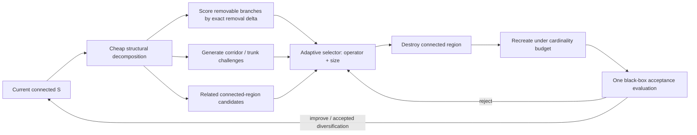

# Diagnosing Weak Regions and Rebuilding Rooted Connected Black-Box Solutions

## Executive summary

[SOURCE] The target problem is a rooted, cardinality-constrained connected-subgraph problem on a sparse graph of about 1,300 vertices, with a solution budget around 100 vertices. Its decisive complication is that the deterministic objective \(F(S)\) is a simulator: it is neither additive nor submodular, includes complementarities and threshold penalties, and assigns little intrinsic value to some connector vertices. A connected what-if evaluation costs about 0.007 s, a full evaluation about 0.1 s, and one all-node marginal-value pass about 17 s. The current search revisits leaves and hanging subtrees up to six vertices, reaches 7–12-node regions only randomly, and leaves about 22% of selected “trunk” vertices structurally protected after construction; three seeds differ by a median 40% in final value. fileciteturn0file0

[DERIVED] In the common accounting unit requested in the task, one 17 s marginal pass costs approximately

\[
17/0.007 \simeq 2{,}429
\]

what-if evaluations, and one 0.1 s full evaluation costs about 14.3 what-ifs. Using the task's stated 1–2 s/node recreate cost, rebuilding a destroyed region of \(d\) vertices costs approximately \(143d\)–\(286d\) what-if-equivalent seconds of work. This means that **diagnosis can profitably be much more sophisticated than the present random choice, provided it avoids repeated global marginal passes; recreate cost, not one-off removal scoring, is likely to dominate.** fileciteturn0file0

The techniques with the strongest transfer case are:

| Technique | Why it matters here | Cost in the task's units |
|---|---|---|
| **Removal-delta / worst-component destruction** | Directly measures the damage caused by deleting a currently removable branch instead of trusting construction-time scores. Worst removal is a standard LNS idea; here the black box can supply the score exactly. Shaw's LNS established removal/reinsertion as a large-neighborhood mechanism, and Røpke–Pisinger later made competing destroy/repair heuristics adaptive. citeturn19search1turn14search6 | [DERIVED] One what-if per feasible component scored: 100 components = 100 evaluations = 0.7 s. No 17 s pass. Recreate adds \(1\)–\(2\) s per removed node. |
| **Structurally related, connected-region destruction** | The present random ruin is already the strongest move; Shaw removal deliberately selects *related* elements, while SISR destroys adjacent strings rather than scattered points. The tree analogue is an attached subtree, corridor segment, or neighborhood around a seed cut. citeturn19search1turn19search2 | [DERIVED] Structural candidate generation can use graph arithmetic with zero \(F\)-calls; score only a shortlist with 5–50 what-ifs. A 20-node repair costs roughly 20–40 s. |
| **Key-path / branching-vertex trunk challenges** | Classical Steiner local search explicitly modifies internal paths and branching structure, exactly the region untouched today. Uchoa–Werneck scan vertex insertion/elimination, key-path exchange and key-vertex elimination in \(O(m\log n)\). citeturn18search0turn17view2 | [DERIVED] Use graph calculations only to generate 5–20 candidate corridor replacements; each completed connected replacement costs one 0.007 s what-if, plus any recreate cost. |
| **Adaptive destroy size and operator selection** | The 40% seed spread and dominance of ruin-and-recreate indicate heterogeneous basins. ALNS was created to allocate trials among competing subheuristics according to observed performance; bandit versions additionally address expensive operators. citeturn14search6turn20search3 | [DERIVED] Selector update itself is effectively free in evaluator units. Charge reward by gain per second or gain per what-if-equivalent so a 30-node ruin competes fairly with a 5-node move. |
| **Component-level sampled Shapley diagnosis** | Leave-one-out misses complementarity. Shapley sampling averages marginal effects over contexts and can therefore expose units that are individually weak but jointly important, or vice versa. Castro–Gómez–Tejada give a polynomial sampling estimator; later stratification reduces estimator variance. citeturn19search3turn19search14 | [DERIVED] For \(C=20\) branch-units and 32 connected-prefix permutations, about \(C\times32=640\) evaluations = 4.48 s, far below one 17 s all-node marginal pass. |
| **Warm-start plus explicit “trunk challenge” restarts after input/budget changes** | Reoptimization theory says old solutions can be exploitable after small changes, but also supplies strong negative results: deletion-like changes can defeat reuse, and growing-budget prize-collecting solutions need not admit a single nested solution approximating every budget. citeturn21search3turn21search0 | [DERIVED] Reuse \(S\) as one seed, but devote at least one seed to a forced trunk-changing run or partial cold restart; cost is one ordinary solve, not a new evaluator primitive. |
| **Extreme-value estimates only as diagnostics, never certificates** | Classical work proposed Weibull/extreme-value optimum estimates and stopping rules, but modern empirical work found such estimates can be badly algorithm-dependent; recent theory also predicts power-law diminishing improvement for random multistart. citeturn22search0turn22search4turn22search3 | [DERIVED] Statistical fitting costs essentially no \(F\)-calls, but three seeds are far too little information to justify a reliable tail model. |

[SOURCE] The closest **formal** mathematical relatives are budgeted/rooted node-weighted Steiner problems, rooted maximum-weight connected subgraph, and connected submodular maximization—not ordinary Steiner tree itself. The latter literature is particularly useful for connectivity-aware neighborhoods and exact relaxations, while LNS/ALNS is more useful for deciding what to destroy. Connected facility location and generic network design are genuine neighboring fields but not direct models of this objective. citeturn14academia50turn16view1turn16view2

[DERIVED] The central algorithmic implication is therefore not “replace the simulator with a Steiner solver.” It is: **retain \(F\) as the acceptance oracle, borrow graph-structural neighborhoods from Steiner optimization, and borrow diagnosis/destruction scheduling from LNS.** Classical edge-cost arithmetic can cheaply identify *where a topology can be changed*; the simulator must determine *whether that change is valuable*.



[DERIVED] With the supplied costs, a sensible research hypothesis is that the highest return will come from spending **tens or hundreds of 0.007 s calls to choose a good 10–30-node region**, rather than saving those calls and then spending 20–60 seconds greedily rebuilding a randomly selected region. That hypothesis is directly testable under the reproducibility protocol specified later.

## Names and neighboring fields

[SOURCE] **\(k\)-MST / \(k\)-cardinality tree.** The standard \(k\)-MST objective is cost minimization, not reward maximization: the defining formulation is a minimum-cost tree spanning \(k\) vertices. Arora–Karakostas describe the problem as finding a “minimum tree spanning any \(k\) vertices.” citeturn4search19 Earlier and subsequent approximation work uses prize-collecting Steiner machinery as a principal relaxation. citeturn14search5

**Conditions.** Edge costs are additive and normally nonnegative; there is no arbitrary black-box value on the selected set. Its cardinality constraint is very close to the present \(B\), but its objective structure is not. Practical relevance here is therefore mainly structural: exact/approximate tree construction, Lagrangian connections with PCST, and cardinality handling. citeturn4search11turn14search5

[UNVERIFIED] I did not find, among the primary sources opened, a defensible claim that one particular modern \(k\)-MST heuristic is the universally best practical heuristic. It would be inappropriate to manufacture such a ranking.

[SOURCE] **Budgeted and quota rooted Steiner tree.** D'Angelo and Delfaraz define the budgeted rooted node-weighted Steiner problem by seeking a rooted tree whose cost is bounded while its prize is maximized; the quota version reverses the roles by minimizing cost subject to a prize target. Their submodular variant permits a monotone submodular prize, still much more structured than the present arbitrary \(F\). A copyright-limited defining excerpt from the abstract is: “the total cost of its nodes is at most … \(B\)” while “the total prize is maximized.” citeturn14academia50

**Conditions.** Their 2022/2023 results include directed additive-prize cases and undirected monotone-submodular cases, with bicriteria approximation factors; they are approximation algorithms rather than black-box heuristics. citeturn14academia50 Costa, Cordeau and Laporte's closely related revenue/budget network-design model combines node revenues, arc costs, a budget and a root/hop structure, and was attacked with branch-and-cut on instances up to hundreds of vertices. citeturn12search10

[SOURCE] **Prize-collecting Steiner tree (PCST) and rooted PCST.** PCST trades edge cost against prizes/penalties for vertices omitted. Goemans and Williamson's constrained-forest framework gives a 2-approximation for prize-collecting Steiner tree; the relevant abstract excerpt is “for the prize-collecting … Steiner tree problems, we obtain 2-approximation algorithms.” citeturn14search2turn14search4 Canuto, Resende and Ribeiro later built a practical multistart local-search method with perturbed prizes, path relinking and variable-neighborhood post-optimization, reporting near-optimal behavior on their tested PCST instances. citeturn18search7

**Conditions.** PCST is additive in edge costs and node penalties/prizes. It can model low-value connector nodes naturally, but it cannot directly represent arbitrary multiplicative synergies, threshold penalties or nonlocal simulation effects without an additional surrogate model. citeturn18search7turn14search7

[SOURCE] **Maximum-weight connected subgraph (MWCS), including active modules.** In MWCS, vertices carry additive weights and one seeks a connected vertex set of maximum total weight. This is the cleanest additive relaxation of the user's problem. The bioinformatics “active module” line exemplified by *heinz* turns molecular-network scoring into a maximum-scoring connected-subnetwork problem and uses exact optimization. Dittrich et al.'s original 2008 paper is *Identifying functional modules in protein-protein interaction networks: an integrated exact approach*, DOI 10.1093/bioinformatics/btn161. citeturn15search0 BioNet subsequently exposed exact and heuristic network-search methods in R. citeturn15search10

[SOURCE] Modern exact MWCS work explicitly treats rooted and budget-constrained variants, and the SCIP-Jack application currently lists MWCS, rooted MWCS and budget-constrained MWCS among its supported problem classes. citeturn5search3turn23search14

**Conditions.** Additive node weights are essential to the standard MWCS formulation. If a locally estimated weight vector is substituted for \(F\), the resulting solution is only a surrogate solution unless the surrogate is proved to bound or represent \(F\). citeturn5academia46

[SOURCE] **Connected submodular maximization.** This is formally very close in feasibility space: Xu et al. define a budget-\(K\) problem seeking a vertex set with connected induced subgraph and a submodular value function. Their abstract says the aim is to “find a subset \(S\) with \(K\) nodes” with \(G[S]\) connected. citeturn16view1 Their 2024 work gives approximation guarantees and reports a UAV-deployment application. citeturn16view1

**Conditions.** The guarantees depend on submodularity, which the attached task explicitly rules out. fileciteturn0file0 The field is nevertheless useful for connectivity-aware relaxations and upper bounds only if a valid submodular majorant can be constructed.

[SOURCE] **Submodular orienteering / informative path planning.** Chekuri and Pál's submodular orienteering formulation maximizes a submodular reward over vertices visited by an \(s\)-to-\(t\) walk subject to a length budget; orienteering is the additive special case. citeturn4search0turn4search1 Routing-constrained submodular optimization has also been developed for sensing and related applications. citeturn3search6

**Conditions.** Connectivity is a **walk/path** condition rather than “any rooted connected set.” Thus this is adjacent rather than equivalent. It becomes more relevant on the long corridor-like portions of the supplied graph than on arbitrary branching clusters. fileciteturn0file0

[SOURCE] **Connected reserve / wildlife-corridor design.** Conservation-planning work optimizes site utility under cost and explicit spatial connectivity. Önal and Briers formulate connected reserve selection with integer programming; later corridor-design models choose core/corridor/buffer parcels subject to budgets and connectivity. citeturn5search7turn5search0 Multi-period formulations additionally maintain connectivity while acquisitions evolve through time. citeturn5search2

**Conditions.** The objectives in the opened studies are additive or mathematically specified utility/cost models. The structural similarity—valuable patches plus low-value connecting parcels under a budget—is high; the objective similarity to an arbitrary simulator is low.

[SOURCE] **Connected facility location (ConFL).** This lead is real but should be **dropped as a direct model**. Gollowitzer and Ljubić define it by opening facilities, assigning customers, and connecting the open facilities with a Steiner tree; their compact description is “ConFL combines facility location and Steiner trees.” citeturn16view2 Their study tested MIP models on random instances with up to 1,300 nodes and 115,000 edges and used branch-and-cut for the exponential formulations. citeturn16view2

**Conditions.** Its objective is the sum of facility-opening, assignment and network costs, so there is no analogue of an arbitrary set-valued simulator unless the simulation can first be decomposed into such terms. citeturn16view2

[SOURCE] **Connected network design.** “Network design with connectivity” is a broad umbrella covering Steiner, survivable-network and facility-connection problems rather than one well-defined neighboring objective. For example, connected facility location and generalized constrained-forest models couple additive construction costs to connectivity requirements. citeturn14search12turn15search6

[DERIVED] A useful taxonomy for this application is therefore:

| Literature name | Connectivity object | Objective assumption | Similarity to the task |
|---|---|---|---|
| \(k\)-MST / \(k\)-cardinality tree | tree of \(k\) vertices | additive edge cost | high constraint similarity, low objective similarity |
| Budgeted rooted Steiner / out-tree | rooted tree | additive or sometimes monotone-submodular prizes | very high structural similarity |
| PCST / rooted PCST | tree | additive edge costs + additive prizes/penalties | high structural similarity |
| MWCS / rooted budgeted MWCS | connected vertex set | additive node weights | **closest additive relaxation** |
| Connected submodular maximization | connected induced set | monotone submodular \(f(S)\) | **closest structured set-function relaxation** |
| Submodular orienteering | path/walk | submodular \(f(S)\) | useful mainly for corridors |
| Connected reserve design | connected parcel set | additive/specified utility and cost | strong structural analogy |
| ConFL | Steiner-connected facilities | additive opening/assignment/network cost | neighboring field, not direct model |
| Generic network design | varies | usually additive network cost | umbrella only |

**What the sources say.** [SOURCE] Across these fields, exact guarantees arise from **objective structure**—additive node/edge weights, submodularity, or explicit MIP formulations. The supplied simulator deliberately lacks those properties. The literature therefore validates several useful feasibility representations and search neighborhoods, but it does **not** justify replacing \(F\) by local marginals and treating the resulting additive tree problem as equivalent. citeturn14academia50turn16view1turn16view2

## Tree-shaped neighborhoods and which parts they can change

[SOURCE] The most directly relevant classical paper is Eduardo Uchoa and Renato F. Werneck, *Fast Local Search for Steiner Trees in Graphs*, ALENEX 2010, later expanded in ACM JEA 2012, DOI 10.1145/2133803.2184448. The defining abstract excerpt is: “four local searches … vertex insertion, vertex elimination, key-path exchange, and key-vertex elimination.” Every neighborhood can be scanned for an improving move in \(O(m\log n)\). citeturn18search0turn18search1

[SOURCE] The open SCIP implementation confirms these are not merely theoretical constructs: `heur_local.c` says it implements “vertex insertion, key-path exchange and key-vertex elimination,” and it uses shortest paths, LCA calculations, union-find and link-cut-tree operations. citeturn17view2

| Neighborhood | Precise structural effect | Classical scan | Black-box evidence |
|---|---|---:|---|
| **Steiner-vertex insertion** | Adds one previously unselected Steiner/nonterminal vertex to the structural representation and reconnects/prunes the resulting tree. It can introduce a new interior junction, not merely a leaf. | \(O(m\log n)\) improving-pass bound in Uchoa–Werneck. citeturn18search0 | **No generic black-box use found.** Classical acceptance is additive edge cost. |
| **Steiner-vertex elimination** | Removes a selected nonterminal Steiner vertex and repairs connectivity; can eliminate a degree-2 interior or alter nearby branching. | \(O(m\log n)\). citeturn18search0 | **No** generic simulator objective found. |
| **Key-path exchange** | Replaces an existing path between crucial/key vertices by a better connecting path. A later Steiner solver paper describes it as replacing an existing key path “by a shorter path between the components it connects.” citeturn18search9 | \(O(m\log n)\) per improving pass. citeturn18search0 | **No** in the classical source; “shorter” is edge-cost arithmetic. |
| **Key-vertex elimination** | Removes a crucial branching Steiner vertex, reconnecting the incident components differently. SCIP defines a crucial node as a terminal or a vertex of tree degree at least three. citeturn17view2 | \(O(m\log n)\). citeturn18search0 | **No** generic black-box evidence found. |
| **Subtree prune-and-regraft (SPR)** | Detaches an entire subtree and reattaches it elsewhere, changing both the parent connection and potentially a large internal region's role. | A rooted tree's 1-SPR neighborhood is \(O(n^2)\) in the cited phylogenetic implementation. citeturn14search9 | **Closest “yes,” but not truly generic.** Phylogenetic likelihood is expensive/non-additive, yet its implementations exploit likelihood-specific structure. |
| **Path-add / multi-edge drop** | Steiner-forest local search adds a shortest path and drops multiple now-inessential edges, deliberately allowing multi-edge changes. citeturn18academia47 | Polynomial theoretical neighborhood; problem-specific implementation. | **No** generic black-box use found. |
| **Variable-neighborhood / path relinking for PCST** | Moves among progressively different neighborhoods or interpolates between elite trees; therefore can change larger regions than a one-vertex move. | Empirical metaheuristic, not a single fixed scan bound. | Objective still additive PCST. citeturn18search7 |

[SOURCE] Uchoa–Werneck's significance is not merely asymptotic. Their abstract explicitly notes that the local searches had previously produced good solutions but that high running times constrained their use. citeturn18search1 In the later robust Steiner implementation, improving passes generally converge in only a small number of passes, and dynamic-tree machinery is used to evaluate structural exchanges efficiently. citeturn18search9turn17view2

[SOURCE] **SPR supplies the most relevant cross-field example of a non-additive objective.** ScisTree2 describes SPR as an operation that “prunes … a subtree … and regrafts … to another branch.” It notes an \(O(n^2)\) one-SPR neighborhood and that naively recomputing the objective for every candidate is too expensive. citeturn14search9

[DERIVED] That is an important but limited precedent. A phylogenetic likelihood calculation is not an arbitrary oracle: specialized dynamic programming can cache partial likelihoods. For the supplied \(F\), no such algebra is given. Consequently the transferable part is **the move geometry**, not the phylogenetic acceleration scheme.

[SOURCE] The SCIP implementation is particularly instructive for topology management. Its local Steiner code invokes link-cut-tree cut/evert/link operations, union-find, DFS ordering, lowest-common-ancestor logic and shortest-path routines. citeturn17view2 These are candidate-generation/connectivity tools; they do not require the objective itself to be additive.

[DERIVED] For a graph of only ~1,300 vertices and \(B\approx100\), however, sophisticated fully dynamic connectivity is not automatically necessary. A trial solution contains about 100 vertices, so a DFS/BFS connectivity check on the induced candidate is tiny compared with 0.007 s simulator time unless the simulator's own API already dominates. Dynamic trees become attractive chiefly when thousands of structural candidates are screened **without** calling \(F\).

[UNVERIFIED] **Ejection chains and Lin–Kernighan-style variable-depth tree moves.** I did not find an opened primary source establishing a standard Steiner-tree neighborhood under either of these names with sufficiently precise definitions and complexity to satisfy the evidence rule. The Lin–Kernighan idea is certainly established for tours, but importing the name to this tree problem without a tree-specific primary source would overstate the literature. I therefore do not count it as an evidence-backed Steiner neighborhood.

[DERIVED] A black-box version of a key-path exchange can nevertheless be constructed without pretending edge cost is the objective:

1. Use graph structure to find key vertices, articulation-like bottlenecks and alternative short connecting corridors.
2. Form a **complete connected candidate** with exactly \(B\) vertices.
3. Evaluate that candidate once with \(F\).
4. Accept on \(F\), never on surrogate path length alone.

This converts an \(O(m\log n)\)-style **candidate generator** into a simulator-aware move. The edge-cost metric is then a prefilter only.

**What the sources say.** [SOURCE] Steiner local search contains exactly the interior-changing move classes absent from the current algorithm: path exchanges and branching-vertex elimination, not just leaves. The published fast algorithms rely heavily on additive edge-cost structure, while the clearest expensive-nonadditive analogue, phylogenetic SPR, relies on domain-specific objective caching rather than a generic black-box trick. citeturn18search0turn14search9

## Diagnosing what to destroy under a non-additive objective

[SOURCE] Shaw's foundational LNS formulation explicitly makes *destruction choice* part of the search. The abstract says LNS explores a large neighborhood by selecting “related” customer visits for removal and reinsertion with a tree search. citeturn19search1 This distinguishes two decisions often conflated in ruin-and-recreate: **how much to destroy** and **which related region to destroy**.

[SOURCE] Røpke and Pisinger's 2006 ALNS generalized this by maintaining several competing subheuristics whose use frequencies depend on their historical performance. Their experiments covered more than 350 pickup-and-delivery instances up to 500 requests; the paper reports that multiple competing subheuristics were better than using only one. citeturn14search6turn14search8

The destroy rules relevant to this project separate naturally into evidence-backed and partially verified families:

| Destroy family | Scoring rule | Evidence status | Tree analogue |
|---|---|---|---|
| **Random removal** | Uniform/random elements or regions. | [SOURCE] Standard baseline in LNS/ALNS literature; Shaw also randomizes removal choice. citeturn19search4 | Current implementation's random branches. |
| **Related / Shaw removal** | Choose a seed, then preferentially remove elements similar/near/related to it. | [SOURCE] Shaw primary source. citeturn19search1 | Seed branch + nearby corridor, same articulation basin, nearby selected clusters. |
| **Worst removal** | Rank elements by objective saving obtained by removing them; often perturb ranking to retain randomness. | [SOURCE—secondary definition] Explicitly catalogued in later ALNS literature; the primary Røpke–Pisinger abstract opened here does not expose the formula. citeturn6search15turn14search6 | Exact black-box removal delta of an attached component. |
| **Adjacent string removal** | Remove contiguous route subsequences designed to create “spatial slack.” | [SOURCE] Christiaens–Vanden Berghe, Transportation Science 2020. Defining excerpt: “The ruin method functions via adjacent string removal.” citeturn19search2 | Contiguous corridor segment or connected subtree. |
| **Learned destroy** | Policy selects variables/elements to release; solver/repair optimizes the rest. | [SOURCE] Wu et al. train RL as the destroy operator, choosing a subset of variables. citeturn19academia48 | Learned probability over selected vertices/branches/trunk cuts. |
| **Adaptive neural partial removal** | Learned context-dependent destruction, including its scale. | [SOURCE] Dynamic Partial Removal explicitly advertises “adaptive destruction.” citeturn19academia49 | Jointly learn region and size after enough training data exist. |
| **Cluster/history/critical removal** | Cluster similarity, past failure/success, or bottleneck statistics. | [UNVERIFIED] These appear in the ALNS survey material retrieved, but I did not open an original defining paper for each individual rule. | Potentially useful, but not counted as primary-evidence techniques here. |

[SOURCE] **Connected destruction has a useful analogue in SISR.** Christiaens and Vanden Berghe's “adjacent string removal” is deliberately contiguous rather than scattered and was successfully applied across multiple routing variants. citeturn19search0turn19search2 It does not prove that connected destruction is always superior; it proves that a large, deliberately structured neighborhood can be highly effective.

### Contribution measures when \(F\) is non-additive

[DERIVED] For a removable component \(C\subseteq S\) such that \(S\setminus C\) remains connected, define its exact leave-one-out loss

\[
L(C)=F(S)-F(S\setminus C).
\]

If the objective is to identify **weak** regions, small \(L(C)\) is weak in absolute terms, while \(L(C)/|C|\) is weak per unit of budget.

This requires exactly **one 0.007 s what-if per component** because \(F(S)\) is already known. No additive assumption is involved.

[DERIVED] This is superior to construction-time marginals for one specific question—“what is this component worth *in the current context*?”—but it has three intrinsic limitations:

1. A connector can have high removal loss because deleting it also makes valuable descendants unavailable.
2. Two individually weak components can be jointly important through complementarity.
3. A component can look indispensable only because the present trunk forces a bad topology; after a simultaneous alternative connection, it may be unnecessary.

Thus removal delta is a **contextual ablation score**, not a causal allocation of total value.

[SOURCE] **Shapley-value sampling** supplies a principled interaction-aware allocation. Castro, Gómez and Tejada's 2009 paper, DOI 10.1016/j.cor.2008.04.004, develops a polynomial sampling estimator of Shapley values; the later stratified estimator explicitly refines that sampling method and reports roughly 30% average variance-efficiency gains in its experiments, exceeding 80% in the best tested cases. citeturn19search3turn19search14

[DERIVED] For component units \(C_1,\ldots,C_k\), a Shapley estimate averages

\[
F(A\cup C_i)-F(A)
\]

over random predecessor sets \(A\) induced by permutations. If all components attach independently to a fixed connected trunk \(T\), evaluate prefixes

\[
T,\;T\cup C_{\pi_1},\;T\cup C_{\pi_1}\cup C_{\pi_2},\ldots
\]

so every queried coalition remains connected. One permutation then costs about \(k\) what-if calls rather than arbitrary disconnected-coalition evaluations. With \(k=20\) and 32 permutations, that is about 640 calls or 4.48 s.

[DERIVED] This component-level restriction is important. A conventional Shapley calculation over all ~100 selected vertices samples coalitions that will often be disconnected and therefore outside the evaluator's cheap what-if domain. Grouping vertices into rooted branches/corridor blocks converts the statistic into a feasible connected-prefix experiment.

[UNVERIFIED] **Banzhaf estimates.** Banzhaf values are another coalition-average contribution measure and can be Monte Carlo sampled, but I did not open a primary Banzhaf-sampling source during this review. For the present report they should be regarded as an unverified alternative rather than an evidence-backed implementation choice.

[UNVERIFIED] **Generic influence/sensitivity estimators.** I did not find a primary source in the searched connected-subgraph/LNS literature defining a black-box “influence” score that directly solves the present connectivity-constrained diagnosis problem. Finite perturbation sensitivity is effectively what the removal-delta estimator already provides.

[SOURCE] **Regret is better supported as a repair score than as a destruction contribution.** In ALNS practice, regret insertion prioritizes an uninserted item according to how much worse later insertion options become if its best opportunity is missed; it is not naturally a measure of how much a currently selected component contributes to \(F\). The retrieved ALNS survey catalogues greedy and \(k\)-regret repair rules in that role. citeturn6search1

[SOURCE] **Learned destruction has become a genuine research direction.** Wu et al. factor the combinatorial destroy decision into per-variable choices, train an actor–critic policy, and report better solutions than their LNS baselines at equal runtime on four integer-programming problem classes, including generalization to larger instances. citeturn19academia48 Sonnerat et al. likewise learn neighborhood selection for MIP and report substantial primal-gap improvements on several large-scale datasets. citeturn20academia45

[DERIVED] Those learned policies are not immediately data-efficient for the current setting. Three expensive solution seeds per instance are a tiny training set. A learned policy becomes more plausible if the engineering system accumulates **many historical re-solves across related evaluator inputs and budgets**, turning those repeated instances into an offline dataset.

### Destroy size

[SOURCE] Shaw's original method explicitly varied the number of removed visits to maintain diversity. citeturn19search4 More recent adaptive-LNS research goes further by treating neighborhood scale itself as a learnable choice; bandit-based schemes have been proposed to adapt both neighborhood/operator selection and neighborhood size. citeturn11search0

[DERIVED] Here size adaptation matters unusually strongly because repair cost is approximately linear and large:

| Destroyed size | Stated recreate time | What-if-equivalent time |
|---:|---:|---:|
| 6 | 6–12 s | 857–1,714 |
| 10 | 10–20 s | 1,429–2,857 |
| 20 | 20–40 s | 2,857–5,714 |
| 30 | 30–60 s | 4,286–8,571 |

The current 2–12-node random branch move therefore explores only part of the potentially useful size range, while a systematic 20–30-node trunk move is expensive enough that its **location should be diagnosed before repair**. fileciteturn0file0

**What the sources say.** [SOURCE] LNS research has moved from random destruction toward related, objective-aware, contiguous and learned destruction, while ALNS separates operator choice from the repair engine. The primary literature does not establish a universal superiority theorem for connected over scattered destruction; it supplies successful examples such as related removal and adjacent-string removal. citeturn19search1turn19search2turn19academia48

## Adaptive operator choice and computational budgets

[SOURCE] The defining Røpke–Pisinger idea is that competing subheuristics are invoked with frequencies reflecting historical performance. Their concise primary-source description is: “used with a frequency corresponding to their historic performance.” citeturn14search6 This is the origin of the ALNS adaptive layer.

[SOURCE] In the standard segment-based roulette update, a later explicit formulation writes

\[
w_{o,m+1}
=(1-\eta)w_{o,m}
+\eta\frac{\pi_o}{\theta_o},
\]

where \(w_{o,m}\) is an operator weight, \(\pi_o\) its accumulated reward in the segment, \(\theta_o\) the number of uses, and \(\eta\in[0,1]\) the reaction factor. Selection probability is proportional to current weight. citeturn14search1 The ALNS meta-analysis identifies the reaction factor, segment structure, and outcome scores as tunable parameters. citeturn14search3

[UNVERIFIED] The exact numerical score and reaction-factor values used in every experiment of the original 2006 paper were not exposed by the opened publisher abstract, so I do not report remembered values as facts.

[DERIVED] For the present maximization problem, the roulette mechanism can be used without changing its logic. For operator \(o\), one can define a cost-normalized reward

\[
R_o =
\frac{\max(0,F(S')-F(S))}
{\text{seconds}_o}
\]

or, preferably for reproducibility,

\[
R_o =
\frac{\max(0,F(S')-F(S))}
{N_{\text{what-if}}+
2429N_{\text{marginal-pass}}+
143\text{--}286\,N_{\text{regrown nodes}}},
\]

where the denominator is measured in approximate what-if-equivalent work. The second formula prevents a slow 30-node destroy from appearing attractive merely because its accepted gain is larger in absolute terms.

[SOURCE] **Bandit selection** is now used explicitly in optimization solvers. Hendel's ALNS-for-MIP work starts from the observation that LNS heuristics are powerful but expensive and uses multi-armed-bandit selection among eight LNS neighborhoods, together with mechanisms that regulate subproblem complexity. The implementation was integrated into SCIP and tested on public MIPLIB and Coral instances. citeturn20search3turn20search13

[SOURCE] The MIP-ALNS work is particularly relevant to the question “how do we account for operator time?” because the computational budget is treated as scarce and the reward design distinguishes useful versus failed expensive neighborhood calls rather than simply counting acceptance. citeturn11search2turn20search3

[DERIVED] For this black-box system a **cost-aware UCB** rule is straightforward:

\[
\text{score}_o =
\widehat{\mu}_o
+
c\sqrt{\frac{\log t}{n_o}},
\qquad
\widehat{\mu}_o =
\text{EWMA}\!\left(
\frac{\Delta F_o}{\text{cost}_o}
\right).
\]

This has two advantages over plain roulette weights: it explicitly represents uncertainty, and newly introduced trunk-changing operators are guaranteed exploration rather than being starved because they have fewer early successes.

[SOURCE] Evidence that adaptivity always helps is much weaker than the popularity of ALNS might suggest. Turkeš, Sörensen and Hvattum's meta-analysis of 25 ALNS implementations reports only **0.14% average improvement attributable to the adaptive layer**, with the choice of underlying heuristics strongly affecting its usefulness. citeturn20search1turn20search11

[SOURCE] This does not contradict Røpke–Pisinger's original finding that multiple competing subheuristics were advantageous: “multiple operators are good” and “online reweighting is materially better than well-tuned fixed probabilities” are different hypotheses. citeturn14search6turn20search1

[DERIVED] Consequently, the experiment should include **three distinct controls**:

| Control | Purpose |
|---|---|
| fixed equal operator probabilities | tests value of operator portfolio itself |
| offline-tuned fixed probabilities | tests whether online adaptation adds value |
| online roulette/bandit | tests actual adaptivity |

Comparing ALNS only with the existing fixed-order algorithm would confound the benefit of the new neighborhoods with the benefit of adaptive selection.

[DERIVED] A second bandit arm should represent **destroy-size buckets**, e.g. 4–6, 7–12, 13–20, and 21–30 vertices. Operator and size can initially be treated as a joint arm \((o,d)\); if data become sparse, a factorized model can learn operator and size separately.

**What the sources say.** [SOURCE] The strongest evidence supports using a **portfolio** of complementary neighborhoods; evidence for the incremental value of classic roulette adaptation is modest on average. More recent MIP work motivates cost- and uncertainty-aware bandit selection when neighborhoods have materially different computational costs. citeturn14search6turn20search1turn20search3

## Reoptimization after evaluator inputs or budget change

[SOURCE] Reoptimization is a distinct algorithmic field: an old solution is supplied together with a modified instance, and the aim is to exploit the old solution rather than solve entirely from scratch. In Steiner-tree reoptimization, Escoffier, Milanič and Paschos study minor changes such as vertex insertion/deletion. Their key negative result is that good maintenance after deletion can be impossible without “ex nihilo computation.” citeturn21search3turn21search6

[SOURCE] More recent Steiner reoptimization work studies changes in edge costs and terminal/Steiner status and obtains approximation guarantees for specific local modifications. These results depend on additive Steiner structure and on the modification being explicitly characterized. citeturn1view1

[DERIVED] The supplied reoptimization setting is harder: “other inputs” to an arbitrary simulator are reoptimized between graph solves. Such a change can effectively alter the value of **every coalition simultaneously**, even if the graph itself is unchanged. Therefore the local-perturbation guarantees from additive Steiner reoptimization do not carry over.

[SOURCE] There is also a direct result concerning **growing budgets**. Disser, Griesbach, Klimm and Lutz study incremental rooted PCST with a growing budget and state that “no incremental solution exists that simultaneously approximates the optimum for all budgets.” They obtain bicriteria guarantees only by allowing additional budget and/or approximation loss. citeturn21search0turn21search2

This is the strongest evidence against assuming that an optimal or near-optimal \(B\)-solution should simply be nested inside a good \(B+10\)-solution.

[SOURCE] Incremental connected facility location likewise studies staged expansion through a planning horizon, but with additive facility/connection costs and explicit period decisions, not a changing black-box objective. citeturn15search8turn15search11

### Can the old trunk be certified?

[DERIVED] **For an unrestricted deterministic black-box \(F\), there is no local-query certificate that an old trunk is globally correct.** A simple indistinguishability argument shows why.

Assume an algorithm has evaluated a finite family of connected sets \(Q=\{S_1,\ldots,S_q\}\), all retaining the old trunk. Pick some unqueried feasible connected set \(T\) using a different trunk. Construct two objectives:

\[
F_1(S)=F_{\mathrm{observed}}(S)\quad \text{for every queried }S,
\]

and

\[
F_2(S)=
\begin{cases}
F_1(S), & S\in Q,\\
M, & S=T,
\end{cases}
\]

with \(M\) arbitrarily large.

Both black boxes are indistinguishable on every query made so far, yet the trunk is globally acceptable under one and catastrophically wrong under the other. Therefore no collection of only local removal deltas, marginals, or old-run statistics can certify the trunk without additional assumptions on \(F\), an exhaustive comparison, or a valid global upper bound.

[DERIVED] The practical test can therefore be **falsification**, not certification:

- retain the old solution as one warm start;
- explicitly force removal of one old trunk segment in a second run;
- use a partial or full cold construction in another seed;
- compare after the **same evaluator-equivalent budget**, not merely the same number of iterations.

If the challenger improves \(F\), the old trunk is falsified. If it does not, the experiment increases confidence but does not prove optimality.

[DERIVED] For budget increments \(B\to B+10\), record the containment statistic

\[
\text{retention}(B,B+10)=
\frac{|S_B\cap S_{B+10}|}{|S_B|}
\]

separately for old leaves, small subtrees, and old trunk vertices. That empirical curve answers whether *this application* has useful approximate nesting, without assuming a theorem the literature explicitly denies in general.

### Warm starts

[SOURCE] Modern mathematical-programming solvers support continuing or restarting from incumbent information; Gurobi's current guidance explicitly discusses warm starts in staged termination workflows. citeturn23search0

[DERIVED] In the custom LNS, “warm start” requires no solver-specific facility: initialize \(S\) to the old connected solution, re-evaluate it under the new simulator input, and immediately run the same destruction portfolio—including trunk-changing arms. Warm-start reuse is safe; **warm-start freezing is the danger.**

**What the sources say.** [SOURCE] Reoptimization literature supports exploiting an old solution under controlled changes but also provides impossibility/negative results for some changes. Incremental PCST directly refutes universal nesting across budgets. None of the opened sources supplies a global “trunk is still correct” certificate for an arbitrary non-additive black-box objective. citeturn21search3turn21search0

## Estimating distance from optimum and stopping without knowing it

[SOURCE] The classical statistical idea is old. McRoberts' 1971 Operations Research paper applies extreme-value distributions, especially Weibull models, as “mechanisms for estimating optimum limits” and derives continuation/stopping decisions from those estimates. citeturn22search0

[SOURCE] Modern evidence is considerably more cautious. Velasco, Guerrero and Hospitaler's 2022 study concludes that extreme-value estimates of combinatorial optima can be unreliable because they depend on the quality and distribution produced by the search algorithm. Poor algorithms produced high-variance estimates; paradoxically, strong algorithms' low-variance samples could also make endpoint estimation problematic. citeturn22search4

[SOURCE] Masuyama, Dan and Umetani's 2025 analysis of random multistart derives power-law formulas for best-value improvement and expected relative gap and describes a “curse of scale-freeness”: halving the remaining expected gap can require work proportional to the amount already invested. citeturn22search2turn22search3

[DERIVED] With only **three independent seeds**, an EVT/Weibull fit is not credible as an optimum estimator. There are too few tail observations to identify a tail shape, distinguish one attraction basin from several, or validate goodness of fit.

[DERIVED] More fundamentally, seed spread alone cannot give a distribution-free gap bound. For any three observed outcomes \(x_1,x_2,x_3\), one can posit a run-quality distribution that produces those values with high probability but contains a rare basin with value \(M\gg \max x_i\). The observations cannot rule it out. Thus the reported 40% seed spread is evidence of **search instability**, not a numerical estimate of the optimality gap. fileciteturn0file0

### Upper bounds from additive relaxations

[DERIVED] An additive connected-subgraph relaxation supplies a mathematically valid upper bound only if it is a proven **majorant** of the black box. For example, suppose weights \(w_v\) and constant \(c\) satisfy

\[
F(S)\le c+\sum_{v\in S}w_v
\qquad
\text{for every feasible connected }S.
\]

Then

\[
\max_{S\text{ feasible}}F(S)
\le
\max_{S\text{ feasible}}
\left(c+\sum_{v\in S}w_v\right),
\]

and the right-hand side is a rooted cardinality/budget MWCS-type optimization problem.

[SOURCE] Exact MWCS and rooted/budget variants are within the scope of modern Steiner/MWCS solvers such as SCIP-Jack. citeturn5search3turn23search14

[DERIVED] By contrast, a vector of **current marginal values** does not automatically define such a majorant. Under positive complementarity, a group can be worth more than the sum of its marginals measured at another context. Therefore “solve the additive marginal problem exactly and call its value an upper bound” would be invalid for the supplied \(F\).

### Stopping

[SOURCE] A recent review of metaheuristic termination emphasizes that common stopping rules such as a maximum iteration count or a maximum number of iterations without improvement generally do not guarantee solution quality. citeturn22search9

[DERIVED] For this system, there are three qualitatively different stopping statements:

| Stopping statement | What it means |
|---|---|
| “No improvement in 5,000 what-ifs” | local empirical stagnation only |
| “Three seeds agree within 2%” | empirical stability only |
| “Incumbent is within 2% of a proved upper bound” | actual certificate, provided the bound is valid |

[SOURCE] Mathematical-programming solvers can use the third category on an exact surrogate model. For example, Gurobi's current `MIPGap` parameter is a relative optimality-gap criterion, while `TimeLimit` supplies an external runtime stop. citeturn23search3turn23search4 Such a gap applies to the MIP being solved, **not** automatically to the original simulator objective.

[DERIVED] The recommended reporting convention for this research is therefore to call the black-box result a **best-known value**, not a “2% optimal” solution, unless a genuine simulator-level upper bound is supplied.

**What the sources say.** [SOURCE] Extreme-value endpoint estimation has historical precedent but modern negative evidence; finite seed spread is not an optimality certificate; and conventional no-improvement/time rules are termination policies, not proofs. A defensible optimality gap requires a valid lower/upper-bound pair for the actual objective. citeturn22search0turn22search4turn22search9

## Open-source code, reproducible experiments, transferable algorithms, and failure modes

[SOURCE] **SCIP-Jack / SCIP.** The current SCIP website lists SCIP Optimization Suite **10.0.2** (April 2026). SCIP-Jack supports ordinary, rooted and prize-collecting Steiner variants; node-weighted Steiner; MWCS; rooted MWCS; budget-constrained MWCS; group and hop-constrained variants. Its site points to SteinLib and the 11th DIMACS Challenge for benchmark instances. citeturn23search6turn23search14

[SOURCE] The older public Steiner application source is unusually useful for implementation study: `heur_local.c` contains vertex insertion, key-path exchange and key-vertex elimination and calls link-cut tree, LCA, union-find, shortest-path and DFS machinery. citeturn17view2

[SOURCE] **SteinerPy 1.0.19** is a readable Python implementation whose documented experimental portfolio includes Uchoa–Werneck vertex elimination and key-path exchange, plus implied-profit candidates; the documentation notes that each candidate is checked for terminal connectivity. citeturn18search11

[SOURCE] **BioNet** is an R package for biological-network analysis including exact and heuristic active-module search. citeturn15search10 The `mwcsr` ecosystem additionally exposes classical, budgeted and generalized MWCS formulations and both heuristic and exact back ends. citeturn12search0

[SOURCE] **Open-source SISR** is not a tree solver, but its 2026 C++ implementation is directly worth reading for contiguous ruin-and-recreate engineering; the repository advertises an Apache-2.0 license and implementations for multiple routing/orienteering variants. citeturn19search7

[SOURCE] **Gurobi Optimizer 13.0** is the current documented commercial version as of September 2026. It is not a black-box connected-subgraph solver, but it is appropriate for exact additive/MIP relaxations and bounds. Current documentation exposes `MIPGap`, `TimeLimit`, `MIPFocus`, `Heuristics`, MIP-start limits and related controls. citeturn23search9turn23search3

| Code / solver | Current version verified here | Language / status | Relevant functionality | Connectivity / data structures | License |
|---|---|---|---|---|---|
| SCIP / SCIP-Jack | SCIP 10.0.2; separate SCIP-Jack version string not shown on opened page | C/C++, exact/heuristic optimization framework | STP, PCST, rooted PCST, MWCS, rooted/budget MWCS | Link-cut tree, union-find, LCA/DFS and shortest paths visible in Steiner local heuristic. citeturn17view2turn23search14 | [UNVERIFIED] License text was not opened in this review. |
| SteinerPy | 1.0.19 docs | Python | vertex elimination, key-path exchange, exact/dual pipeline | explicit connectivity checks. citeturn18search11 | [UNVERIFIED] Not verified from opened page. |
| BioNet | version not verified | R | exact + heuristic active-module/MWCS-style search | graph package representation | [UNVERIFIED] Not verified from opened source. |
| `mwcsr` | version not verified | R ecosystem | classic, budgeted, generalized MWCS; heuristic/exact approaches | connected-subgraph formulation | [UNVERIFIED] Not verified from opened source. citeturn12search0 |
| SISR open source | 2026 repository/paper | C++ | contiguous string ruin/recreate | route-local contiguous structures | Apache-2.0. citeturn19search7 |
| Gurobi | 13.0 | commercial solver/APIs | exact MIP surrogate, warm starts, bounds | generic MIP; connectivity encoded in formulation | Commercial. citeturn23search9 |

[DERIVED] For a reproducible **additive-surrogate** benchmark with Gurobi 13.0, record at minimum the model formulation, version, `Seed`, thread count, `MIPGap`, `TimeLimit` or deterministic work budget, `MIPFocus`, and `Heuristics`; do not silently tune these between algorithms. The current manual defines `Heuristics=0.05` as the default target fraction of MIP runtime spent on feasibility heuristics and `MIPGap=1e-4` as its default relative gap. citeturn23search3

[SOURCE] Time limits themselves can introduce run-to-run timing effects; Gurobi's documentation distinguishes time-based limits and deterministic work-style controls. citeturn23search3turn23search8

**Cross-technique comparison required by the task**

| Technique | Changes which part of solution? | How it picks the place | Cost per move in this problem's units | Black-box objective used in source? | Primary source |
|---|---|---|---|---|---|
| Removal-delta worst component | leaf or detachable subtree; can extend to larger detachable regions | exact \(F(S)-F(S\setminus C)\) | [DERIVED] 1 what-if = 0.007 s per candidate | **No** for classical worst-removal arithmetic; **yes by direct adaptation** here | Røpke & Pisinger 2006 for ALNS framework. citeturn14search8 |
| Related/Shaw ruin | clustered/related elements | random seed + relatedness | structural ranking + shortlisted evaluations | No; routing objective | Shaw 1998. citeturn19search1 |
| Adjacent string / connected-region ruin | corridor-like contiguous block | spatial adjacency/slack | [DERIVED] selection nearly free; repair \(d\) nodes = \(d\)–\(2d\) s | No; routing objective | Christiaens & Vanden Berghe 2020. citeturn19search2 |
| Steiner-vertex insertion | interior junction/topology | graph-cost improvement | classical \(O(m\log n)\) scan; [DERIVED] shortlist then 1 \(F\)-call/candidate | **No** | Uchoa & Werneck 2010/2012. citeturn18search0 |
| Steiner-vertex elimination | interior Steiner vertex | graph-cost improvement | same | **No** | Uchoa & Werneck. citeturn18search0 |
| Key-path exchange | trunk/interior corridor | shortest alternative connection between resulting components | classical \(O(m\log n)\); [DERIVED] 5–20 black-box candidates = 0.035–0.14 s plus repair | **No** | Uchoa & Werneck. citeturn18search0turn18search9 |
| Key-vertex elimination | branching node and several incident regions | test removal/reconnection of degree-\(\ge3\) key vertex | \(O(m\log n)\) classical scan | **No** | Uchoa & Werneck; SCIP implementation. citeturn17view2turn18search0 |
| Subtree prune-regraft | whole attached subtree + attachment location | enumerate prune and reattachment edges | one-SPR neighborhood \(O(n^2)\); objective-specific acceleration in source | **Closest yes:** expensive likelihood, but not generic black box | ScisTree2 2025 implementation discussion. citeturn14search9 |
| Sampled component Shapley | diagnosis, then any component chosen for ruin | average marginal over random connected contexts | [DERIVED] \(P C\) what-ifs for \(P\) permutations, \(C\) components | Generic characteristic-function evaluations; connectivity adaptation is derived | Castro et al. 2009; stratification 2017. citeturn19search3turn19search14 |
| Learned LNS destroy | potentially any selected variables | neural policy | inference cheap; training expensive/offline | Objective queried through solver/reward rather than additive local arithmetic | Wu et al. 2021. citeturn19academia48 |
| ALNS roulette / bandit | whichever region chosen by underlying operator | historical reward / exploration policy | [DERIVED] negligible selector cost | Objective-agnostic framework | Røpke & Pisinger 2006; Hendel 2022. citeturn14search6turn20search3 |
| Warm-start trunk challenge | old trunk and early construction decisions | forcibly free old trunk section, compare equal-budget rebuild | one additional solve or several 10–30-node rebuilds | Generic adaptation | Reoptimization evidence: Escoffier et al.; Disser et al. citeturn21search3turn21search0 |

**Reproducible experimental protocol**

[DERIVED] The engineering experiment should freeze a collection of **input snapshots** consisting of graph, root, simulator-side inputs and cardinality budget. For each snapshot, compare the present method against each new configuration using the same three seed identifiers. Never reuse an improved solution from one method as another method's starting solution except in a separately labeled warm-start experiment.

[DERIVED] Because the primitive costs differ by orders of magnitude, report both wall clock and an evaluator ledger:

\[
E_{\mathrm{eq}}
=
N_{0.007}
+14.3N_{\mathrm{full}}
+2429N_{\mathrm{marginal}}
+\frac{T_{\mathrm{repair}}}{0.007}.
\]

The primary anytime plot should be best \(F\) versus \(E_{\mathrm{eq}}\); secondary plots should use wall clock.

[DERIVED] At fixed checkpoints—e.g. 10k, 25k, 50k and 100k what-if-equivalents—log the value of the incumbent, the individual three-seed values, median and range, number of accepted moves by operator, attempted/accepted gain per second, destroy-size distribution, number of regrown vertices, floor/penalty status, and time to reach predetermined target values.

[DERIVED] To diagnose whether the **trunk** is genuinely improving rather than only leaves, log for every accepted solution:

\[
\text{trunk churn}
=
1-
\frac{|T_{\mathrm{before}}\cap T_{\mathrm{after}}|}
{|T_{\mathrm{before}}\cup T_{\mathrm{after}}|},
\]

where trunk membership is defined exactly as in the existing implementation (>12 vertices lost on cut). Also log the largest detached descendant count affected by each accepted move. This turns “does the algorithm reconsider early choices?” into a directly measured quantity.

[DERIVED] With three seeds, show all observations; do not report \(p\)-values or narrow confidence intervals implying a precision the experiment does not possess. Use paired seed comparisons and effect sizes. For development, the decisive metric is **best-known improvement at equal evaluator budget**; for production, add median time-to-target.

[DERIVED] Benchmark the graph machinery separately from \(F\): use SteinLib and DIMACS Steiner instances to unit-test key-path/key-vertex code and connectivity handling, but do **not** treat performance on additive Steiner costs as evidence of simulator-objective quality. SCIP-Jack explicitly identifies these benchmark libraries. citeturn23search14

**Pseudo-code sketch: contribution-scored, size-adaptive connected ALNS — [DERIVED]**

```text
INPUT: connected S of size B, black-box F, graph G
best <- S; fbest <- F(S)
build rooted decomposition of S into removable components and trunk cuts

for iteration = 1..budget:
    choose (destroy_operator, size_bucket) by cost-aware bandit

    if operator == WORST_COMPONENT:
        candidates <- removable components near requested size
        for C in shortlist(candidates):
            loss[C] <- F(S) - F(S \ C)          # 1 what-if each
        R <- biased_choice_toward_small(loss[C] / |C|)

    else if operator == RELATED_REGION:
        seed <- random selected vertex, weighted by historical weakness
        R <- connected_region_around(seed, requested_size)

    else:
        R <- trunk_corridor_candidate(S, requested_size)

    S0 <- remove_region_preserving_root_component(S, R)
    Snew <- greedy_regrow(S0, B, allow_new_corridors = true)
    fnew <- F(Snew)

    reward <- (fnew - F(S)) / measured_total_cost
    update_bandit(operator, size_bucket, reward)

    if accept(fnew, F(S)):
        S <- Snew
        if fnew > fbest: best <- Snew; fbest <- fnew

return best
```

This deliberately spends exact black-box calls on **choosing** the region before paying the much larger recreate cost. Shaw/Røpke–Pisinger supply the LNS/ALNS architecture; the cost normalization and connected-tree component scoring are adaptations to the supplied evaluator. citeturn19search1turn14search6

**Pseudo-code sketch: connected component-Shapley diagnosis — [DERIVED]**

```text
INPUT: current S, rooted decomposition into fixed trunk T + C1..Ck
       P permutation samples

phi[1..k] <- 0

for sample = 1..P:
    pi <- random permutation of {1..k}
    A <- T
    fA <- F(A)                         # cache whenever repeated

    for j in pi:
        A2 <- A union Cj               # connected because Cj attaches to T
        fA2 <- F(A2)
        phi[j] <- phi[j] + (fA2 - fA)
        A <- A2
        fA <- fA2

phi <- phi / P
rank components by phi[j] / |Cj|

for each of a small number of lowest-ranked components:
    destroy component plus optional related neighbors
    regrow to B with paths unconstrained by old branch
    evaluate completed connected solution once
    retain best improvement

return best rebuilt solution and phi
```

[SOURCE] The use of random marginal contexts comes from Shapley sampling; stratification can subsequently allocate more samples to high-variance coalition sizes. citeturn19search3turn19search14 [DERIVED] The fixed-trunk decomposition is the connectivity device specific to this application.

**Pseudo-code sketch: explicit trunk key-path challenge — [DERIVED]**

```text
INPUT: S, root r, graph G, size B
identify crucial vertices in S:
    root, branch vertices, and articulation-like corridor endpoints

for each high-priority trunk segment P between crucial vertices:
    D <- descendants / region whose connection depends on P
    if |D| outside allowed destroy range:
        continue

    temporarily forbid the internal vertices of P
    generate K short alternative corridors between boundary components
    generate K variants that also drop one adjacent weak branch

    for corridor Q in variants:
        S0 <- retain root-side structure plus Q
        remove enough low-score vertices to restore cardinality slack
        Snew <- regrow all free slots with ordinary greedy constructor

        if Snew is connected and |Snew| == B:
            fnew <- F(Snew)             # simulator is final judge
            keep candidate if fnew improves incumbent

    record best gain, cost, and trunk churn for segment P

occasionally challenge a random trunk segment even if prior gain was poor
return best candidate found
```

[SOURCE] The topology comes from key-path exchange/key-vertex elimination. citeturn18search0turn17view2 [DERIVED] Forbidding the old path during repair is essential: otherwise a greedy recreate can simply reconstruct the same trunk and falsely report that the trunk survived a challenge.

**Known failure modes and negative results**

| Failure mode | Evidence / consequence |
|---|---|
| **Tiny neighborhoods produce misleading “local optimality.”** | [SOURCE] Steiner-forest work explicitly notes that constant-factor local search can require moves adding/dropping many edges together. citeturn18academia47 |
| **Removal loss overvalues connectors.** | [DERIVED] Removing a trunk vertex also deletes or disconnects everything dependent on it; raw loss is not the vertex's isolated contribution. |
| **Current-context marginals miss complementarity.** | [DERIVED] This follows directly from the task's non-additive/non-submodular \(F\); a pair may have high joint value despite weak one-at-a-time effects. fileciteturn0file0 |
| **Shapley on individual vertices generates disconnected coalitions.** | [DERIVED] Use components attached to a fixed trunk or reject infeasible coalition queries. |
| **Large destruction can spend the entire budget on repair.** | [DERIVED] A 30-node rebuild costs approximately 30–60 s, equivalent to 4,286–8,571 cheap what-ifs. |
| **Greedy recreate can reconstruct what was destroyed.** | [DERIVED] Explicitly forbid/penalize the old corridor during trunk-challenge trials or the experiment does not test an alternative topology. |
| **Classic ALNS adaptivity may add little.** | [SOURCE] The 25-implementation meta-analysis found only 0.14% average gain from adaptiveness. citeturn20search1 |
| **Learned destroy policies may be data hungry.** | [DERIVED] Three seeds per snapshot do not constitute the scale of training corpus used in published learned-LNS studies. citeturn19academia48turn20academia45 |
| **Warm-start solutions need not remain structurally valid after change.** | [SOURCE] Steiner reoptimization gives negative results for some deletion-style changes. citeturn21search3 |
| **Solutions need not nest as budget grows.** | [SOURCE] Incremental rooted PCST explicitly proves there is no single incremental solution simultaneously approximating all budgets in general. citeturn21search0 |
| **EVT can give false confidence.** | [SOURCE] Modern experiments find optimum estimates depend strongly on the search algorithm producing the sample. citeturn22search4 |
| **An additive surrogate is not automatically an upper bound.** | [DERIVED] A bound requires a pointwise majorization proof \(F(S)\le U(S)\), which local marginals do not provide under complementarity. |
| **Exact MIP optimality can certify the wrong objective.** | [DERIVED] A zero MIP gap for an MWCS surrogate proves optimality only for that additive surrogate, not for the simulator \(F\). Gurobi's gap semantics refer to its modeled MIP. citeturn23search3 |

[DERIVED] The most consequential open research questions for this application are therefore unusually concrete: how to estimate interaction-aware component weakness while querying only connected sets; how to adapt destroy **geometry and size jointly** when repair is much more expensive than diagnosis; whether the application's mostly-tree-like topology yields empirical budget nesting despite the general negative theorem; how often old trunk regions survive genuine forced challenges after simulator-input changes; and whether a learnable surrogate can provide **provable majorants**, rather than merely good rankings, so that simulator-level optimality bounds become possible.

**All URLs opened or directly surfaced as opened research/documentation sources during this review**

[SOURCE] The following list includes the research, documentation and repository pages actually retrieved for the evidence above; a failed PDF access is identified separately rather than treated as read evidence.

```text
https://doi.org/10.1145/2133803.2184448
https://epubs.siam.org/doi/abs/10.1137/1.9781611972900.1
https://www.scipopt.org/doc-7.0.0/html/heur__local_8c.php
https://www.researchgate.net/publication/269416782_A_Robust_and_Scalable_Algorithm_for_the_Steiner_Problem_in_Graphs
https://steinerpy.readthedocs.io/en/stable/guide/performance.html

https://epubs.siam.org/doi/10.1137/S0097539793242618
https://doi.org/10.1006/jcss.1997.1542
https://arxiv.org/abs/2211.03653
https://arxiv.org/abs/2204.12162
https://journals.aps.org/pre/abstract/10.1103/PhysRevE.86.026706

https://pubmed.ncbi.nlm.nih.gov/18586718/
https://pubmed.ncbi.nlm.nih.gov/20189939/
https://pubmed.ncbi.nlm.nih.gov/25009366/
https://scholarsmine.mst.edu/comsci_facwork/1786/
https://faculty.essec.edu/en/research/10426-mip-models-for-connected-facility-location-a-theoretical-and-computational-study/
https://ucrisportal.univie.ac.at/en/publications/layered-graph-approaches-to-the-hop-constrained-connected-facilit
https://research.wu.ac.at/en/publications/a-cutting-plane-algorithm-for-the-capacitated-connected-facility-/
https://repositum.tuwien.at/handle/20.500.12708/53849
https://strathprints.strath.ac.uk/69136/

https://doi.org/10.1007/3-540-49481-2_30
https://pubsonline.informs.org/doi/epdf/10.1287/trsc.1050.0135
https://doi.org/10.1287/trsc.2019.0914
https://github.com/hankarudova/open-source-sisr-routing
https://www.econbiz.de/10003828044
https://researchportal.uc3m.es/display/act461142
https://arxiv.org/abs/2111.03466
https://arxiv.org/abs/2005.09330
https://arxiv.org/abs/2107.10201

https://link.springer.com/article/10.1007/s12532-021-00209-7
https://optimization-online.org/2018/12/6992/
https://www.zib.de/userpage//hendel/publication/adaptive-large-neighborhood-search-for-mixed-integer-programming/
https://www.sciencedirect.com/science/article/pii/S037722172030936X

https://doi.org/10.4230/LIPIcs.ESA.2024.47
https://arxiv.org/abs/2407.04447
https://journals.lib.unb.ca/index.php/AOR/article/view/5653
https://archive.dimacs.rutgers.edu/TechnicalReports/abstracts/2007/2007-01.html
https://www3.math.tu-berlin.de/disco/de/research/publications/

https://pubsonline.informs.org/doi/abs/10.1287/opre.19.6.1331
https://link.springer.com/article/10.1007/s10687-025-00511-w
https://waseda.elsevierpure.com/en/publications/curse-of-scale-freeness-intractability-of-large-scale-optimizatio/
https://eurekamag.com/research/095/516/095516066.php
https://doi.org/10.1016/j.orp.2023.100283

https://scipopt.org/
https://scipjack.zib.de/
https://docs.gurobi.com/
https://docs.gurobi.com/projects/optimizer/en/current/reference/parameters.html
https://support.gurobi.com/hc/en-us/articles/360013419411-How-do-I-set-multiple-termination-criteria-for-a-model
https://support.gurobi.com/hc/en-us/articles/360047717291-How-do-I-use-callbacks-to-terminate-the-solver
```

[UNVERIFIED] One attempted DTU-hosted PDF for the Røpke–Pisinger manuscript returned HTTP 403 and was **not** used as a read source; where that paper is cited above, the opened INFORMS/publisher metadata and abstract are the evidence.

**What the sources say.** [SOURCE] The most reusable implementation is not a single solver. SCIP-Jack/Steiner local-search code supplies the topology machinery; LNS/SISR code supplies destruction/recreate architecture; exact MWCS/MIP software supplies additive baselines and, where valid, bounds. The major unsolved engineering issue is the interface between these structures and an arbitrary, interaction-heavy simulator objective—precisely the part for which existing additive Steiner algorithms do not provide a ready-made acceptance rule. citeturn17view2turn19search7turn23search14