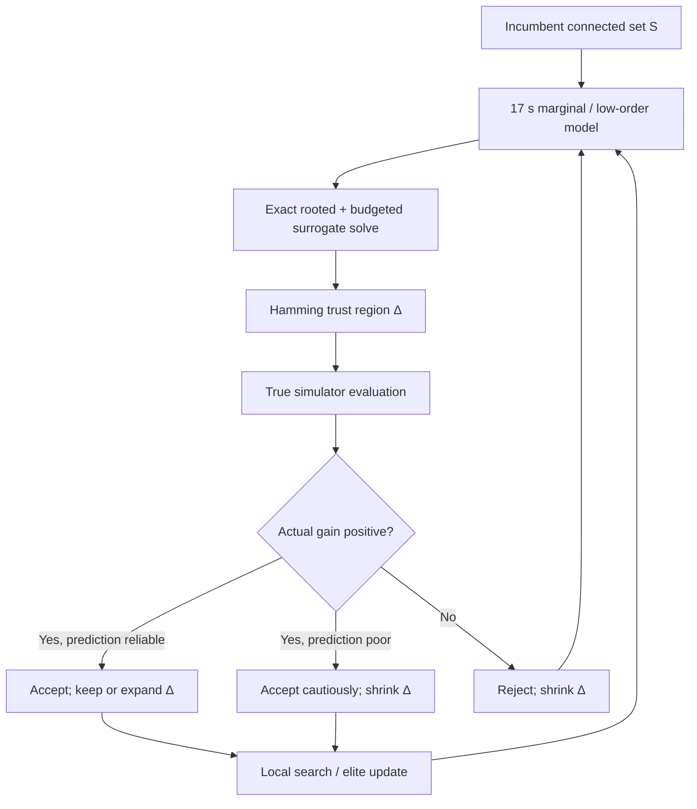

# Planning the Whole Connected Solution at Once: Exact Surrogates, Interaction Models, Recombination, and Acceptance Rules

## Executive summary

[SOURCE] The engineering problem is a rooted connected-subgraph optimization problem on an undirected sparse graph with about 1,300 vertices, average degree about 2.3, and a cardinality budget near 100. The true deterministic objective is a non-additive, non-submodular black-box simulator; a local what-if costs about 0.007 s, a full evaluation about 0.1 s, and a graph-wide marginal-value vector about 17 s. The current method is greedy construction followed by local search, with strict-improvement acceptance and about 22% of the selected trunk effectively frozen after construction. fileciteturn0file0

[DERIVED] The most important conclusion is that **whole-solution optimization is computationally realistic here, but only if the expensive black box is separated from a much cheaper structural surrogate**. A 1,300-node, roughly 1,500-edge graph is tiny compared with the graph sizes handled by contemporary Steiner/MWCS codes; the difficult part is not graph connectivity but the mismatch between an additive surrogate and the true interacting objective. The strongest practical architecture is therefore:

1. obtain a marginal or low-order model around an incumbent;
2. optimize that model globally subject to the root, cardinality, and connectivity requirements;
3. evaluate the proposed connected set with the real simulator;
4. control how far successive surrogate solutions may move;
5. retain several structurally different elite solutions and periodically re-optimize their union.

[SOURCE] The exact additive subproblem belongs most directly to the **rooted maximum-weight connected subgraph** family with an additional cardinality/budget constraint. Closely related canonical families include budgeted node-weighted Steiner tree and k-cardinality tree. Fischetti et al. define the latter as finding “a subtree with \(k\) edges, having minimum weight” and prove strong NP-hardness on general graphs but polynomial solvability when the input itself is a tree. Chimani et al. later showed that directed-cut branch-and-cut can solve many KCT instances with 200–5,000 vertices to proven optimality and can outperform contemporary metaheuristics. citeturn14search3turn14search1

[SOURCE] For the precise node-weighted family, SCIP-Jack is unusually relevant: its current documentation lists rooted MWCS, budget-constrained MWCS, node-weighted Steiner tree, rooted prize-collecting Steiner tree, and related classes among its supported variants. SCIP-Jack 2.2 was released in May 2026 and includes Python/NetworkX and C++ interfaces. However, its documentation lists **rooted MWCS** and **budget-constrained MWCS** separately; I did not find documentation stating that “rooted + budgeted MWCS” is a single named built-in mode. Thus the exact conjunction should be treated as a small formulation change rather than assumed to be a turnkey problem class. citeturn20search7

[DERIVED] For this application, a general MIP is therefore at least as important as a specialized Steiner solver. With binary \(x_v\), \(x_r=1\), \(\sum_v x_v\le B\), and either flow or connectivity-cut constraints, SCIP, HiGHS, Gurobi/CPLEX if available, or CP-SAT with an explicit connectivity formulation can optimize the additive surrogate. For \(B\simeq100\), a single-commodity flow formulation can use \(B-1\), rather than 1,300, as its flow big-\(M\), which is advantageous numerically.

[SOURCE] HiGHS 1.15.1 was released on July 2, 2026; it supports LP, convex QP and MIP and has native Windows binaries and Python bindings. Its callback interface exposes MIP solution/improvement events and a cut-pool callback, but the documentation I opened does not expose a general SCIP-style dynamic lazy-constraint handler. Consequently, explicit connectivity flow constraints or an external solve–separate–resolve loop are safer than assuming arbitrary lazy connectivity cuts are available in HiGHS. citeturn23search13

[SOURCE] OR-Tools provides CP-SAT plus a solver-independent MathOpt layer; MathOpt supports SCIP, HiGHS, CP-SAT, Gurobi and other solvers. CP-SAT is an integer solver, so real-valued marginal weights must be scaled to integers before use. The current documentation describes callbacks in MathOpt, but callback support is solver dependent, and the remote MathOpt service explicitly does not yet support callbacks. citeturn22search0turn22search1turn22search8

[DERIVED] At the stated costs, the global marginal passes themselves are likely to cost more than the exact additive solver on this sparse graph. Ten marginal passes consume 170 s; twenty consume 340 s. In contrast, one surrogate proposal costs \(17\) s plus the solver time plus only \(0.1\) s for a true evaluation. Thus even a solver taking several seconds per iteration is acceptable. The target should be **a handful of informative global re-optimizations**, not hundreds of 17-second relinearizations.


[DERIVED] The chart above uses only the costs in the task: \(10^4\) what-ifs cost 70 s; \(10^5\) cost 700 s; ten, twenty and fifty global marginal passes cost 170, 340 and 850 s respectively; 1,000 full evaluations cost 100 s. fileciteturn0file0

[SOURCE] Local branching provides the most directly transferable combinatorial mechanism for restraining a global surrogate solve: Fischetti and Lodi introduced an additional inequality defining a neighborhood around the incumbent and used the MIP solver as a black-box tactical search engine. Their experiments used CPLEX 7.0 on difficult MIPs and obtained better incumbents than the underlying solver on 23 of 29 instances. citeturn12search8

[DERIVED] Here that means adding a symmetric-difference bound
\[
\sum_{v:x_v^0=1}(1-x_v)+\sum_{v:x_v^0=0}x_v \le \Delta,
\]
while still optimizing connectivity globally. Start with \(\Delta\) in the order of 10–30 selected-status changes, not because literature establishes those numbers for this graph, but because the incumbent has only about 100 selected vertices and the surrogate is local. Expand \(\Delta\) when predictions are reliable; shrink it when the surrogate repeatedly predicts gains that disappear under the true objective.

[SOURCE] BOCS and COMBO establish that Bayesian/surrogate optimization of binary structures is possible, but their demonstrated binary experiments are orders of magnitude smaller than 1,300 variables. BOCS experiments included roughly 10- and 24-variable cases, and its acquisition optimization was already difficult for the 24-variable higher-order setting; COMBO reports binary benchmark problems around 21–31 variables and hundreds, not thousands, of objective evaluations. citeturn12academia50turn13view3turn12search6turn13view1

[DERIVED] Consequently, **full-space BOCS/COMBO on 1,300 binary variables with an additional hard connectivity constraint is not a realistic first-line method**. A sparse quadratic model restricted to graph-local interactions is much more plausible: if interactions are screened only along approximately 1,495 graph edges rather than all \(\binom{1300}{2}=844{,}350\) pairs, the interaction model remains modest and can be linearized in a MIP.

[SOURCE] Linkage-learning algorithms such as LTGA/GOMEA and DSMGA-II explicitly learn variable dependencies and use them to move groups together. Thierens and Bosman describe GOMEA as an algorithm designed to maximize mixing of partial solutions; DSMGA-II “adopts pairwise linkage detection” and stores dependencies in a dependency-structure matrix. Later GOMEA work confirms that exposing dependency structure can drastically reduce evaluations on decomposable black-box benchmark families, while also finding that the benefit is problem dependent. citeturn17search0turn17academia49turn17academia48turn17search5

[DERIVED] With the current simulator budget, learning all pair interactions blindly is unattractive. Sharing evaluations, a naïve full second-order binary design needs \(1+n+\binom n2=845{,}651\) distinct configurations, which would cost about 5,920 s or 98.7 minutes even at 0.007 s each—and many such configurations may violate connectivity or cardinality. Restricting candidate pairs to graph edges gives roughly \(1+1300+1495=2796\) configurations, only about 19.6 s at the same nominal cost before feasibility/repair overhead. That is a two-orders-of-magnitude difference.

[SOURCE] Solution merging is unusually well matched to this problem. Bosman’s Steiner-tree solution-merging method takes the union of generated solutions, exploits the reduced graph’s smaller effective width, and solves the induced subproblem to extract an improved solution. SCIP-Jack itself contains a recombination heuristic in its Steiner-tree plugin architecture. citeturn20academia47turn20search9

[DERIVED] For three 100-node solutions, their raw union has at most 300 vertices and usually far fewer. Therefore a three-parent **union-and-re-solve** is one of the lowest-risk ways to reconsider the currently frozen trunk: optimize the additive or low-order surrogate over the union plus required connector paths, force the root, impose \(B\), and validate the resulting set with the black box. Unlike ordinary crossover, connectivity is handled by the solver rather than repaired afterward.

[SOURCE] GRASP, reactive GRASP, path relinking, and KCT ant-colony methods all have primary literature on closely related graph problems. Classical GRASP alternates a randomized greedy construction with local search; reactive GRASP adapts the restricted-candidate-list parameter from observed solution quality. For edge-weighted KCT, Blum and Blesa found that the relative ranking of metaheuristics depended on cardinality, with ant colony stronger at low cardinality and tabu search stronger at high cardinality. citeturn19search8turn19search7turn14search2

[DERIVED] These constructive metaheuristics are realistic **only if their inner construction uses cheap cached/surrogate scores**. Recomputing a 17 s global marginal vector at every one of ~100 construction steps would cost ~28 minutes per construction and defeats the purpose. One marginal pass reused across a randomized construction, followed by a true evaluation and perhaps one relinearization, is economically much more sensible.

[SOURCE] Simulated annealing, threshold accepting, record-to-record travel, late acceptance, and step-counting hill climbing all exist to allow temporary non-improvement rather than becoming trapped at the first local optimum. Threshold accepting was explicitly proposed as a simpler alternative to simulated annealing; Dueck later introduced record-to-record travel as a one-parameter method; late acceptance bases its threshold on search history; step-counting hill climbing holds the current cost as an acceptance bound for a fixed number of steps. citeturn16search0turn15search0turn15search12turn15search4turn15search16

[DERIVED] The asymmetric evaluation cost changes how these methods should be tested. Allowing a slightly worse **0.007 s what-if** is cheap; allowing a worse move after paying 20–40 s to regrow 20 nodes is expensive. Thus acceptance policy should be attached primarily to the cheap exploratory layer, or to already-computed whole proposals, rather than deliberately commissioning many expensive rebuilds merely to accept worse solutions.

[DERIVED] A practical first experiment is therefore: three independent runs; each run uses 5–10 global marginal passes, an exact rooted/budgeted surrogate solve with a Hamming trust region, occasional union-and-re-solve across elites, and the existing local search between global proposals. At five passes the marginal overhead is 85 s/run; at ten it is 170 s/run. The surrogate solver should be time-capped rather than necessarily proved optimal every time, while final selected surrogate instances can be allowed to prove optimality to obtain an additive-model dual bound.

[DERIVED] The principal negative result is conceptual: **an optimal additive surrogate solution and its MIP dual bound do not constitute an upper bound on the true black-box optimum** unless the surrogate has been proved to dominate the real objective over every feasible set. The additive gap is still useful as a model-quality diagnostic, but not as a certificate that the simulator optimum is near.

### Executive method ranking

| Method | [DERIVED] Realism here | [DERIVED] Approximate cost in the stated units | Main reason |
|---|---:|---:|---|
| Exact additive rooted/budgeted connected solve | **Very high** | 17 s marginal pass + solver seconds + 0.1 s true check | [SOURCE] Exact MWCS/Steiner machinery is mature at much larger graph sizes. citeturn20search7turn14search1 |
| Trust-region surrogate iterations | **Very high** | 5–10 passes ≈ 85–170 s + solves | [SOURCE] Hamming-style local branching is established in MIP. citeturn12search8 |
| Three-solution union + exact re-solve | **Very high** | Solver seconds + ~0.1 s validation if weights are already available | [SOURCE] Solution-merging on union subgraphs has direct Steiner precedent. citeturn20academia47 |
| Graph-local sparse pair model | **High / experimental** | ~2.8k probes ≈ 20 s nominal for edge-local screening | [SOURCE] Pair/linkage detection and sparse polynomial models have direct literature support. citeturn17academia49turn18search3 |
| Reactive GRASP on surrogate | **Moderate–high** | Several cheap constructions per weight pass | [SOURCE] RCL randomization and reactive adaptation are established. citeturn19search7turn19search8 |
| LAHC / threshold acceptance | **Moderate** | Essentially no computational overhead once proposals exist | [SOURCE] Both use simple acceptance-memory/threshold mechanisms. citeturn15search0turn15search4 |
| Full GOMEA/DSMGA-II | **Moderate research value** | Not established at this constrained 1,300-variable scale | [SOURCE] They learn linkage, but published results are predominantly unconstrained benchmark landscapes. citeturn17academia48turn17academia49 |
| Full-space BOCS/COMBO | **Low** | Acquisition model/optimizer is the bottleneck, not 0.1 s evaluations | [SOURCE] Demonstrated binary dimensions are only tens of variables. citeturn13view3turn13view1 |
| Blind all-pairs interaction screening | **Low** | ~845,651 distinct binary contexts ≈ 98.7 min nominal | [DERIVED] Quadratic scaling overwhelms local-interaction sparsity. |

## Exact additive surrogate and rooted budgeted connectivity

[SOURCE] **Question addressed:** Q1. The surrogate problem is
\[
\max \sum_{v\in V} w_v x_v
\]
subject to \(x_r=1\), \(\sum_v x_v\le B\), \(x_v\in\{0,1\}\), and connectivity of the selected vertices. This is naturally a rooted, budget-constrained MWCS; with explicit vertex costs and prizes it is also a budgeted node-weighted Steiner formulation. Bateni, Hajiaghayi and Liaghat study the budgeted node-weighted Steiner family with vertex costs and prizes and a budget, including rooted variants. citeturn0search1

[SOURCE] Fischetti, Hamacher, Jørnsten and Maffioli, *Networks* 24 (1994), DOI 10.1002/net.3230240103, give the classical weighted k-cardinality-tree formulation. Their defining sentence is: “the problem of finding in a given undirected graph \(G\) a subtree with \(k\) edges.” They prove the general problem strongly NP-hard, polynomial on input trees, and develop an integer-programming formulation plus exact separation for generalized subtour constraints. citeturn14search3

[SOURCE] Chimani, Kandyba, Ljubić and Mutzel, *ACM Journal of Experimental Algorithmics* 14 (2010), DOI 10.1145/1498698.1537600, define KCT as “finding a subtree \(T\) of \(G\) with exactly \(k\) edges.” Their exact method uses directed cuts. Their tests span graphs with 200–5,000 nodes and show that the exact algorithm can often outperform metaheuristics while also proving optimality. The accessible publisher abstract does not expose a sufficiently detailed per-instance hardware/runtime table to give a defensible number for the precise 1,300-node, \(k\simeq100\) regime. citeturn14search1

[DERIVED] KCT is not literally the engineering surrogate: KCT normally has edge costs and exactly \(k\) edges, whereas this surrogate has vertex rewards and at most \(B\) vertices. The connection is structural. Every feasible connected selected vertex set contains a spanning tree, so a rooted arborescence can encode connectivity without requiring the chosen induced subgraph itself to be acyclic.

**Canonical formulations**

[DERIVED] A **single-commodity flow formulation** on the bidirected graph uses \(x_v\in\{0,1\}\) and nonnegative flows \(f_{ij}\):
\[
x_r=1,\qquad \sum_vx_v\le B,
\]
\[
\sum_i f_{iv}-\sum_j f_{vj}=x_v \quad(v\ne r),
\]
\[
\sum_j f_{rj}-\sum_i f_{ir}=\sum_{v\ne r}x_v,
\]
\[
0\le f_{ij}\le (B-1)x_i,\qquad
0\le f_{ij}\le (B-1)x_j.
\]
Every selected non-root vertex receives one unit originating at \(r\). Since at most \(B\) vertices are selected, \(B-1\) is a sufficient flow bound.

[SOURCE] The closely related directed-cut formulation is standard in exact Steiner/MWCS work. Rehfeldt, Franz and Koch’s 2022 *Networks* paper, DOI 10.1002/net.22101, develops formulations and polyhedral results for optimal connected subgraphs, including rooted MWCS and Steiner arborescence representations. Their rooted formulation requires a selected vertex to be reachable from the root; undirected graphs are handled by bidirecting edges. citeturn10search1turn10search2

[DERIVED] A **directed connectivity-cut formulation** can therefore use arc variables \(y_{ij}\) and impose, for every \(U\subseteq V\setminus\{r\}\) and every selected \(v\in U\),
\[
\sum_{(i,j)\in\delta^-(U)}y_{ij}\ge x_v.
\]
The exponentially many constraints need not be generated in advance: after solving a relaxation, violated cuts are found by root-to-vertex minimum cuts. SCIP's separator/constraint-handler architecture is designed for precisely this pattern; HiGHS is better used with explicit flow constraints or an external separation loop because its documented callback API is more limited. citeturn20search9turn23search13

[SOURCE] Álvarez-Miranda, Ljubić and Mutzel’s 2013 MWCS chapter, DOI 10.1007/978-3-642-38189-8_11, develops a node-separator branch-and-cut approach for MWCS and reports improvements over earlier PCST transformations and node-only formulations. citeturn10search4

[DERIVED] A vertex-only separator version says, informally, that if \(v\) is selected and \(r\) is selected, at least one vertex in every \(r\)-\(v\) separator must also be selected. Such cuts can be particularly attractive on this sparse corridor-and-cluster graph because many separators are tiny articulation-like bottlenecks.

[UNVERIFIED] **MTZ-style connectivity** is also possible by selecting one incoming parent for every non-root selected vertex and assigning an integer depth \(d_v\), with inequalities of the form \(d_j\ge d_i+1-M(1-y_{ij})\). The classical Miller–Tucker–Zemlin source was not opened in this research pass, so I do not present a verbatim primary-source quote. For this graph, flow/cut formulations have stronger directly opened primary support.

### Tree knapsack and nearly tree-like graphs

[SOURCE] Cho and Shaw, “A Depth-First Dynamic Programming Algorithm for the Tree Knapsack Problem,” *INFORMS Journal on Computing* 9 (1997), DOI 10.1287/ijoc.9.4.431, study the rooted tree-knapsack condition that selecting a node requires selecting the path to the root and obtain pseudopolynomial dynamic programming with \(\Theta(nH)\) complexity in their depth-first scheme. citeturn11search6turn11search5

[SOURCE] Cho, Shaw and Kim’s related *Computers & Operations Research* paper, DOI 10.1016/S0305-0548(96)00091-3, describes a rooted tree with vertex profits/demands and asks for a maximum-profit rooted subtree within capacity. Their experiments include trees of roughly 50–500 vertices and capacities up to 5,000–10,000. citeturn11search1turn11search3

[DERIVED] With unit vertex costs and cardinality \(B\), an elementary bottom-up recurrence is
\[
D_v(k)=\max\{\text{weight of a connected \(k\)-vertex subtree rooted at \(v\)}\}.
\]
When merging child \(c\),
\[
D^{new}_v(k)=
\max_{0\le j<k}\{D^{old}_v(k-j)+D_c(j)\},
\]
where \(D_c(0)=0\) represents excluding the entire child branch. Naïvely each child merge is a max-plus convolution costing \(O(B^2)\), hence \(O(nB^2)\) overall; specialized depth-first tree-knapsack schemes can remove a pseudopolynomial factor in appropriate formulations. Recent automaton-constrained tree-knapsack work explicitly notes that the natural DP incurs quadratic pseudo-polynomial max-plus convolution and gives faster heavy-light methods. citeturn11academia42

**[DERIVED] Tree-knapsack pseudocode**

```text
TREE_KNAPSACK(root r, budget B, weights w):
    root the input tree at r
    process vertices in postorder
    for each vertex v:
        D[v][0..B] = -∞
        D[v][1] = w[v]                 # choose v itself
        size = 1
        for each child c of v:
            N[0..B] = -∞
            for k = 1 .. min(size, B):
                N[k] = max(N[k], D[v][k])   # exclude c's branch
                for j = 1 .. min(subtree_size[c], B-k):
                    N[k+j] = max(
                        N[k+j],
                        D[v][k] + D[c][j]
                    )
            D[v] = N
            size = min(B, size + subtree_size[c])
    return max_{1 <= k <= B} D[r][k]
```

[DERIVED] For \(n=1300\) and \(B=100\), even the conservative \(O(nB^2)\) count is only about 13 million simple DP combination operations. On an actual tree this is operationally negligible relative to one 17 s marginal-value pass.

[DERIVED] Cycles can be handled in four qualitatively different ways. Restricting to a chosen spanning tree makes the DP exact on that tree but only a **lower-bound heuristic** for the original maximization problem because another cycle edge might permit a better connector. Enumerating choices for a small feedback-edge set is exact but exponential in the number of cycle choices. A tree decomposition permits exact or parameterized dynamic programming whose state must encode both budget and boundary connectivity; state growth is exponential in treewidth. Finally, one may simply use the tree DP as a proposal generator and let a general MIP handle the original graph.

[SOURCE] The bounded-width literature confirms both the power and the limitation of tree decomposition. For example, Steiner-type problems admit dynamic programming/FPT techniques on suitable bounded-width structures, but even Steiner Forest remains NP-hard at treewidth three, so “small treewidth” is not by itself a guarantee of a trivial DP for every connectivity variant. citeturn22academia48turn22search7

### Solver comparison

| Solver / code | [SOURCE] Documented problem class or defining wording | Root + budget + node weights | Licence / interface | Evidence on scale |
|---|---|---|---|---|
| **SCIP-Jack 2.2** | [SOURCE] “classic Steiner tree problem in graphs, and fourteen related problems”; docs list rooted MWCS, MWCS with budget constraints, NWST, PCST and others. citeturn20search7 | [DERIVED] Rooted and budgeted MWCS are separately documented; their exact conjunction is **not explicitly verified** as one mode. Small formulation extension. | [SOURCE] Academic/noncommercial terms; Python/NetworkX and C++ interfaces in 2.2. | [SOURCE] Site says graphs with hundreds of thousands of edges can often be solved within minutes; no directly comparable 1,300/100 timing found. citeturn20search7 |
| **SCIP 10.0.2** | [SOURCE] General constraint integer programming / MIP framework with user plugins, separators and constraint handlers. | [DERIVED] Yes, by flow or cut model. | [SOURCE] Apache 2.0; PySCIPOpt; Windows packages. | [UNVERIFIED] No primary benchmark opened specifically for this model/size. |
| **heinz / BioNet** | [SOURCE] Dittrich et al. formulate exact active-subnetwork extraction through ILP/PCST; later BioNet work permits a fixed predefined subnetwork size. citeturn4view0turn4view1 | [DERIVED] Node weights + cardinality yes; root requires forcing \(x_r=1\), a small model modification rather than a documented turnkey option. | [SOURCE] R/Bioconductor BioNet remains actively distributed in 2026. citeturn23search6 | [SOURCE] Original heinz paper says large PPI subnetworks are typically solved to optimality in minutes; exact matching hardware/size was not exposed in opened HTML. |
| **Dual-ascent APCST framework** | [SOURCE] Leitner et al. give an exact branch-and-bound/dual-ascent framework covering PCST, MWCS, node-weighted Steiner and related transformations. citeturn5search0turn5search9 | [DERIVED] Root/prizes yes in related classes; hard cardinality budget not documented as a native mode. | [SOURCE] Research code was reported publicly available in the paper. | [SOURCE] Authors report many literature instances solved optimally within seconds, including large benchmark families; not an apples-to-apples \(B=100\) benchmark. |
| **pcst_fast 1.0.10** | [SOURCE] “fast implementation of the Goemans-Williamson scheme for the prize-collecting Steiner tree / forest problem.” citeturn23search1turn23search2 | [SOURCE] Root parameter exists; [DERIVED] no exact hard-cardinality constraint. | [SOURCE] C++/Python, MIT. citeturn23search0turn23search1 | [SOURCE] Published package documentation reports very large edge sets handled in seconds; it is an approximation implementation, not an exact \(B\)-cardinality solver. |
| **HiGHS 1.15.1** | [SOURCE] LP, convex QP, and MIP. citeturn23search10turn23search13 | [DERIVED] Yes with explicit flow/cut-loop formulation. | [SOURCE] C++/Python, Windows binaries; standard builds MIT, HiPO-containing prebuilt binaries treated as Apache 2.0 in 1.15.1. citeturn23search13 | [UNVERIFIED] No model-specific 1,300-node timing located. |
| **OR-Tools CP-SAT / MathOpt** | [SOURCE] OR-Tools targets flows, integer/linear programming and constraint programming; MathOpt can dispatch to CP-SAT, SCIP, HiGHS and commercial solvers. citeturn22search3turn22search8 | [DERIVED] Yes with explicit parent/flow constraints; integer scaling required for CP-SAT objective coefficients. | [SOURCE] Apache 2.0; Python/C++/Java/C#. | [UNVERIFIED] No primary connected-subgraph benchmark at this exact size found. |
| **Chimani et al. KCT B&C** | [SOURCE] Exact directed-cut algorithm for edge-weighted k-cardinality trees. citeturn14search1 | [DERIVED] Cardinality yes; user’s node-weighted maximization is not the native objective. | [UNVERIFIED] Standalone maintained library/licence not established. | [SOURCE] Published experiments cover 200–5,000 vertices and often beat then-state-of-the-art metaheuristics. |

### Numerical stability and implementation details

[SOURCE] CP-SAT is integer based; objective weights therefore require scaling/rounding rather than passing arbitrary floating-point marginal values. OR-Tools’ documentation presents CP-SAT as a SAT-based constraint solver and MathOpt as the layer for general mathematical optimization. citeturn22search2turn22search8

[DERIVED] If marginal values span several orders of magnitude, choose a scaling \(q\) and integer coefficient \(\hat w_v=\mathrm{round}(qw_v)\). Record \(q\) and bound the maximum objective perturbation by approximately \(B/(2q)\) in the original units. With \(B=100\), this makes the effect of integerization auditable.

[DERIVED] For floating-point MIP, normalize the typical \(|w_v|\) near one or \(10^1\)–\(10^3\), avoid gratuitous \(M=n\) when \(M=B\) suffices, and explicitly log feasibility tolerances. Threshold-penalty discontinuities can create very large surrogate coefficients; clipping them without recording the clipping rule changes the model and should therefore be treated as an experimental parameter.

**What the sources say.** [SOURCE] The exact additive problem is squarely inside well-studied connected-subgraph/Steiner integer-programming territory; cut formulations and tree DPs have strong primary support, and exact KCT work reaches well beyond the graph size here. citeturn14search1turn10search1turn11search6 [SOURCE] No opened documentation establishes a single specialized package that simultaneously advertises all four features—rooted, hard-cardinality-budgeted, node-weighted, maximum connected subgraph—as a named turnkey mode; a general MIP formulation removes that ambiguity. citeturn20search7

## Iterated surrogates for the non-additive black box

[SOURCE] **Question addressed:** Q2. The difficulty is not optimizing \(\sum w_vx_v\), but deciding when a linearization around one connected set can safely propose a very different connected set. Local branching supplies a directly applicable combinatorial neighborhood mechanism. Fischetti and Lodi’s defining idea is to add “local branching” constraints and use the MIP solver to explore the resulting incumbent neighborhood. citeturn12search8

[DERIVED] Let \(S_t\) be the incumbent and \(w^{(t)}_v\) the 17-second marginal pass. The naïve procedure
\[
S_{t+1}=\arg\max_{\text{connected},\,r\in S,\,|S|\le B}
\sum_{v\in S}w^{(t)}_v
\]
can jump from one side of the graph to another even though the marginals are only locally meaningful. It is therefore preferable to solve
\[
\max \sum_v w_v^{(t)}x_v,\qquad
d_H(x,x^{(t)})\le\Delta_t.
\]

[DERIVED] Because both solutions have approximately \(B\) selected nodes, a remove-one/add-one swap contributes two to the ordinary binary Hamming distance. That convention must be fixed in experiments: “\(\Delta=20\)” can mean 20 bit changes or about ten swaps.

[SOURCE] Classical trust-region derivative-free algorithms use a local model inside a region around the incumbent and modify that region according to agreement between model prediction and observed objective behavior. CONORBIT, for example, uses RBF surrogate models inside trust regions for expensive constrained black-box optimization. It is continuous rather than combinatorial, so it supports the acceptance-ratio principle rather than the graph-specific formulation. citeturn22search10

[DERIVED] Combining this principle with local branching gives the natural ratio
\[
\rho_t=
\frac{F(S'_t)-F(S_t)}
     {\hat F_t(S'_t)-\hat F_t(S_t)}.
\]
The denominator is the surrogate-predicted improvement. This exact discrete connected-subgraph algorithm was **not** found as a published off-the-shelf method in the opened sources; it is a derived synthesis of local branching and trust-region acceptance.



**[DERIVED] Surrogate–solve–evaluate pseudocode**

```text
SURROGATE_TRUST_SEARCH(S, B, root):
    Δ = initial_radius
    best = S
    while evaluation budget remains:
        w = ESTIMATE_ALL_MARGINALS(S)          # ~17 s
        P = SOLVE_CONNECTED_SURROGATE(
                weights=w,
                root=root,
                cardinality=B,
                hamming_center=S,
                hamming_radius=Δ)
        predicted = SURROGATE(P) - SURROGATE(S)
        actual = TRUE_OBJECTIVE(P) - TRUE_OBJECTIVE(S)

        if predicted <= 0:
            Δ = max(Δ_min, shrink * Δ)
            continue

        ρ = actual / predicted
        if actual > 0:
            S = P
            best = argmax_F(best, S)

        if ρ >= η_good:
            Δ = min(Δ_max, expand * Δ)
        elif ρ < η_bad:
            Δ = max(Δ_min, shrink * Δ)

    return best
```

[DERIVED] Sensible parameters to report—not universal literature defaults—are \(\Delta_0,\Delta_{\min},\Delta_{\max}\), shrink/expand factors, and \(\eta_{\rm bad},\eta_{\rm good}\). Since the objective is deterministic, repeated evaluation of the same set is unnecessary except as a simulator-integrity check.

### Why additive weights can fail

[DERIVED] **Connector bias:** a corridor vertex can have near-zero one-at-a-time marginal value while being indispensable to reach several valuable descendants. A global connectivity solver can recover it if downstream prizes are represented, but a trust region may still under-value an entire new branch if none of its reward nodes has meaningful local marginal weight.

[DERIVED] **Threshold invisibility:** suppose a hard penalty disappears only after three nodes move together. Every individual marginal can be zero or negative while the triple has large positive true value. No additive model around the incumbent can represent this without either multi-point probing or history.

[DERIVED] **Oscillation:** if two mutually exclusive structures alternately acquire high local marginals, exact optimization can jump \(A\to B\to A\). Trust-region contraction, tabu/history penalties, or averaging multiple marginal vectors can suppress such two-cycle behavior.

[DERIVED] **Budget displacement:** multiplicative/payoff vertices tend to receive positive marginals while low-value connector vertices consume the same unit cardinality. The exact additive model correctly prices their explicit budget consumption but not their higher-order enabling value.

[DERIVED] **Model exploitation:** an exact solver is exceptionally good at finding combinations where the surrogate is wrong. This is the combinatorial analogue of optimizer’s curse: increasing surrogate-solve quality can decrease true-objective quality unless model validity is controlled.

### Low-order and Bayesian combinatorial surrogates

[SOURCE] Baptista and Poloczek’s 2018 ICML BOCS work models combinatorial objectives with Bayesian sparse polynomial surrogates and optimizes an acquisition function over binary variables. The opened paper material shows examples including a 24-variable Ising problem; at this scale some acquisition optimizations were already described as prohibitively large for more expensive formulations. citeturn12academia50turn13view3

[SOURCE] Oh et al.’s COMBO, NeurIPS 2019, performs Bayesian optimization on combinatorial domains through graph representations and spectral models. Its reported binary experiments include roughly 21-variable contamination control, 24-variable Ising models and a 31-binary-variable architecture problem, with evaluation budgets on the order of 170–270. citeturn12search6turn13view1

[DERIVED] An unrestricted quadratic surrogate at \(n=1300\) has
\[
1300+\binom{1300}{2}=845{,}650
\]
nonconstant linear/pair coefficients. That is already much larger than the total black-box budget and ignores connectivity.

[DERIVED] A graph-local quadratic surrogate with interactions only on the ~1,495 original graph edges has only about 2,795 linear-plus-pair coefficients. A binary interaction \(z_{uv}=x_ux_v\) can be linearized using
\[
z_{uv}\le x_u,\quad z_{uv}\le x_v,\quad
z_{uv}\ge x_u+x_v-1.
\]
This retains a MILP surrogate and exact root/cardinality/connectivity constraints.

[DERIVED] Global multiplier nodes create an important exception: an interaction graph limited strictly to original graph adjacency can miss a remote multiplier affecting many clusters. Therefore the candidate interaction set should be “graph-local pairs plus a small learned/global list,” not simply \(E(G)\).

**What the sources say.** [SOURCE] Combinatorial surrogate optimization and Hamming-neighborhood MIP search are established ideas, but the opened BOCS/COMBO experiments do not support an inference that general Bayesian combinatorial optimization scales directly to 1,300 constrained bits. citeturn12search8turn13view3turn13view1 [DERIVED] A locally valid sparse surrogate followed by exact constrained optimization is far better aligned with the available evidence and cost model.

## Learning interactions and variables that must move together

[SOURCE] **Question addressed:** Q3. Heckendorn and Wright’s 2004 *Evolutionary Computation* paper, DOI 10.1162/1063656043138914, studies black-box binary functions under bounded epistasis and explicitly aims to recover “the complete epistatic structure of the function” through limited probing and Walsh coefficients. citeturn18search3

[SOURCE] Hsu and Yu’s DSMGA-II defines its central mechanism as follows: it “adopts pairwise linkage detection and stores the information in the form of dependency structure matrix.” The algorithm then builds incremental linkage sets and uses restricted/back mixing to exploit those dependencies. citeturn17academia49

[SOURCE] Thierens’ LTGA introduces a linkage tree learned by hierarchical clustering of variables, and Thierens and Bosman’s subsequent GOMEA work explicitly designs optimal mixing around learned linkage. The 2024 parameterless GOMEA work states that detecting and exploiting dependencies between variables “can be key” and reports extensive comparisons against DSMGA-II on black-box problems designed to require linkage discovery. citeturn17search8turn17search0turn17academia48

[SOURCE] The evidence is not uniformly positive for real problems: later GOMEA work found that the benefit of linkage learning was “clearly visible” on artificial benchmarks but much less clear on several real-world-inspired permutation problems. citeturn17search5

### Direct pairwise tests

[DERIVED] For two binary decisions \(i,j\), a context-specific second difference is
\[
I_{ij}
 =F(1_i,1_j)-F(1_i,0_j)-F(0_i,1_j)+F(0_i,0_j).
\]
A nonzero value indicates that the effect of one variable depends on the state of the other in that context. Because the feasible domain here requires connectivity and near-fixed cardinality, the four corners generally cannot be toggled naïvely; they need balanced add/remove companions or a connectivity-preserving repair.

[DERIVED] Testing every pair separately would involve 844,350 candidate pairs. Even with maximal sharing of the singleton/baseline evaluations, evaluating all pair states requires \(1+n+\binom n2=845{,}651\) configurations. At 0.007 s each that is 5,919.6 s, or 98.7 minutes, before repairs. It is therefore incompatible with the intended “tens of minutes” budget.

[DERIVED] Average degree 2.3 implies approximately
\[
m\approx\frac{1300(2.3)}2=1495
\]
edges. Restricting direct interaction tests to graph edges reduces a shared baseline/single/pair design to roughly \(1+1300+1495=2796\) configurations, nominally 19.6 s at 0.007 s each. fileciteturn0file0

[DERIVED] Given hanging clusters of 3–8 nodes, a second high-value candidate set consists of all pairs within each such cluster, plus cluster-to-global-multiplier pairs. This is a structural prior not supplied by linkage-learning literature but by the task’s graph description. fileciteturn0file0

### Sparse polynomial and Walsh surrogates

[SOURCE] Negahban and Shah connect sparse Boolean-polynomial learning with compressed sensing and give a high-probability recovery result using \(m=O(s^2n)\) random observations for an \(s\)-sparse polynomial under their assumptions. citeturn18search5

[SOURCE] A 2026 result by van Doornmalen, Molina, Verdugo and Verschae specifically studies polynomial surrogates for bounded binary black-box optimization. Their results distinguish noisy and noiseless regimes: degree-\(d\) and sparse Fourier–Walsh learning have substantially different sample complexity, with the deterministic/noiseless setting easier than sub-Gaussian-noise uniform estimation. citeturn18academia46turn18search1

[DERIVED] Those theoretical sample-complexity statements do **not** transfer directly here because their sampling domains are Boolean hypercubes or random Boolean designs, whereas the simulator is meaningful on a tiny structured slice: connected, rooted sets of roughly 100 out of 1,300 vertices. The connectivity constraint destroys the ability to make arbitrary membership queries.

[DERIVED] The useful translation is therefore not “run a generic sparse Walsh recovery algorithm,” but “use sparsity as a modeling prior”: maintain a small list of candidate pair/group terms discovered from graph locality, repeated co-selection in elites, failed surrogate moves, and targeted perturbations.

### Group testing and linkage from elite solutions

[DERIVED] With deterministic simulation, a practical group test can compare a block move with the sum of its component predictions:
\[
R(G)=
F(S\triangle G)-F(S)
-\sum_{i\in G}\widehat{\Delta}_i.
\]
Large residual magnitude says the group contains interaction not represented by the additive model.

[DERIVED] Recursive bisection can then localize the interaction: test a cluster, split it in half if its residual is large, and continue until a small linked subset remains. This is a derived engineering use of group testing rather than a directly opened theorem for connected-subgraph simulation.

[DERIVED] Elite solutions themselves provide another low-cost signal. If two vertices repeatedly change together across high-quality solutions despite many opportunities to separate, their empirical mutual information/co-selection can seed a linkage tree. This requires no extra simulator calls; however, it identifies correlation, not necessarily causal interaction.

### Evaluation budget comparison

| Interaction method | [DERIVED] Evaluations at \(n\approx1300\) | Feasibility for this problem | Primary evidence |
|---|---:|---|---|
| Exhaustive pair second differences | ~845,651 shared configurations | Poor | [SOURCE] Pairwise/epistatic probing is established, but unrestricted quadratic growth dominates. citeturn18search3 |
| Original-edge pairs | ~2,796 shared contexts before repairs | Good | [DERIVED] Uses graph locality prior. |
| Cluster-local pairs, cluster size 3–8 | Typically tens per cluster | Very good | [DERIVED] Exploits stated graph structure. |
| DSMGA-II pair linkage | Algorithm-dependent population evaluations | Uncertain | [SOURCE] Pairwise dependency matrix is intrinsic to DSMGA-II. citeturn17academia49 |
| LTGA/GOMEA linkage tree | Population-dependent | Uncertain | [SOURCE] Linkage is learned from population statistics. citeturn17search8turn17search0 |
| Sparse Boolean polynomial | Depends on sparsity and sampling assumptions | Promising only with strong locality | [SOURCE] Sparse recovery can require far fewer samples than dense polynomial fitting under its theoretical assumptions. citeturn18search5turn18academia46 |
| Elite co-selection | 0 additional simulator evaluations | Excellent screening heuristic | [DERIVED] Correlation is not proof of interaction. |

**What the sources say.** [SOURCE] Pairwise linkage, hierarchical linkage models, and sparse polynomial representations all have solid primary foundations. citeturn18search3turn17search8turn17academia49 [DERIVED] At \(n=1300\), locality assumptions are not optional: learning dense second-order structure is inconsistent with the evaluation budget, while the graph’s approximately 1,500 edges and tiny hanging clusters offer a strong structural screen.

## Randomized and population construction

[SOURCE] **Question addressed:** Q4. Feo and Resende’s 1995 GRASP paper, DOI 10.1007/BF01096763, describes GRASP as an iterative randomized method in which every iteration has two stages: an adaptive randomized greedy construction followed by local search. citeturn19search8turn19search6

[SOURCE] The defining idea of the restricted candidate list is to randomize among high-quality greedy candidates rather than always selecting the unique best one. Reactive GRASP, introduced by Prais and Ribeiro, automatically adjusts “the restrictiveness of the candidate list” using the quality of solutions previously obtained; their test application often matched exact results without manual calibration of a single fixed greediness parameter. citeturn19search7turn19search13

[DERIVED] Applied to this graph, an RCL can be built from candidate “payoff node + connector path” packages rather than single vertices. A value-threshold RCL controlled by \(\alpha\) preserves the current engineering representation and only replaces deterministic “best candidate” selection with a controlled random choice.

[DERIVED] The dominant parameter is not just \(\alpha\): it is **how often gains are refreshed**. If every construction step triggers the 17-second all-node marginal computation, 100 steps cost 1,700 s before any local search. If one marginal vector is reused for a whole randomized construction, ten constructions cost 170 s in global-weight passes instead.

[SOURCE] Yahyanejad and Sadeghi Bigham describe three iterated-greedy methods for the hop-constrained Steiner tree and benchmark them on standard Steiner-derived instances. Their strongest variant reports cost improvements over a previous method that differ markedly between sparse and dense graph/hop settings. citeturn19academia48

[DERIVED] This is supportive, but not direct evidence for the exact rooted-cardinality black-box problem. “Iterated greedy” here should mean repeated destroy/reconstruct at whole-solution scale or rebuilding a fresh connected set with inherited elite information, not simply duplicating the existing local ruin-and-recreate neighborhood.

[SOURCE] Blum and Blesa’s 2005 *Computers & Operations Research* study, DOI 10.1016/j.cor.2003.11.007, tests tabu search, evolutionary computation, and ant-colony optimization for edge-weighted KCT. Their conclusion is explicitly cardinality dependent: low-cardinality instances favored ant colony, while tabu search had advantages at higher cardinalities. citeturn14search2

[SOURCE] Blum and Blesa also investigated combining ant colony optimization with dynamic programming for KCT, illustrating a pattern especially relevant here: a population/construction heuristic can delegate a structured subproblem to an exact DP rather than relying on stochastic construction alone. citeturn14search10

[UNVERIFIED] I did not open a satisfactory primary source establishing beam search as state of the art for this exact KCT/PCST family. Beam search remains an algorithmically natural lead—keep the best \(b\) partial connected sets instead of one—but it should not be presented as literature-backed superiority on these benchmarks from the evidence obtained in this review.

[DERIVED] A beam width \(b\) multiplies construction work roughly by \(b\), unless duplicate states and score updates are heavily shared. At the true what-if cost, evaluating \(c\) possible extensions for \(b\) states across 100 levels costs approximately \(0.007\times100bc\) seconds. Even \(b=10,c=20\) gives 140 s, so a beam should use surrogate/cached extension scores and reserve black-box evaluations for finalists.

### Parameters that matter

| Method | [SOURCE] / [DERIVED] Main parameters | Relative cost versus plain greedy |
|---|---|---|
| GRASP | [SOURCE] RCL threshold/cardinality and number of starts. citeturn19search8 | [DERIVED] Approximately number-of-starts times construction cost. |
| Reactive GRASP | [SOURCE] Candidate \(\alpha\) values and adaptation from historical quality. citeturn19search7 | [DERIVED] Similar per start; adds trivial statistics. |
| Iterated greedy | [SOURCE] Destruction/reconstruction strategy and repetition count. citeturn19academia48 | [DERIVED] Depends on destroyed fraction; naturally parallel across starts. |
| KCT ACO | [SOURCE] Pheromone-driven construction; effectiveness varies with cardinality. citeturn14search2 | [DERIVED] Population-size × iteration construction cost; much higher than one greedy pass. |
| Beam search | [UNVERIFIED] Beam width, branching width, pruning criterion | [DERIVED] Roughly beam-width multiplier unless scores are shared. |

**What the sources say.** [SOURCE] Randomized greedy construction and adaptive candidate-list control are well established, and constructive population methods have been competitive on KCT. citeturn19search8turn19search7turn14search2 [SOURCE] KCT evidence also warns against expecting one constructive metaheuristic to dominate across cardinalities and graph classes. citeturn14search2

## Combining strong connected solutions

[SOURCE] **Question addressed:** Q5. Path relinking was applied directly to prize-collecting Steiner trees by Canuto, Resende and Ribeiro, *Networks* 38 (2001), DOI 10.1002/net.1023. Their method combines multistart local search, perturbed prizes, path relinking and variable-neighborhood post-optimization, and found optimal solutions on nearly all instances tested. citeturn20search5

[SOURCE] Ribeiro, Uchoa and Werneck’s hybrid Steiner GRASP applies “adaptive path-relinking” to an elite set as post-optimization and reports competitive, robust performance on broad Steiner benchmark sets. citeturn20search14

[SOURCE] Marzo and Ribeiro’s prize-collecting generalized MST work similarly combines GRASP, path relinking and restarts; their experiments include instances up to 439 vertices and release the test data/results. citeturn20search0

[DERIVED] Classic path relinking is awkward for this application if an elementary bit flip breaks connectivity or exceeds \(B\). A connectivity-preserving path can instead treat one source solution \(S_A\) and guiding solution \(S_B\) as follows: repeatedly add a target vertex/path from \(S_B\setminus S_A\), then prune expendable leaves from \(S_A\setminus S_B\) until the budget is restored. Each step moves structurally toward the guide.

[DERIVED] But the stronger option is often not literal path relinking; it is **union re-optimization**.

[SOURCE] Bosman’s “A Solution Merging Heuristic for the Steiner Problem in Graphs Using Tree Decompositions” constructs a reduced graph from “the union of generated solutions” and solves the induced instance to improve them. The key empirical premise is that unions of good solutions on sparse benchmarks can have sufficiently small effective width for strong optimization. citeturn20academia47

[SOURCE] SCIP-Jack’s documented Steiner application explicitly contains “a recombination heuristic (`heur_rec.c`)” alongside construction, local-improvement and reduction modules. citeturn20search9

[DERIVED] If each elite solution contains 100 vertices, a union of three has at most 300 unique selected vertices. Adding shortest connector alternatives may raise that, but the restricted graph can still be much smaller than 1,300. This also directly attacks the 22% frozen-trunk issue: trunk vertices common to all parents remain available, but alternative trunks present in any parent enter the same exact re-optimization.

**[DERIVED] Three-parent recombination pseudocode**

```text
RECOMBINE_THREE(A, B, C, root r, budget Bmax, weights w):
    U = vertices(A) ∪ vertices(B) ∪ vertices(C)

    for each pair of structurally important vertices in U:
        add a small number of short connector-path alternatives to U

    H = subgraph of original G induced by U and added connectors

    child = SOLVE_EXACT(
        graph=H,
        objective=sum(w[v] * x[v]),
        require x[r] = 1,
        require sum(x) <= Bmax,
        require selected vertices connected
    )

    if child does not have Bmax vertices and exact Bmax is desired:
        child = CONNECTED_GREEDY_FILL(child, Bmax)

    score = TRUE_OBJECTIVE(child)

    if score exceeds the weakest elite score:
        insert child into elite set
        remove one low-quality or near-duplicate elite solution

    return child
```

[DERIVED] An elite set should not contain only the numerically top \(k\) near-duplicates. A simple diversity statistic is Jaccard distance
\[
d(A,B)=1-\frac{|A\cap B|}{|A\cup B|}.
\]
Requiring a minimum distance before admission makes recombination expose genuinely different trunks/clusters.

[DERIVED] A budget repair after a heuristic crossover should preferentially remove non-articulation leaves or entire weak terminal branches; arbitrary deletion can disconnect the child. Exact union re-solving removes the need for ad-hoc repair.

[SOURCE] The opened primary abstracts establish that path relinking/restarts/solution merging can improve Steiner-family heuristics, but they do **not** expose a clean, directly comparable ablation giving “X% benefit over exactly the same independent multistart without relinking” for the user’s scale. That requested quantitative increment is therefore unspecified from the opened evidence. citeturn20search5turn20search14turn20academia47

**What the sources say.** [SOURCE] Elite-solution interaction is not merely a generic evolutionary idea: PCST and Steiner algorithms have direct path-relinking and recombination precedents, and modern Steiner code implements recombination explicitly. citeturn20search5turn20search9 [DERIVED] For a strict root/cardinality constraint, union-and-exact-re-solve is cleaner than ordinary crossover because the optimizer enforces connectivity and budget simultaneously.

## Acceptance rules under a fixed evaluation budget

[SOURCE] **Question addressed:** Q6. Kirkpatrick, Gelatt and Vecchi’s 1983 Science paper, DOI 10.1126/science.220.4598.671, establishes the connection between annealing in statistical mechanics and “multivariate or combinatorial optimization.” citeturn16search0

[SOURCE] Dueck and Scheuer’s 1990 *Journal of Computational Physics* paper, DOI 10.1016/0021-9991(90)90201-B, introduces threshold accepting as a simpler deterministic alternative to simulated annealing and reports a 442-city TSP result in about 1–2 CPU seconds for its deterministic version on the historical test hardware. citeturn15search0

[SOURCE] Dueck’s 1993 paper, DOI 10.1006/jcph.1993.1010, introduces Great Deluge and record-to-record travel and states that both are essentially one-parameter algorithms controlling acceptance of worse intermediate solutions. citeturn15search12

[SOURCE] Burke and Bykov’s late-acceptance work uses previous search history rather than a conventional cooling schedule to set the acceptance reference. Their later journal treatment emphasizes that this avoids an arbitrary schedule parameter tied directly to objective scaling. citeturn15search4turn15search14

[SOURCE] Bykov and Petrovic’s 2016 *Journal of Scheduling* step-counting hill climbing paper defines SCHC as “a new single-parameter local search heuristic” in which “the current cost serves as an acceptance bound for a number of consecutive steps.” citeturn15search16

### Acceptance-rule comparison

| Rule | Definition / principal parameter | Implication here |
|---|---|---|
| **Strict improvement** | [SOURCE] Accept only a better candidate; this is the current policy in the task. fileciteturn0file0 | [DERIVED] Deterministic and budget-efficient, but cannot cross objective valleys. |
| **Simulated annealing** | [SOURCE] Temperature-controlled probabilistic acceptance originates with Kirkpatrick et al. citeturn16search0 | [DERIVED] Needs initial temperature and cooling schedule; scale of \(F\) matters. |
| **Threshold accepting** | [SOURCE] Accept deterioration only below a threshold, then lower that threshold. citeturn15search0turn15search2 | [DERIVED] Easier to audit than SA; threshold can be set from empirical move-loss quantiles. |
| **Record-to-record travel** | [SOURCE] Dueck’s one-parameter rule changes how worsening moves are accepted relative to the record. citeturn15search12 | [DERIVED] Natural when “distance from best seen” has a meaningful scale. |
| **Late acceptance HC** | [SOURCE] Acceptance reference comes from previous search history. citeturn15search4 | [DERIVED] Principal parameter is history length \(L\); avoids temperature calibration. |
| **Step-counting HC** | [SOURCE] Current cost is held as acceptance bound for a chosen number of steps. citeturn15search16 | [DERIVED] One principal step-count parameter; computational overhead negligible. |

[UNVERIFIED] The exact canonical Metropolis formula \(p=\exp(\Delta/T)\) for a worsening maximization move is standard, but the opened Science HTML only exposed the abstract rather than the defining algorithmic page; under the file’s strict evidence rule I therefore do not present a verbatim formula quotation as [SOURCE].

### The asymmetric-cost issue

[DERIVED] A 20-node regrow costing 1–2 s per node is approximately 20–40 s. At 0.007 s per simple what-if, that equals about 2,857–5,714 cheap what-if evaluations. Therefore a policy that increases the number of *attempted expensive regrows* by merely ten can consume the equivalent of 28,000–57,000 local evaluations.

[DERIVED] This suggests separating **proposal expenditure** from **acceptance permissiveness**. For already-computed cheap candidate moves, permissive acceptance is nearly free. For an expensive whole region reconstruction, the decision to spend the construction cost should first be screened by a surrogate or structural criterion; acceptance can then be applied after the true score is known.

[UNVERIFIED] I did not find, among the opened primary literature, a controlled LNS study matching this exact asymmetry—0.007 s elementary candidates versus 20–40 s reconstructed regions—and directly comparing SA, threshold acceptance, LAHC, RRT and SCHC under an equal wall-clock budget. That requested comparison is therefore **not found** rather than inferred from unrelated benchmarks.

### Restarts and run allocation

[SOURCE] Hart’s 1998 *SIAM Journal on Optimization* paper, DOI 10.1137/S1052623494277317, develops sequential stopping rules for stochastic/global optimization and shows they can be applied to multistart local search; the rule estimates the probability mass of \(\epsilon\)-close points and stops when a required confidence is reached. citeturn21search0

[SOURCE] Boender and Rinnooy Kan’s Bayesian multistart framework models observed local optima as cells in a generalized multinomial distribution and derives posterior information about both the number of local optima and their attraction-region sizes to decide when to stop. citeturn21search2

[SOURCE] GRASP stopping-rule literature explicitly builds on these multistart ideas and treats “when to stop repeating randomized construction/local search” as a statistical decision rather than a fixed arbitrary run count. citeturn21search4

[DERIVED] With only three affordable full runs and a current 40% median final-value spread, the existing evidence indicates substantial between-run variability. fileciteturn0file0 Three very short starts therefore provide poor information about the upper tail, but a single very long run also gives no replication. A defensible experimental allocation is three equal independent top-level seeds, while each seed internally uses shorter restart episodes and shares an elite pool only within that seed.

[DERIVED] Report quality-versus-time traces, not only final values. If most runs plateau early, shift budget toward more restarts; if the incumbent continues to improve late, lengthen runs. This adaptation uses observed attainment curves rather than assuming a universal “many short versus few long” rule.

[DERIVED] Under a \(10^5\)-what-if nominal budget, 700 s is available for local probes. Reserving 170 s for ten marginal passes leaves 530 s before solver/full-evaluation overhead, equivalent to about 75,700 additional what-ifs. Five passes leave 615 s, or roughly 87,900 what-ifs. This makes the number of 17 s passes a first-order allocation decision. fileciteturn0file0

**What the sources say.** [SOURCE] Every non-monotone acceptance family reviewed here has evidence that allowing temporary deterioration can improve search on hard combinatorial problems, but their original benchmark domains and cost structures differ substantially. citeturn16search0turn15search0turn15search12turn15search16 [SOURCE] Multistart stopping literature supports basing restart decisions on observed repetition statistics rather than an arbitrary fixed count. citeturn21search0turn21search2

## Solution quality, open-source implementations, reproducibility, and evidence register

**Question addressed: Q7 — knowing how good the result is**

[SOURCE] Exact MIP/Steiner solvers return primal/dual information that can certify an **additive surrogate** optimum or a bounded surrogate optimality gap. HiGHS supports MIP, and MathOpt exposes suboptimal primal/dual solutions and detailed termination reasons for supporting solvers. citeturn23search13turn22search8

[DERIVED] Let
\[
U_w=\max_{S\in\mathcal F}\sum_{v\in S}w_v
\]
be the exact surrogate optimum and \(W(S)\) the surrogate score of the incumbent. Then \(U_w-W(S)\) is a valid additive-surrogate gap. It says nothing rigorous about
\[
F^*-\!F(S)
\]
unless a separately proved relation such as
\[
F(T)\le a+\sum_{v\in T}w_v
\qquad\forall T\in\mathcal F
\]
holds.

[DERIVED] Consequently, the surrogate dual bound should be labelled **model upper bound**, never “true optimum upper bound.”

[SOURCE] Derigs’ 1985 *Operations Research* paper, DOI 10.1287/opre.33.5.1024, explicitly studies statistical confidence limits for unknown combinatorial optima and defines a statistical lower bound for a minimization optimum through a probability statement. He reports computational experience on TSP and quadratic assignment and concludes that usefulness is problem dependent. citeturn21search7

[SOURCE] Hart’s stopping rules and Boender–Rinnooy Kan’s Bayesian method provide additional statistical machinery for multistart optimization, but both rely on sampling/attraction-region assumptions rather than supplying deterministic optimality certificates. citeturn21search0turn21search2

[DERIVED] With only three top-level seeds, fitting a credible extreme-value or Bayesian optimum estimator would be poorly identified. The appropriate immediate evidence is instead a hierarchy:

- [DERIVED] exact optimum/gap on the additive surrogate;
- [DERIVED] exact true-objective optimum on many reduced/small instances where exhaustive or exact enumeration is possible;
- [DERIVED] repeated attainment distributions on full instances;
- [DERIVED] ablations under equal evaluation/wall-clock budgets;
- [DERIVED] convergence traces and time-to-target;
- [DERIVED] stability of the best structure across seeds;
- [DERIVED] comparison against deliberately strengthened baselines.

[SOURCE] Published heuristic studies in the cited KCT, PCST, GRASP and Steiner literature typically support heuristic quality by comparison with known optima/best-known values on public benchmark sets and/or exact algorithms, rather than claiming near-optimality solely because several random starts agree. citeturn14search1turn20search5turn19search7

**Question addressed: Q8 — open-source/source-available code worth reading**

| Package | Language / licence | Supported class | [DERIVED] Python-on-Windows practicality | Why inspect it |
|---|---|---|---|---|
| **SCIP 10.0.2 / PySCIPOpt** | [SOURCE] C/C++; Apache 2.0; Python binding and Windows builds. | General CIP/MIP with separators, constraint handlers, heuristics. | **Easy–medium** | Cut separation, custom connectivity handling, incumbent callbacks. |
| **SCIP-Jack 2.2** | [SOURCE] C++ plus new Python/NetworkX interface; academic/noncommercial licensing terms. citeturn20search7 | 15 Steiner/MWCS-related classes. | **Medium** | Most relevant specialized reductions/heuristics; `heur_rec.c` for recombination. citeturn20search9 |
| **HiGHS 1.15.1** | [SOURCE] C++; Python; standard binary MIT, HiPO build licensing distinction noted in release. citeturn23search13 | LP/QP/MIP. | **Easy**: official x86-64 Windows assets exist. | Clean baseline for explicit-flow MIP. |
| **OR-Tools** | [SOURCE] C++ core with Python/C#/Java; Apache 2.0. | CP-SAT, flows, MIP interfaces, MathOpt. citeturn22search3turn22search8 | **Easy** | Convenient CP-SAT/SCIP/HiGHS prototyping. |
| **pcst_fast 1.0.10** | [SOURCE] C++ with Python package; MIT. citeturn23search0turn23search2 | Approximate PCST/PCSF using Goemans–Williamson scheme. | **Medium** if a matching wheel exists; otherwise C++ build required. | Extremely compact prize-collecting implementation and fast surrogate baseline. |
| **BioNet / heinz lineage** | [SOURCE] R/Bioconductor; exact MWCS-style active-subnetwork machinery. citeturn4view0turn4view1turn23search6 | MWCS / biological active subnetworks; fixed-size extension documented in literature. | **Medium–hard** from Python on Windows because R becomes an extra runtime. | Exact node-weighted formulation and biological MWCS preprocessing. |
| **mwcsr** | [SOURCE] R package; supports classic MWCS, budget MWCS, generalized MWCS; exact `virgo_solver` when CPLEX is present. citeturn20search1 | MWCS/Budget MWCS/GMWCS/SGMWCS. | **Medium–hard** | Direct budget-MWCS code paths; useful formulation reference. |
| **pcst_fast reference repo** | [SOURCE] C++, MIT. “Fast approximation algorithm for the PCST/F problem.” citeturn23search0 | PCST/forest approximation. | **Medium** | Short enough to study algorithm/data structures directly. |

[UNVERIFIED] The current BioNet and `mwcsr` licence strings were not established from the opened package pages/repository snippets, so they should be read from each package’s current `DESCRIPTION`/licence file before redistribution. I do not infer them from historical package metadata.

### Cross-method comparison

| Method | What it adds over current greedy + local search | Evaluations / solver time expected at this size | Root + cardinality? | Black-box objective? | Primary source |
|---|---|---|---|---|---|
| Exact additive MWCS MIP | [DERIVED] Reconsiders the whole topology/trunk at once | [DERIVED] 17 s model pass + solver seconds + 0.1 s validation | Yes, explicitly modeled | Via surrogate | [SOURCE] Rehfeldt et al.; Álvarez-Miranda et al. citeturn10search1turn10search4 |
| KCT directed-cut B&C | Whole-tree exact search | [SOURCE] Tested on 200–5,000 vertices | Cardinality yes; root/node rewards need adaptation | No | [SOURCE] Chimani et al. citeturn14search1 |
| Tree knapsack DP | Exact global solution when graph is a tree | [DERIVED] ≤~13M naïve DP combinations for \(n=1300,B=100\) | Root/budget natural | Via surrogate | [SOURCE] Cho & Shaw. citeturn11search6 |
| Local-branching surrogate loop | Whole-solution moves while limiting surrogate extrapolation | [DERIVED] ~5–10 × 17 s plus solver time | Yes | Via surrogate + true acceptance | [SOURCE] Fischetti & Lodi. citeturn12search8 |
| Sparse quadratic local surrogate | Represents pair synergies/antagonism | [DERIVED] ~2.8k edge-local probes before repair overhead | Yes in downstream MIP | Via surrogate | [SOURCE] Sparse/pairwise foundations. citeturn18search3turn18search5 |
| BOCS | Bayesian polynomial surrogate | [SOURCE] Paper tests tens of binary variables, not 1,300 | Not native to cited experiments | Yes | [SOURCE] Baptista & Poloczek. citeturn12academia50 |
| COMBO | Graph-based BO over combinatorial spaces | [SOURCE] ~21–31 binary variables in cited experiments | Connectivity would require custom domain machinery | Yes | [SOURCE] Oh et al. citeturn12search6 |
| LTGA/GOMEA | Learns groups of dependent variables | Population dependent; scale here not established | Needs custom feasibility handling | Yes | [SOURCE] Thierens; Thierens & Bosman. citeturn17search8turn17search0 |
| DSMGA-II | Pairwise dependency matrix + linked mixing | Population dependent | Needs custom feasibility handling | Yes | [SOURCE] Hsu & Yu. citeturn17academia49 |
| Reactive GRASP | Diverse whole constructions instead of one greedy trunk | [DERIVED] multiples of construction cost; cheap if same marginal pass reused | Easy to enforce constructively | Directly or via surrogate | [SOURCE] Prais & Ribeiro. citeturn19search7 |
| KCT ACO | Population-level constructive diversification | Higher than greedy; many ants/iterations | Cardinality native in KCT; root adaptation | Usually additive objective | [SOURCE] Blum & Blesa. citeturn14search2 |
| Path relinking | Searches between elite topologies | Depends on path length and move evaluation | Repair/connected moves required | Yes | [SOURCE] Canuto et al. citeturn20search5 |
| Union + exact re-solve | Combines several trunks/branches globally | [DERIVED] Restricted graph ≤300 raw parent vertices plus connectors; solver seconds | Yes | Via surrogate, then true validation | [SOURCE] Bosman; SCIP-Jack recombination. citeturn20academia47turn20search9 |
| Threshold / late acceptance | Escapes strict-improvement local minima | Negligible policy overhead | Independent of constraints | Yes | [SOURCE] Dueck & Scheuer; Burke & Bykov. citeturn15search0turn15search4 |
| Bayesian/sequential multistart stopping | Quantifies whether more starts remain worthwhile | Statistical bookkeeping only | N/A | Yes | [SOURCE] Boender–Rinnooy Kan; Hart. citeturn21search2turn21search0 |

### Recommended reproducibility protocol

[DERIVED] Freeze the graph and simulator build first. Store a content hash for the graph, simulator executable/source revision, numerical libraries, compiler/runtime, and every external solver. The minimum solver-version record for a new experiment should include SCIP/SCIP-Jack or HiGHS/OR-Tools version, Python version, OS, processor model, physical core count, RAM, thread count, and random seed.

[DERIVED] For each algorithmic run, log: seed; starting solution; true initial \(F\); every accepted and rejected whole proposal; cumulative numbers of 0.007 s what-ifs, 0.1 s full calls and 17 s marginal passes; solver wall-clock; solver node count; best primal and dual surrogate objective; MIP gap; Hamming distance proposed; predicted gain; true gain; \(\rho\); and maximum resident memory.

[DERIVED] Record both **evaluation-normalized** and **wall-clock-normalized** convergence. The key curves are best true \(F\) versus number of what-if equivalents and best true \(F\) versus elapsed seconds. Solver CPU time should not be silently excluded from the latter.

[DERIVED] Convert heterogeneous calls to an optional “what-if equivalent” accounting unit:
\[
1\text{ full eval}\approx 14.29\text{ what-ifs},
\qquad
1\text{ marginal pass}\approx2428.6\text{ what-ifs}.
\]
These follow from \(0.1/0.007\) and \(17/0.007\). Solver time should still be added separately rather than converted unless hardware is fixed. fileciteturn0file0

[DERIVED] Compare methods using the same three top-level seeds and identical stopping budgets. Because only three runs are presently affordable, do not report only the best run. Report all three values, median, range, and anytime traces. For development-time tuning, use separate instances or nested seeds so that repeated tuning does not overfit the final three runs.

[DERIVED] Build a small exact-validation suite from the real graph: induced/subgraph instances of approximately 30, 50, 100, 250 and 500 vertices retaining the root/corridor/cluster pattern, with budgets scaled accordingly. On these, enumerate or solve the additive model to proven optimality and, where feasible, enumerate the true simulator objective. This distinguishes “surrogate optimization failure” from “surrogate model failure.”

[SOURCE] Public external validation should include the benchmark families used in MWCS/PCST and KCT literature. Rehfeldt/Koch’s MWCS work uses the DIMACS implementation-challenge MWCS/PCST collections, while Chimani et al. and Blum/Blesa provide the relevant KCT experimental literature. citeturn20academia50turn14search1turn14search2

[DERIVED] Public additive benchmarks cannot validate the nonlinear simulator model, but they can answer whether the implementation of connectivity, budget, cuts and solver integration is competitive and correct.

### Parameter matrix for the first controlled experiment

| Component | [DERIVED] Values to test | Why |
|---|---|---|
| Surrogate type | linear; linear + graph-edge pairs | Isolate value of interactions. |
| Marginal passes/run | 5, 10 | 85 versus 170 s model-estimation overhead. |
| Hamming radius | 10, 20, 40 bit changes | Span conservative to substantial whole-solution changes. |
| Radius adaptation | fixed; shrink/expand from \(\rho\) | Test whether model-validity feedback matters. |
| Exact-solve limit | 1, 5, 20 s/proposal | Determine whether surrogate proof effort matters. |
| Elite size | 3, 6 | Enough diversity without large bookkeeping. |
| Recombination | none; pair union; three-parent union | Directly test whole-topology combination. |
| Acceptance | strict; threshold; LAHC | Compare deterministic diversification at equal budget. |
| GRASP | deterministic greedy; fixed RCL; reactive RCL | Separate construction diversity from later search. |

[DERIVED] A full factorial would be too expensive and statistically wasteful with three seeds. Use staged ablation: first surrogate solver versus current baseline; then trust radius; then recombination; then pair terms; then acceptance. Freeze earlier choices before testing later ones.

### Known failure modes and negative results

[DERIVED] **Surrogate optimality can be anti-correlated with true improvement.** Exact optimization magnifies model misspecification; use true-objective validation and radius control.

[DERIVED] **Zero-weight connectors are not dispensable.** Any pruning based purely on \(w_v\le0\) can destroy access to profitable remote nodes.

[DERIVED] **Hard threshold penalties create high-order discontinuities.** First-order marginals can make every member of a required group look unattractive.

[DERIVED] **Sparse graph does not imply sparse functional interaction.** A global multiplier can interact with distant branches; graph-edge pair screening must include explicitly detected long-range terms.

[SOURCE] **BOCS/COMBO scaling evidence is weak for this dimension.** Their opened experimental evidence is in tens, not thousands, of binary variables. citeturn13view3turn13view1

[SOURCE] **Linkage learning is not universally beneficial.** GOMEA studies report strong benefits on some synthetic/decomposable problems but much weaker evidence on some real-world-inspired cases. citeturn17search5

[DERIVED] **A spanning-tree restriction can miss the best connected set.** It is a feasible subproblem, not an exact solution to a cyclic graph unless the optimum happens to lie in that spanning tree.

[DERIVED] **A union of elites can lose novelty.** If all parents share the same frozen trunk, union re-optimization cannot discover a trunk never represented by any parent. Periodic unrestricted global surrogate solves remain necessary.

[DERIVED] **Too-small trust regions reproduce local search.** If \(\Delta\) allows only one or two swaps, the global solver cannot reconsider the 22% frozen backbone in a meaningful way.

[DERIVED] **Too-large trust regions reproduce surrogate extrapolation failure.** A radius near 200 bit changes permits replacing almost the complete 100-node solution.

[DERIVED] **Dense pairwise modeling is a budget trap.** At 1,300 variables, unrestricted pair structure creates 844,350 interactions before higher orders.

[DERIVED] **CP-SAT coefficient scaling can change close rankings.** Integerization error must be documented and checked against observed marginal differences.

[DERIVED] **Statistical optimum estimates are not certificates.** Three seeds are especially insufficient to distinguish a narrow upper tail from a genuine plateau; confidence statements depend on sampling assumptions. citeturn21search7turn21search0

[UNVERIFIED] No opened source provided a directly applicable theorem for choosing the optimal number of long versus short heuristic runs under this problem’s nonstationary, quality-improving objective and three-run practical cap. Sequential/Bayesian stopping theory provides a framework but not a plug-in numerical answer. citeturn21search0turn21search2

### Bottom-line experimental design

[DERIVED] The strongest first whole-solution baseline is **SCIP or HiGHS with an explicit single-commodity flow formulation**, using the 17 s marginal vector, \(x_r=1\), \(\sum x_v\le100\), and a time cap of a few seconds. Compare it with the present solution immediately; this determines how much value is lost solely by the frozen greedy topology.

[DERIVED] The next experiment should add a local-branching Hamming radius and 5–10 relinearizations. This directly tests whether surrogate extrapolation, rather than surrogate optimization, is the dominant error.

[DERIVED] The third experiment should maintain 3–6 diverse elites and periodically solve over the union of two or three solutions. It is almost tailor-made for the stated graph because a three-parent union is at most 300 selected vertices before connector alternatives.

[DERIVED] Only after those results should extra budget be spent learning interactions. Begin with original-edge and within-cluster pairs, then add long-range terms only when residual tests identify them.

[DERIVED] Full-space BOCS/COMBO and unconstrained population linkage learning should be research branches rather than baseline replacements: the primary literature opened here does not demonstrate scaling remotely close to 1,300 constrained binary variables.

### URLs opened and inspected for this report

[SOURCE] The following are the primary/documentation URLs inspected and used as evidence; where a publisher page was paywalled, only the accessible publisher abstract/metadata was used, and no quote was reconstructed from memory.

```text
https://onlinelibrary.wiley.com/doi/10.1002/net.3230240103
https://doi.org/10.1145/1498698.1537600
https://doi.org/10.1137/1.9781611972887.3
https://epubs.siam.org/doi/10.1137/15M102695X
https://doi.org/10.1002/net.22101
https://doi.org/10.1007/978-3-642-38189-8_11
https://doi.org/10.1016/j.disc.2014.08.026
https://doi.org/10.1287/ijoc.9.4.431
https://doi.org/10.1016/S0305-0548(96)00091-3
https://arxiv.org/abs/1808.06981

https://scipjack.zib.de/
https://scipopt.org/
https://scipopt.org/doc-7.0.0/html/STP_MAIN.php
https://github.com/ERGO-Code/HiGHS/releases
https://highs.dev/
https://developers.google.com/optimization
https://developers.google.com/optimization/cp
https://developers.google.com/optimization/math_opt
https://developers.google.com/optimization/service/math_opt/overview
https://developers.google.com/optimization/support/cite

https://github.com/fraenkel-lab/pcst_fast
https://github.com/fraenkel-lab/pcst_fast/releases
https://github.com/ludwigschmidt/pcst-fast
https://github.com/ctlab/mwcsr
https://www.bioconductor.org/packages/stats/bioc/BioNet/

https://pubmed.ncbi.nlm.nih.gov/
https://doi.org/10.1093/bioinformatics/btn161
https://doi.org/10.1093/bioinformatics/bts265
https://doi.org/10.1287/ijoc.2017.0788
https://arxiv.org/abs/1409.5308
https://epubs.siam.org/doi/10.1137/17M1145963

https://doi.org/10.1007/s10107-003-0395-5
https://arxiv.org/abs/1806.08838
https://proceedings.neurips.cc/
https://arxiv.org/abs/1902.00448

https://ir.cwi.nl/pub/18916
https://doi.org/10.1007/978-3-642-15844-5_27
https://arxiv.org/abs/1807.11669
https://arxiv.org/abs/2109.05259
https://scholarworks.umt.edu/cs_pubs/12/
https://doi.org/10.1162/1063656043138914
https://devavrat.mit.edu/publication/learning-sparse-boolean-polynomials/
https://arxiv.org/abs/2606.17319
https://arxiv.org/abs/1504.01649

https://doi.org/10.1007/BF01096763
https://doi.org/10.1287/ijoc.12.3.164.12639
https://doi.org/10.1016/j.cor.2003.11.007
https://upcommons.upc.edu/entities/publication/11b7a278-4df8-4d4f-8a42-95575e1ddcd6
https://arxiv.org/abs/1808.06981

https://doi.org/10.1002/net.1023
https://optimization-online.org/2001/05/320/
https://arxiv.org/abs/1504.07834
https://doi.org/10.1111/itor.12725

https://doi.org/10.1126/science.220.4598.671
https://doi.org/10.1016/0021-9991(90)90201-B
https://doi.org/10.1006/jcph.1993.1010
https://www.sciencedirect.com/science/article/pii/S0377221716305495
https://link.springer.com/article/10.1007/s10951-016-0469-x

https://epubs.siam.org/doi/10.1137/S1052623494277317
https://ageconsearch.umn.edu/record/272326
https://pubsonline.informs.org/doi/10.1287/opre.33.5.1024
```

[SOURCE] The literature therefore supports a fairly sharp engineering conclusion: exact connectivity optimization is already a solved-enough subproblem at this graph size; the research uncertainty lies in **how much non-additive information must be supplied to that optimizer, how far each surrogate should be trusted, and how effectively several good connected structures can be combined**. The strongest primary evidence favors exact or near-exact surrogate solving, controlled Hamming neighborhoods, sparse/local interaction models, elite-solution recombination, and statistically disciplined multistart evaluation, while providing little evidence that unrestricted 1,300-variable Bayesian combinatorial optimization or dense interaction learning is presently competitive for this setting. citeturn14search1turn12search8turn18search3turn20academia47turn21search0