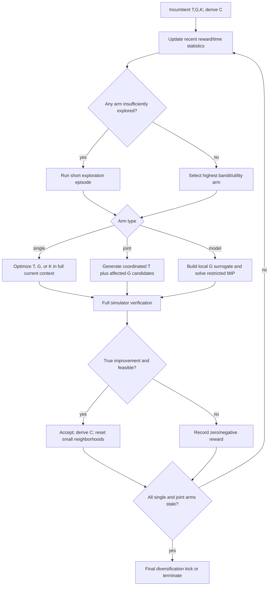

# Scheduling and Joint Optimization of Interdependent Combinatorial Components

## Executive summary

[SOURCE] The engineering problem in the task is a deterministic, strongly non-separable four-component optimization: a connected graph subset \(T\), a tightly constrained catalogue/slot selection \(G\), compatible ordered module lists \(K\), and a derived configuration \(C\). A one-component what-if costs about 0.007 s, a full evaluation 0.1–0.2 s, and a present alternating pass about 200 s. The existing loop adds a median 63% over construction, but successive passes show sharply diminishing gains (+26%, +7%, +4%, +2%, about +2%); the joint \(T+G\) kicks account for the largest share of accepted improvement. fileciteturn0file0

[DERIVED] Those timings imply that one 200 s pass corresponds nominally to about **28,571 cheap what-ifs**, or **1,000–2,000 full-evaluation times**, before optimizer overhead. One full evaluation costs the same wall-clock time as about **14–29 what-ifs**. The main opportunity is therefore not merely to reduce simulator calls, but to spend the existing 200 s on the component or joint neighborhood with the greatest current expected improvement per second.

[SOURCE] The closest problem-level literature is the **Travelling Thief Problem (TTP)** rather than ordinary decomposition. Mei, Li, and Yao's analysis explicitly finds that the component objectives cannot be independently optimized because of nonlinear coupling; on their 39-instance experiment, a whole-solution memetic algorithm significantly beat both standard and dynamically updated cooperative coevolution variants on every tested instance. Their defining observation is: **“it is impossible to decompose the problem into independent sub-problems”** because of the nonlinear objective coupling. Conditions: TTP combines a tour and picking plan; their experimental subset used 10–100 cities and 10–150 items, with 30 independent runs. citeturn16view3turn17view2turn17view3

[SOURCE] The strongest scheduling evidence comes from **contribution-aware cooperative coevolution**. Kazimipour et al. report that ordinary cooperative coevolution optimizes components in round-robin fashion and therefore gives them uniform resources even when contributions differ. Their bandit framework instead allocates computational resources according to observed contribution; their defining description is that it allocates resources **“proportional to their contributions towards improving the overall objective value.”** Conditions: their empirical evidence is for large-scale **continuous** optimization, so the resource-allocation principle transfers more directly than the numerical optimizer itself. citeturn18view0turn18view1turn18view4

[DERIVED] The seven techniques most likely to matter here, ranked by expected leverage, are:

| Technique | Why it is high-priority here | Cost in the task's units |
|---|---|---|
| [DERIVED] **Joint \(T,G\) neighborhoods before another full single-component pass** | [DERIVED] The task's own measurements say joint kicks already produce the largest share of accepted improvement; TTP gives independent evidence that coordinated tour-plus-packing changes can rescue moves that would be rejected when only one component changes. fileciteturn0file0 citeturn17view0 | [DERIVED] A batch of 16 fully evaluated joint proposals = **16 full evaluations = 1.6–3.2 s**; 32 proposals = **3.2–6.4 s**, only 0.8–3.2% of a 200 s pass. |
| [DERIVED] **Adaptive component scheduling by recent improvement per second, with forced exploration** | [DERIVED] Fixed round-robin is exactly the resource-allocation failure studied in contribution-aware CC. It also fits the observed strongly diminishing gains across passes. citeturn18view0turn18view2 | [DERIVED] **Budget-neutral** if it only reallocates the existing 200 s. Contribution scores can use already observed before/after objective values, so scoring itself can require **zero extra simulator calls**. |
| [DERIVED] **Exact/near-exact \(G\) sub-solve of a local linear surrogate, followed by true-simulator verification** | [DERIVED] \(G\) has only ten slot groups and explicit catalogue, covering, requirement and rarity constraints—precisely the kind of structure a small MIP/MMKP-style model can enforce exactly while the nonlinear black-box effect is approximated locally. Matheuristics support solving restricted MIPs inside a larger heuristic. citeturn28view0turn29view0 | [DERIVED] With \(N\) single-choice marginal probes: **\(0.007N\) s + MIP time + 0.1–0.2 s verification**. For 200–1,000 probes, simulator time is **1.4–7.0 s** plus one verification. |
| [DERIVED] **A mutual-staleness trigger, not “one pass kept nothing”** | [DERIVED] Component-local stagnation can coexist with profitable joint moves. Contribution-aware CC explicitly tracks current contribution/stagnation; TTP shows locally bad single-component moves can become good once the other component is coordinated. citeturn18view3turn17view0 | [DERIVED] **Zero additional evaluations** when based on logged improvement/time; an optional three-pair interaction probe over \(T,G,K\), at four full evaluations per pair, costs **12 full evaluations = 1.2–2.4 s**. |
| [DERIVED] **Context-consistent construction: never optimize \(G\) against an empty \(T\) unless empty \(T\) is deliberately being tested** | [SOURCE] CC evaluates a candidate subsolution by putting it into a context vector and evaluating the complete objective. TTP constructive methods often fix one component while constructing the other, but this is a methodological convention rather than evidence that an empty placeholder is good. citeturn18view1turn16view2 [DERIVED] The task's 7,330→4,296 example is direct evidence that its present empty-\(T\) context can point \(G\) in a misleading direction. fileciteturn0file0 | [DERIVED] One realistic baseline full evaluation costs **0.1–0.2 s**; the material cost is constructing the rough partner component, which is not given and therefore cannot be quantified from the task. |
| [DERIVED] **Trust-region/local-branching restriction around the incumbent when \(G\)'s surrogate is imperfect** | [SOURCE] Fischetti and Lodi use a general MIP solver tactically inside neighborhoods defined by local-branching inequalities; on 29 difficult MIPs, 23 produced significantly better incumbents under the local-branching scheme. Their defining phrase is **“explore effectively suitable solution subspaces”** using a black-box MIP solver. citeturn28view0 | [DERIVED] Cap each sub-solve at, for example, **2–10 s = 1–5% of one current pass**; this is a proposed engineering budget, not a literature-derived optimum. |
| [DERIVED] **Feasibility-first comparison plus targeted cross-component repair** | [SOURCE] Deb's rule avoids hand-tuned objective penalties; the defining rule is **“Any feasible solution is preferred to any infeasible solution.”** Among feasible solutions objective decides; among infeasible ones violation decides. Conditions: population-based search; nine constrained test problems including an engineering design case. citeturn23view0turn24view0 | [DERIVED] If violation measures are already available from a candidate evaluation, comparison adds **zero simulator cost**. A \(G\)-MIP repair can share the sub-solve above and needs one final **0.1–0.2 s** verification. |

[DERIVED] A practical interpretation of the current pass history is therefore: **do less compulsory round-robin work after early passes, spend more of the remaining budget on \(T\!\leftrightarrow\!G\) coordination and model-based \(G\) neighborhoods, and treat “all single blocks stale” as a reason to try a joint neighborhood—not immediately as termination.** This is a synthesis of the task's measurements with the CC, TTP, VNS and matheuristic evidence; none of the cited studies tests this exact four-component simulator. fileciteturn0file0 citeturn18view0turn17view0turn28view3turn28view0

## Names and literature

[SOURCE] **Travelling Thief / multi-component optimization is the strongest verified naming lead.** Mei, Li, and Yao formulate TTP specifically as an overall problem whose TSP and knapsack parts are interdependent, and report that a whole-problem memetic algorithm consistently beat their cooperative decompositions. Namazi et al. likewise describe TTP as a representative multi-component optimization problem with interacting components and classify existing solvers into constructive, fixed-tour, cooperative, full-encoding and hyper-heuristic approaches. citeturn16view3turn16view2

[SOURCE] **Technique/source:** Mei, Li & Yao, published online 2014, *Soft Computing* 20 (2016), 157–172, DOI 10.1007/s00500-014-1487-2. **Defining quote:** “the non-linear interdependence of the sub-problems” makes independent decomposition difficult. **Conditions:** their representative experimental subset contains 39 instances drawn from a 540-instance generator; \(n=10\)–100 cities and \(m=10\)–150 items occur in the benchmark generator, algorithms were run 30 times, and neighboring solutions counted as full fitness evaluations because no TSP-only/KP-only shortcut applies to the coupled objective. citeturn16view3turn17view2turn17view3

[SOURCE] This paper also supplies a particularly relevant negative result: the memetic whole-solution method beat standard CC and dynamically updated CC on all 39 selected instances; dynamically updating collaborators more often generally converged faster but obtained worse final solutions, which the authors attribute to stronger selection pressure and early trapping in local optima. citeturn17view3turn17view4

[SOURCE] **Cooperative coevolution is the strongest verified process-level analogue.** In CC, components are optimized separately but candidate subsolutions are evaluated in the context of the current values of all other components. Kazimipour et al. state that a candidate subsolution is inserted into a context vector and **the whole vector is evaluated by the original objective**; traditionally each component gets one epoch in a round-robin cycle. Conditions: the developed theory and experiments concern large-scale continuous optimization, not a catalogue/graph combinatorial problem. citeturn18view1

[SOURCE] **Interaction-aware decomposition is relevant, but less directly than scheduling.** Omidvar, Li, Mei & Yao's 2014 IEEE *Transactions on Evolutionary Computation* differential-grouping method attempts to **“uncover the underlying interaction structure”** and form groups with low between-group dependence. Its tests are numerical large-scale benchmark functions, and the paper documents sensitivity to its numerical interaction tolerance: for one case, a \(10^{-6}\) threshold caused many separable variables to be misclassified, and differential grouping was worse than CCVIL on six of twenty functions under that setting. citeturn28view5turn28view6

[DERIVED] In the present task, the macro-decomposition \(T/G/K/C\) is already known, so the most useful transfer from differential grouping is not “discover the four components.” It is the idea of measuring **which subparts within or across \(T,G,K\) interact strongly enough to merit a joint move**. That adaptation is not tested by Omidvar et al.; it is a derived discrete use of their interaction principle. citeturn28view5

[SOURCE] **Multidisciplinary design optimization is a valid architectural analogy, but not a direct algorithmic match.** Cramer, Dennis, Frank, Lewis & Shubin, *SIAM Journal on Optimization* 4(4), 1994, DOI 10.1137/0804044, define MDO as **“the coupling of two or more analysis disciplines with numerical optimization.”** Their IDF formulations emphasize reuse of specialized disciplinary analysis codes and trade-offs among disciplinary feasibility, computation and architecture. citeturn27view1

[SOURCE] The modern OpenMDAO description reinforces the mismatch: OpenMDAO is a framework for multidisciplinary analysis/optimization but is **primarily designed for gradient-based optimization** and places particular emphasis on efficient derivatives and coupled numerical models. That makes MDO terminology useful for describing coupled components and disciplinary consistency, while its principal numerical methods are not directly transferable to this discrete black-box problem. citeturn28view4

[UNVERIFIED] **Integer block-coordinate descent is a plausible and bibliographically relevant name, but the primary page could not be opened successfully during this run.** The identified paper is Jäger & Schöbel, “The blockwise coordinate descent method for integer programs,” *Mathematical Methods of Operations Research* 91 (2020), DOI 10.1007/s00186-019-00673-x. The retrieved bibliographic abstract says blockwise coordinate descent is used in discrete optimization under several names and studies convergence for integer programs; because the primary content fetch failed, no verified defining quotation or experimental conditions are asserted here. citeturn10search1

[UNVERIFIED] **Benders-/Lagrangian-style decomposition with coupling or complicating variables is mathematically relevant but a weaker fit to the implementation described in the task.** Such methods are strongest when the original model exposes algebraic coupling that can be dualized or represented in a master problem; the task instead exposes a deterministic black-box simulator. A primary source was identified during searching but not successfully opened, so this line is not used as evidence for the recommended algorithm.

[DERIVED] The additional literatures that fit the engineering mechanism more tightly than classical algebraic decomposition are **variable-neighborhood search** for changing neighborhood scale/order and **matheuristics/local branching** for embedding exact restricted solves inside heuristic search. Both operate naturally on discrete solutions and do not require the entire nonlinear simulator to be expressible as a global mathematical program. citeturn28view3turn28view0

**What the sources say.** [SOURCE] The verified literature supports three different descriptions of the problem: TTP/multi-component optimization describes the non-separable objective most closely; cooperative coevolution describes the alternating component-optimizer architecture; MDO describes the architectural idea of coupled specialist analyses. Interaction-aware CC provides tools for finding dependencies, but its evidence is continuous. MDO is mainly gradient-oriented, and the opened sources do not establish it as a discrete solver architecture for this case. citeturn16view3turn18view1turn28view5turn27view1turn28view4

## Scheduling the component optimizers

[SOURCE] The ordinary CC baseline is essentially the fixed-loop policy in the task: optimize one component for an epoch, update its context, move to the next, and repeat. Kazimipour et al.'s description says that traditional CC gives each component one epoch and completes a cycle only after every subproblem has received one. Their abstract highlights the failure mode: uniform allocation is inefficient when component contributions are unequal. citeturn18view0turn18view1

[SOURCE] **Bandit-Based Cooperative Coevolution — Kazimipour et al., 2019, *Applied Soft Computing*, DOI 10.1016/j.asoc.2018.12.007. Defining quote:** it allocates resources **“proportional to their contributions towards improving the overall objective value.”** Conditions: large-scale continuous optimization; an objective/context-vector evaluation scores the effect of a component; the component-choice problem is treated as a dynamic credit-assignment problem because component rewards may change during search. citeturn18view0turn18view4

[SOURCE] This matters for “who moves when” because the authors explicitly describe the reward distributions as nonstationary: the value of optimizing a component changes with the optimization state, so a scheduler must balance re-sampling alternatives against repeatedly using the currently best component. citeturn18view4

[SOURCE] Earlier contribution-based schemes reviewed in the same opened paper give concrete stopping granularities. CBCC1 gives the currently most contributing component one additional epoch; CBCC2 keeps optimizing that component **until it stops improving**; CBCC3 emphasizes its most recent contribution rather than accumulating evidence forever. citeturn18view2

[SOURCE] The same literature describes a mutual-state trigger in CCFR: after exploitation of the currently rewarding component, **when estimated component contributions converge to the same level**, it returns to exploration; it also sets a component's contribution to zero when a stagnation detector fires. This is reported in Kazimipour et al.'s related-work section, not verified here from the original CCFR paper. citeturn18view3

[SOURCE] A second, more fine-grained allocation line is Ren et al.'s FCRA, which uses a single optimizer iteration as its allocation unit and selects the subproblem judged most likely to yield the largest next contribution. The retrieved arXiv record states that the preprint was withdrawn; although a later journal publication exists in the bibliographic record, the opened record itself must therefore be treated cautiously. Its defining sentence says FCRA takes **“a single iteration as a basic CRA unit.”** citeturn18view5

[DERIVED] For this task, an immediately measurable reward is

\[
r_i=\frac{\max(0,F_{\rm after}-F_{\rm before})}{\text{seconds spent in component }i},
\]

with \(i\in\{T,G,K,TG\text{-joint},\ldots\}\). Using improvement per wall-clock second rather than raw improvement matters because a \(G\) exact sub-solve, a \(T\) neighborhood and a \(K\) move need not consume equal time. This reward definition is derived; BBCC supplies the contribution-allocation principle, not this particular formula. citeturn18view0

[DERIVED] The task's observed pass sequence makes stale detection especially important. At 200 s/pass, the reported nominal gain rates fall from \(26/200=0.13\) percentage points per second on the first reported pass to \(7/200=0.035\), \(4/200=0.020\), and \(2/200=0.010\) if the percentages are treated purely as displayed pass gains. Because the task does not specify whether those percentages all use the same denominator, these numbers are only descriptive rates and should not be interpreted as additive objective derivatives. fileciteturn0file0

[DERIVED] “Mutually stale” should be distinguished from “each single block failed once.” A measurable state is: all single-block optimizers have recently produced reward below a threshold **and** the uncertainty/recency term forces at least one fresh probe of each block. If all single-block rewards are low but a \(T,G\) joint arm remains productive, the solution is block-stale but not jointly stale.

[DERIVED] A cheap component-level interaction diagnostic is a discrete cross-difference. For components \(i,j\), create one legal perturbation \(i'\) and one \(j'\), evaluate
\[
I_{ij}=\left|F(i',j')-F(i',j)-F(i,j')+F(i,j)\right|.
\]
Four full evaluations cost 0.4–0.8 s per pair; testing \(TG,TK,GK\) costs 1.2–2.4 s. A large \(I_{ij}\) means the observed effects are not additive in that local context. This exact diagnostic is a derived discrete analogue of interaction testing, not an algorithm benchmarked in the cited CC papers. citeturn28view5

[SOURCE] There is also a caution against switching **too** rapidly. In Mei et al.'s TTP experiment, dynamic CC updated collaborators after the first subproblem so the next subproblem immediately saw the changed partner; this converged faster but generally finished worse than standard CC. The authors attribute the outcome to premature local trapping under strong selection pressure. citeturn17view3turn17view4

[DERIVED] Thus “adaptive” should not mean “switch after every accepted micro-move.” The literature points to an intermediate grain: bounded epochs/slices, recent reward measurement, and periodic exploration. That is materially different from both a fixed round-robin pass and unrestricted “optimize one block to completion.”

**What the sources say.** [SOURCE] Fixed round-robin is the conventional CC baseline; contribution-aware CC gives more effort to components producing greater current improvement, and bandit formulations explicitly account for changing rewards. Some schemes use one epoch as a unit, others exploit a component until no further improvement, while TTP results warn that overly frequent collaborator replacement can accelerate convergence yet worsen the final local optimum. Most quantitative scheduling evidence is from continuous large-scale optimization rather than combinatorial multi-component simulators. citeturn18view0turn18view2turn18view4turn17view4

## Joint moves

[SOURCE] TTP provides unusually direct evidence for a move analogous to \(T+G\). A normal 2-opt move changes a tour segment without modifying the collection plan. Namazi et al. show why that can make a potentially useful structural move look bad: after reversal, item timing changes and the unmodified packing decision can reduce overall gain. citeturn17view0

[SOURCE] **Profit Guided Coordination Heuristic — Namazi et al., 2019/2020, “A Cooperative Coordination Solver for Travelling Thief Problems,” arXiv:1911.03124. Defining quote:** **“adjusting the collection plan in coordination with reversal of the segment.”** The operator reverses a tour segment, removes relatively unattractive items that become early in the reversed segment, then admits attractive unselected items later in it, subject to weight control. citeturn17view0

[SOURCE] Crucially, the paired parts are **not chosen arbitrarily**. The changed tour segment determines the affected packing region, and profitability boundaries from the old solution identify which selected/unselected items should be reconsidered. This is stronger guidance than “randomly perturb two components.” citeturn17view0

[SOURCE] Namazi et al.'s experimental conditions are substantial: three 20-instance TTP categories, instances from 76 to 33,810 cities, 1/5/10 items per city depending on category, ten independent runs, a normal ten-minute timeout, 2 GB memory and a 2.66 GHz Xeon X5650. They compare standard 2-opt/bit-flip combinations with PGCH and boundary bit-flip using relative deviation index. citeturn17view1

[SOURCE] Mei et al. give complementary negative evidence. Their whole-solution memetic method uses the union of tour and picking-plan neighborhoods and significantly outperformed separate CC variants across all 39 selected TTP instances under similar evaluation budgets. The authors explicitly interpret this as evidence that accounting for component interdependence matters. citeturn16view5turn17view3

[SOURCE] **Variable Neighborhood Search — Hansen & Mladenović, 2001, *European Journal of Operational Research* 130(3):449–467. Defining quote:** **“Systematic change of neighborhood”** yields the VNS metaheuristic. Conditions: a general framework for combinatorial and global optimization; the paper presents basic VNS and larger-instance extensions including variable-neighborhood decomposition search. citeturn28view3

[DERIVED] VNS does not by itself tell the present solver that \(T\) should be paired with exactly two \(G\) slots. Its transferable contribution is an **ordered family of neighborhoods**. For example:

\[
N_1=T\text{-only},\quad
N_2=G\text{-only},\quad
N_3=K\text{-only},\quad
N_4=(T,G_{\text{affected}}),\quad
N_5=(T,G_{\text{affected}},K_{\text{related}}),
\]

with escalation when smaller neighborhoods stop producing reward and reset to small neighborhoods after improvement. This particular ordering is derived from the task structure and its measured joint-kick success. fileciteturn0file0 citeturn28view3

[DERIVED] The important design question is therefore **which \(G\) slots are “affected” by a \(T\) change**. Three measurable choices are available: slots whose marginal values change most under the proposed \(T\) perturbation; slots that are active in currently tight covering/requirement constraints; or slots implicated by recent successful joint moves. The first directly measures coupling, the second measures feasibility leverage, and the third exploits empirical search history.

[DERIVED] With 0.1–0.2 s full evaluations, joint neighborhoods can be tested much more cheaply than a complete 200 s pass. Sixteen coordinated candidates cost 1.6–3.2 s of simulator time; 64 cost 6.4–12.8 s. Therefore even fairly aggressive joint probing can occupy a small fraction of one current pass unless candidate generation itself dominates.

[SOURCE] Local branching provides a second mechanism for compound moves: instead of hand-enumerating a multi-component neighborhood, add a linear inequality limiting Hamming distance from the incumbent and let a MIP solver explore combinations within that region. Fischetti & Lodi's primary 2003 study used CPLEX 7.0 and found significantly better incumbents in 23 of 29 difficult MIP cases than the underlying solver alone. citeturn28view0

[DERIVED] For \(G\), a Hamming-distance restriction can naturally mean “change at most two slots”; for a joint \(T,G\) model it could mean “permit one bounded \(T\) structural perturbation plus at most two \(G\)-slot replacements.” Because the simulator objective is not globally linear, this would still require a surrogate or candidate-generation model and final black-box verification.

**What the sources say.** [SOURCE] TTP gives direct evidence that a move affecting one component can be wrongly rejected if its strongly coupled partner is frozen, and its PGCH operator chooses companion changes from the region structurally affected by the first move. VNS supplies a general mechanism for escalating and sequencing neighborhoods, while local branching lets a MIP solver search a bounded compound neighborhood. None of the opened papers provides a universal formula for selecting the best component pair in an arbitrary black-box combinatorial system. citeturn17view0turn28view3turn28view0

## Construction order

[SOURCE] Construction order is clearly present in TTP algorithms, but **controlled evidence isolating order itself is much weaker than the evidence for joint moves**. Namazi et al.'s review of constructive TTP methods says a tour is commonly constructed first, kept fixed, and then a packing plan is generated. citeturn16view2

[SOURCE] The same CoCo paper describes component initialization under deliberately simplified partner assumptions: its decomposition can initialize a tour while assuming an empty packing plan, or initialize packing under an idealized travel context. This demonstrates that cheap placeholders are used in the literature; it does **not** demonstrate that an empty placeholder is superior to a realistic incumbent. citeturn6view2

[SOURCE] **Context-vector cooperative coevolution provides the cleaner general principle.** A candidate for one component is evaluated by merging it with values from the other components and evaluating the whole original objective. Defining quote: a candidate **“must be plugged into the context vector”** before whole-objective evaluation. Conditions: large-scale continuous CC. citeturn18view1

[DERIVED] The task's own construction pathology is fully consistent with this issue: \(G\) is optimized against an empty \(T\), and in one cited case value falls from 7,330 to 4,296 before later \(T\) construction catches up. The absolute fall is \(3,034\), or \(3,034/7,330\approx41.4\%\) relative to 7,330. This does not prove a different initialization will improve the final optimum, but it proves that the chosen intermediate context can reverse the apparent direction of improvement. fileciteturn0file0

[SOURCE] Mei et al.'s collaborator-update experiment also shows that context timing is subtle. Standard CC waits until both subproblems have been processed before replacing collaborators; dynamic CC lets the second subproblem immediately use the newly updated first component. Dynamic updating converged faster but usually produced inferior final results. citeturn16view5turn17view3

[UNVERIFIED] **Iterated greedy / destroy-and-reconstruct is an important construction lead but its primary publisher page did not open successfully in this research run.** The identified source is Ruiz & Stützle, “A simple and effective iterated greedy algorithm for the permutation flowshop scheduling problem,” *European Journal of Operational Research* (2007), DOI 10.1016/j.ejor.2005.12.009. The retrieved bibliographic abstract describes repeated destruction followed by greedy reconstruction and local search; because the primary page fetch failed, it is not used as verified comparative evidence here. citeturn11search4

[UNVERIFIED] A packing-first TTP thesis/algorithm line was also found, providing a counterexample to the usual tour-first convention, but no opened peer-reviewed primary comparison isolating “tour first versus packing first” was found in this search. Consequently, no general claim that \(T\)-first, \(G\)-first or \(K\)-first is empirically best is justified.

[DERIVED] The correct experiment for this particular solver is therefore small and direct: hold the total construction budget fixed and compare at least \(K\!\to\!G\!\to\!T\), \(K\!\to\!T\!\to\!G\), \(T\!\to\!G\!\to\!K\), and the existing order, always evaluating a component against the best **realistic current completion** of the others. Record construction objective, objective after a fixed 200 s improvement budget, wall time and component changes retained. This experimental design is derived rather than a result from the cited literature.

[DERIVED] A second controlled factor should be **partner context**: empty placeholder, cheap realistic default, and current incumbent completion. Separating “order” from “context quality” matters because the current algorithm changes both simultaneously when it builds \(G\) against empty \(T\).

**What the sources say.** [SOURCE] TTP algorithms commonly construct one component before another, and some explicitly use simplified or empty partner assumptions. Cooperative coevolution instead evaluates a partial solution in a full context. The opened literature does not establish a general optimal construction order, and Mei et al.'s update-frequency results show that fresher context is not automatically better if it induces excessively greedy convergence. citeturn16view2turn18view1turn17view4

## Exact or model-based sub-solvers inside the loop

[SOURCE] The generic OR name for placing an exact mathematical-programming solver inside a heuristic search is **matheuristics**; local branching is one of the canonical examples. Fischetti & Lodi, *Mathematical Programming* 98 (2003), 23–47, use a MIP solver as a tactical search engine inside strategically chosen neighborhoods. Their defining phrase is a **“generic MIP solver as a black-box ‘tactical’ tool.”** Conditions: general difficult MIPs; CPLEX 7.0; 29 test cases; better incumbents in 23 cases. citeturn28view0

[SOURCE] \(G\)'s structure is especially close to a **multiple-choice multidimensional knapsack** when each slot/group must make one discrete selection and several aggregate resource/cover constraints couple the groups. Mansini & Zanotti, 2020, *INFORMS Journal on Computing* 32(4):1061–1079, DOI 10.1287/ijoc.2019.0909, define MMKP as selecting exactly one item per group while respecting several resource availabilities and maximizing total profit. citeturn29view0

[SOURCE] **Core-based exact MMKP — defining quote:** **“exactly solves subproblems of increasing size”** through recursive variable fixing until an optimality condition is met. Conditions: benchmark MMKP instances; their algorithm closed ten previously open benchmark instances to optimality and improved best-known values for many others. The authors report that their method found, within three minutes, better solutions than Gurobi found in one hour on the tested benchmark setting. citeturn29view0

[SOURCE] That performance result should not be read as a general solver ranking. It is one algorithm/problem-class comparison from 2020, not evidence that a specialized MMKP algorithm always beats modern Gurobi or another MIP solver. citeturn29view0

[SOURCE] **Kernel search is a directly relevant matheuristic alternative.** Lamanna, Mansini & Zanotti's 2022 EJOR method repeatedly solves restricted mixed-integer subproblems. Defining quote: it uses **“a sequence of restricted mixed-integer subproblems.”** Conditions: MMKP benchmarks; 276 open and 17 closed instances are reported; the method improved the known value on 185 of 276 open instances and found 8 of 17 known optima, while comparison exact methods were allowed up to five hours. citeturn28view2

[UNVERIFIED] The classic one-dimensional multiple-choice knapsack reference found was David Pisinger, “A minimal algorithm for the multiple-choice knapsack problem,” *European Journal of Operational Research* 83(2), 1995, 394–410, DOI 10.1016/0377-2217(95)00015-I. The retrieved record describes a dynamic-programming/exact method with class reduction, but the DOI page failed to open, so exact instance-size and runtime claims from that paper are not reproduced.

[DERIVED] \(G\) is not exactly a textbook MMKP. Its three \(\ge75\) covering constraints point in the opposite inequality direction from ordinary capacity constraints; requirements can depend on selected items; rarity rules add side constraints; and more than one catalogue line may be selected within a slot. Nevertheless, all of these are straightforward 0–1 linear constraints **if their logical requirements can be algebraically expressed**, making a small MIP a more natural representation than forcing the problem into a pure MMKP algorithm.

[DERIVED] The real complication is the objective. With \(T,K\) held fixed and \(C\) re-derived, the simulator's true value \(F(G;T,K,C(G))\) is still nonlinear and black-box. An exact MIP can therefore be exact only for a **surrogate**, not automatically for the true simulator objective.

[DERIVED] A local linear surrogate around incumbent \(G^0\) can be built by cheap what-ifs. For candidate line/choice \(j\), estimate

\[
c_j \approx F(G^0\text{ with }j;T,K)-F(G^0;T,K).
\]

Then solve

\[
\max_x \sum_j c_jx_j
\]

subject to slot selection, the three cover sums, rarity restrictions, conditional requirements and a Hamming/trust-region bound. The candidate returned by the MIP is always evaluated by the real simulator before acceptance.

[DERIVED] With 500 marginal probes, coefficient acquisition costs \(500\times0.007=3.5\) s; one real verification adds 0.1–0.2 s. Even allowing 5 s to solve the MIP gives roughly 8.6–8.7 s, about 4.3% of a current 200 s pass. With 1,000 probes and a 10 s MIP cap, the corresponding rough total is 17.1–17.2 s, about 8.6% of a pass. Actual model-construction and cache costs are not supplied by the task. fileciteturn0file0

[DERIVED] Pair interactions can be incorporated selectively. For choices \(i,j\) suspected to interact, estimate a quadratic correction
\[
q_{ij}=F(i,j)-F(i)-F(j)+F_0,
\]
then either add linearized auxiliary variables \(y_{ij}=x_ix_j\) or keep only a small list of high-magnitude interactions. This avoids attempting to model every black-box interaction and keeps the subproblem small.

[DERIVED] “How far to trust the result” has a clean operational answer: bound the number of slot changes initially, for example \(\sum_s [G_s\neq G_s^0]\le2\). If the predicted and realized improvement agree, enlarge the radius; if the surrogate predicts improvement but the simulator rejects it, shrink the radius and refresh coefficients. This is a derived trust-region/local-branching policy inspired by Fischetti & Lodi, not a theorem about this simulator. citeturn28view0

[DERIVED] Verification should never be delegated to the surrogate. A sub-solve produces a proposal; the deterministic full simulator determines whether the actual objective improved and whether any derived-\(C\) consequences preserve feasibility. Thus a solver's reported MIP “optimality” means optimality for the frozen local model only.

[SOURCE] Current solver documentation supports reproducible time/gap caps, though no opened source establishes a universal fastest solver for this small-\(G\) workload.

| Solver | [SOURCE] Relevant controls in opened/official documentation | [DERIVED] Recommended experiment setting for \(G\) | Evidence status |
|---|---|---|---|
| Gurobi | [SOURCE] Official parameter material exposes `TimeLimit`, `Threads`, and tuning/seed controls; it warns that a wall-clock `TimeLimit` can introduce run-to-run differences and documents deterministic work-style limits. citeturn20search2 | [DERIVED] Pin one thread and seed; log version, runtime, incumbent, bound and gap; compare fixed time and fixed work if available. | [SOURCE] Direct page reopen returned HTTP 429, although the official documentation search result was retrieved. |
| HiGHS | [SOURCE] Official docs expose `time_limit`, `threads`, `random_seed`, `mip_rel_gap` and `mip_abs_gap`; default MIP relative gap shown is \(10^{-4}\). citeturn29view2 | [DERIVED] Use one thread, fixed seed, explicit relative gap, and 2/5/10 s caps. | [SOURCE] Successfully opened official documentation. |
| SCIP | [SOURCE] Official SCIP 10.0.2 parameters include `limits/time`, `limits/gap`, node/stall limits, and deterministic versus opportunistic parallel mode; the current parameter page reports deterministic parallel mode as the default setting. citeturn21search0turn29view3 | [DERIVED] Start single-threaded or deterministic, cap time and gap explicitly, preserve parameter file in experiment artifacts. | [SOURCE] Successfully opened official documentation. |
| IBM CPLEX | [SOURCE] The official 22.1.2 parameter index was opened; separate retrieved IBM documentation lists time, gap, random-seed and thread controls. citeturn29view4turn20search3 | [DERIVED] Same one-thread/fixed-seed/time-gap protocol to make the comparison about the model, not uncontrolled parallelism. | [SOURCE] Official parameter material retrieved, though the opened list page itself exposed little detail in parsed text. |

[DERIVED] For solver benchmarking, the meaningful metrics are not only solver runtime. Record **surrogate objective, true full-simulator objective before/after, feasibility, number of changed slots, MIP incumbent/bound/gap, MIP nodes, coefficient-probe count, solve time, verification time, and acceptance rate**. This distinguishes “solver solved the surrogate well” from “surrogate produced useful real improvements.”

[SOURCE] The literature benchmark evidence available from the opened sources is summarized below.

| Study/dataset | [SOURCE] Scale/conditions | [SOURCE] Metric | [SOURCE] Runtime protocol / result |
|---|---|---|---|
| Mei–Li–Yao TTP | [SOURCE] 39 selected TTP instances; generator ranges include 10–100 cities and 10–150 items; 30 runs. citeturn17view2 | [SOURCE] mean/std, best benefit, fitness evaluations, significance test. citeturn17view3 | [SOURCE] Evaluation-budget matching; whole-solution MA significantly better on all 39 selected cases. citeturn17view3 |
| Namazi et al. CoCo TTP | [SOURCE] 60 instances in three categories; 76–33,810 cities; ten runs. citeturn17view1 | [SOURCE] overall gain and relative deviation index. citeturn17view1 | [SOURCE] normally ten minutes/run on Xeon X5650, 2 GB memory. citeturn17view1 |
| Mansini–Zanotti MMKP | [SOURCE] published benchmark instances including previously open cases. citeturn29view0 | [SOURCE] optimality/best-known objective. | [SOURCE] Ten open cases closed; on the study's benchmark, specialized method found better solutions in 3 min than Gurobi in 1 h. citeturn29view0 |
| Lamanna–Mansini–Zanotti MMKP | [SOURCE] 276 open + 17 closed benchmark instances. citeturn28view2 | [SOURCE] best-known improvement, optimum hits, deviation. | [SOURCE] 185/276 open values improved; 8/17 closed optima obtained; comparison with exact methods running five hours. citeturn28view2 |
| Fischetti–Lodi local branching | [SOURCE] 29 difficult general MIPs, CPLEX 7.0. citeturn28view0 | [SOURCE] incumbent quality under restricted-neighborhood strategy. | [SOURCE] significantly better incumbents in 23/29 cases. citeturn28view0 |

**What the sources say.** [SOURCE] Exact and restricted MIP sub-solves are well established inside heuristics, and MMKP has both exact and matheuristic algorithms capable of substantial benchmark performance. The sources do not show how to make this task's nonlinear simulator objective exactly linear. Therefore an exact \(G\) MIP based on sampled marginal values would be exact only for its surrogate; acceptance under the real simulator remains necessary. citeturn28view0turn29view0turn28view2

## Constraint handling across components

[SOURCE] **Deb's feasibility rules — Kalyanmoy Deb, 2000, *Computer Methods in Applied Mechanics and Engineering* 186(2–4):311–338, DOI 10.1016/S0045-7825(99)00389-8. Defining quote:** **“Any feasible solution is preferred to any infeasible solution.”** The other two rules use objective value to compare two feasible solutions and total constraint violation to compare two infeasible ones. citeturn22view0turn23view0turn24view0

[SOURCE] Conditions in Deb's original study matter: it is a population-based evolutionary method; it was tested on nine constrained problems including an engineering design problem. The paper's welded-beam experiment also demonstrates a failure of poorly tuned static penalties: with a small penalty parameter, some runs never produced a feasible solution, whereas high penalties could drive premature convergence far from the constrained optimum. citeturn23view0

[DERIVED] Applied to this task, Deb's rule naturally compares complete \(T,G,K,C\) solutions, not partial components. A proposal that increases the black-box objective but violates a cross-component threshold loses to a feasible incumbent; among infeasible proposals, the comparison can use normalized total shortfall such as
\[
v(x)=\sum_r\max(0,75-\text{cover}_r(x))/75+\text{requirement shortfalls}+\text{rarity violations}.
\]
The exact normalization is derived and should be recorded because it controls comparisons among infeasible candidates.

[SOURCE] **Stochastic ranking — Runarsson & Yao, 2000, *IEEE Transactions on Evolutionary Computation* 4(3), DOI 10.1109/4235.873238. Defining quote:** it aims to **“balance objective and penalty functions stochastically.”** The paper was motivated by the difficulty of choosing a fixed trade-off between objective quality and violation, and reports tests on a set of constrained benchmark problems. The IEEE page itself triggered an access challenge, but an author/publication copy and bibliographic record were retrieved. citeturn29view6turn26search17

[DERIVED] Stochastic ranking is relevant when temporary infeasibility is useful—for example, one component can temporarily undersupply a global threshold that another component can later repair. Unlike Deb's strict feasibility dominance, stochastic ranking sometimes lets a high-objective infeasible point outrank a feasible or less-violating alternative. That can preserve pathways through infeasible intermediate states, but also means feasibility is not monotonically protected.

[SOURCE] **ε-constrained evolutionary handling — Takahama & Sakai, 2006, IEEE CEC, DOI 10.1109/CEC.2006.1688283.** The retrieved primary bibliographic material describes applying an ε-constrained comparison method with differential evolution, gradient-based mutation and feasible elites on 24 constrained test problems, including problems with equality constraints and multimodality. citeturn26search0

[UNVERIFIED] The primary full text for the ε-constrained paper could not be successfully opened during this run, so its detailed ε update formula and exact parameter schedule are not reproduced. The bibliographic abstract indicates that ε permits controlled tolerance of violation early in search and tightens constrained selection, but no exact schedule is asserted here.

[DERIVED] For this combinatorial setting an ε rule can be implemented without copying a continuous-EA operator: permit total normalized global-threshold violation \(v(x)\le\epsilon_t\) during a bounded construction/repair phase, compare such candidates by true objective, and drive \(\epsilon_t\to0\) before a solution becomes an incumbent eligible for final acceptance. This is a derived discrete adaptation.

[SOURCE] General MIP **repair by restricted exact optimization** is supported by the same matheuristic literature used above: local branching lets the solver search a neighborhood while enforcing all modeled constraints, and MMKP kernel search has a first phase explicitly focused on obtaining feasibility before later solution-quality refinement. citeturn28view0turn28view2

[DERIVED] This is especially natural for a threshold that “can be satisfied by any component.” Instead of assigning each component an arbitrary quota, model the global requirement once:
\[
a_T(T)+a_G(G)+a_K(K)\ge75.
\]
When a candidate violates it, freeze most of the incumbent and ask a small exact repair model to find the cheapest legal combination of changes in whichever modeled components can contribute. Where \(T\) or \(K\) is too difficult to model exactly, expose a small menu of precomputed feasible deltas as repair choices and let the MIP choose among them.

[DERIVED] A useful hierarchy follows from the evidence: hard structural impossibilities—connectivity, catalogue legality, incompatible modules—should normally be prevented or repaired immediately; globally redistributable quantitative thresholds can be allowed temporary controlled violation during search; final incumbents should always be checked with the real deterministic simulator.

**What the sources say.** [SOURCE] Deb avoids penalty-weight tuning by comparing feasibility, objective and violation lexicographically in different cases; stochastic ranking deliberately softens that ordering; ε-constrained methods make tolerated violation explicit and time-varying; exact restricted sub-solves can serve as repair operators when the relevant constraints are representable. The opened sources do not establish one constraint-handling method as uniformly best across problem classes. citeturn23view0turn29view6turn26search0turn28view0

## Reproducible synthesis and appendix

**Technique comparison**

| Technique | What it adds over the fixed alternating loop | What it needs | Primary source |
|---|---|---|---|
| [SOURCE/DERIVED] Bandit/contribution scheduler | [DERIVED] Replaces equal \(T,G,K\) time with reward-sensitive allocation while retaining periodic exploration. | [DERIVED] Before/after objective, wall time, recency per component. | [SOURCE] Kazimipour et al., 2019, *Applied Soft Computing*, DOI 10.1016/j.asoc.2018.12.007. citeturn18view0 |
| [SOURCE/DERIVED] Context-vector evaluation | [DERIVED] Makes every partial move answer “is it good with the current other components?” rather than against an artificial empty partner. | [DERIVED] A realistic current completion of other components. | [SOURCE] Kazimipour et al.; CC framework description. citeturn18view1 |
| [SOURCE/DERIVED] Interaction-aware grouping/probing | [DERIVED] Identifies which subparts should be optimized jointly rather than assuming component boundaries imply weak coupling. | [DERIVED] Paired perturbation evaluations or interaction statistics. | [SOURCE] Omidvar et al., 2014, IEEE TEC. citeturn28view5 |
| [SOURCE/DERIVED] PGCH-style compound neighborhood | [DERIVED] Changes \(T\) and the \(G\) decisions affected by the \(T\) move in one acceptance decision. | [DERIVED] Map from \(T\) perturbation to affected \(G\) choices; real full evaluation. | [SOURCE] Namazi et al., arXiv:1911.03124. citeturn17view0 |
| [SOURCE/DERIVED] VNS/VND escalation | [DERIVED] Moves from cheap single-block neighborhoods to broader joint neighborhoods after stagnation. | [DERIVED] Ordered neighborhood family and reset rule. | [SOURCE] Hansen & Mladenović, 2001, EJOR 130:449–467. citeturn28view3 |
| [SOURCE/DERIVED] Local branching | [DERIVED] Lets a MIP solver enumerate combinations in a bounded neighborhood instead of one handcrafted move at a time. | [DERIVED] Linear local model plus incumbent/Hamming radius. | [SOURCE] Fischetti & Lodi, 2003, *Mathematical Programming* 98:23–47. citeturn28view0 |
| [SOURCE/DERIVED] Exact/core-based \(G\) solve | [DERIVED] Enforces slot/cover/rarity/requirement constraints globally inside \(G\), rather than re-solving one slot greedily. | [DERIVED] Linear surrogate coefficients and explicit constraints. | [SOURCE] Mansini & Zanotti, 2020, DOI 10.1287/ijoc.2019.0909. citeturn29view0 |
| [SOURCE/DERIVED] Kernel-search \(G\) matheuristic | [DERIVED] Uses a sequence of smaller restricted MIPs when a monolithic \(G\) solve is too slow. | [DERIVED] Candidate core/ranking and time cap. | [SOURCE] Lamanna, Mansini & Zanotti, 2022. citeturn28view2 |
| [SOURCE/DERIVED] Deb feasibility comparison | [DERIVED] Removes ad hoc objective penalties and cleanly orders feasible/infeasible candidates. | [DERIVED] Consistent constraint-violation measure. | [SOURCE] Deb, 2000, DOI 10.1016/S0045-7825(99)00389-8. citeturn23view0 |
| [SOURCE/DERIVED] Stochastic/ε feasibility relaxation | [DERIVED] Allows temporary threshold shortfalls when later components may compensate. | [DERIVED] Violation metric, relaxation schedule/probability, final feasibility check. | [SOURCE] Runarsson & Yao 2000; Takahama & Sakai 2006. citeturn29view6turn26search0 |

**Proposed experiment protocol**

[DERIVED] A fair engineering comparison should begin every method from the same saved incumbent states, use the same total wall-clock budget, and report both objective-versus-seconds and objective-versus-full-evaluation count. Simulator determinism does not imply solver determinism, so exact-solver version, seed, thread count, gap and time/work limit must also be logged. Official HiGHS and SCIP documentation exposes these controls; Gurobi's documentation likewise exposes time/thread controls and warns about time-limit nondeterminism. citeturn29view2turn29view3turn20search2

[DERIVED] At minimum, test the current fixed loop against four ablations: adaptive scheduling alone; joint \(T,G\) neighborhoods alone; exact/surrogate \(G\) alone; and all three combined. For each, use several independent optimizer seeds even though the simulator is deterministic, because neighborhood ordering, MIP search and adaptive scheduling can still be stochastic.

[DERIVED] The primary metrics should be final true objective after a fixed wall time, time to reach specified objective targets, accepted improvement per second by arm, full/what-if evaluation count, feasibility failures, joint-move acceptance rate, surrogate prediction error, and percentage of time spent in \(T,G,K\), joint moves and MIP. This directly tests the scheduling hypothesis rather than only comparing final scores.

[DERIVED] A useful flow is:



**Effort-allocation rule over components**

[DERIVED] The following is a 21-line derived scheduler; it is inspired by contribution-aware/bandit CC but uses wall-clock-normalized rewards for this task. citeturn18view0turn18view4

```text
arms ← {T, G, K, TG_joint, G_MIP}
for each arm a:
    mean_reward[a] ← 0
    pulls[a] ← 0
    last_used[a] ← -∞
while wall_time < budget:
    stale ← arms with now - last_used[a] ≥ exploration_interval
    if stale is not empty:
        a ← stalest arm in stale
    else:
        for each arm a:
            bonus[a] ← c * sqrt(log(1 + total_pulls) / (1 + pulls[a]))
            score[a] ← mean_reward[a] + bonus[a]
        a ← argmax score[a]
    f0 ← true objective of incumbent
    t0 ← clock()
    candidate ← run_one_bounded_episode(a, incumbent)
    candidate ← derive_C_and_full_verify(candidate)
    elapsed ← clock() - t0
    reward ← max(0, candidate.value - f0) / max(elapsed, εtime)
    update_recency_weighted_mean(mean_reward[a], reward)
    pulls[a] ← pulls[a] + 1
    last_used[a] ← now
    if candidate is feasible and candidate.value > f0:
        incumbent ← candidate
    if all arms recently below stale_threshold:
        break to diversification_or_termination
```

[DERIVED] The `exploration_interval`, confidence constant \(c\), recency weighting and stale threshold must be tuned on held-out instances; the cited literature does not supply values for this combinatorial problem.

**Joint \(T,G\) move**

[DERIVED] This 20-line operator applies the TTP principle that the first component change defines which decisions in the second component should be reconsidered. citeturn17view0

```text
input incumbent (T, G, K), joint_candidate_budget B
choose a legal T perturbation p from a diversified T neighborhood
T′ ← apply p while preserving root membership and connectivity
affected ← rank G slots by changed marginal value under T′
affected ← union(affected, slots active in tight global constraints)
choose the top one or two affected slots
Gseed ← copy G
for each chosen slot s:
    enumerate or shortlist legal replacements for s
    score each replacement with cheap what-if evaluation
build a small joint G repair model over shortlisted replacements
enforce covering sums, rarity limits, and conditional requirements
optionally limit changes to at most two G slots
G′ ← solve repair model under a short time limit
C′ ← derive configuration from T′, G′, K
v′ ← run full deterministic simulator on (T′, G′, K, C′)
if all constraints are feasible and v′ > incumbent.value:
    accept (T′, G′, K, C′)
    record which T feature and G slots interacted successfully
else:
    reject but update interaction statistics
return incumbent
```

[DERIVED] With 20 cheap slot alternatives and one final evaluation, a single such proposal costs roughly \(20(0.007)+0.1\)–\(0.2=0.24\)–0.34 s plus the small repair solve. Ten proposals are therefore of order a few seconds rather than one 200 s pass, absent unexpectedly expensive MIP work. fileciteturn0file0

**Exact \(G\) sub-solve with local linearization and verification**

[DERIVED] This 24-line sketch makes the distinction between exactness of the surrogate and validity under the real simulator explicit. It combines marginal probing, a trust-region restriction, exact MIP constraints and deterministic black-box verification. citeturn28view0turn29view0

```text
input incumbent (T, G0, K), trust radius r, MIP time limit τ
C0 ← derive_C(T, G0, K)
f0 ← full_simulator(T, G0, K, C0)
for each admissible catalogue decision j considered in G:
    Gj ← make the minimal legal single-decision substitution around G0
    cj ← cheap_what_if(T, Gj, K) - cheap_what_if(T, G0, K)
create binary variables xj for catalogue decisions
add exact slot/cardinality constraints
add all three covering constraints
add rarity constraints
add linearized logical/requirement constraints
add trust constraint: number_of_changed_slots(x, G0) ≤ r
maximize Σj cj xj
set solver time limit τ, fixed threads, seed and MIP gap
x* ← solve the MIP
if no feasible MIP candidate exists:
    return G0
G* ← decode x*
C* ← derive_C(T, G*, K)
f* ← full_simulator(T, G*, K, C*)
predicted ← surrogate_value(x*) - surrogate_value(G0)
realized ← f* - f0
log predicted, realized, MIP gap, solve time and changed slots
if G* is truly feasible and realized > 0:
    accept G*
    enlarge r only if prediction quality has been reliable
else:
    reject G*
    shrink r and refresh misleading marginal coefficients
return accepted G
```

[DERIVED] An exact optimality certificate from this model is a certificate for \(\sum c_jx_j\) under its encoded constraints, **not for \(F(T,G,K,C)\)**. This distinction is the main safeguard against “exact solver” becoming synonymous with “exact overall improvement.”

**Known failure modes and negative results**

[SOURCE] **Decomposition can lose the interaction signal.** Mei et al.'s MA beat both CC variants on all 39 tested TTP cases despite comparable evaluation budgets, providing a direct negative result for naïvely optimizing strongly coupled subproblems separately. citeturn17view3

[SOURCE] **Fresher collaborators can be worse.** Their dynamic CC converged faster but generally reached worse final outcomes, attributed to strong selection pressure and early trapping. Thus switching more frequently is not automatically superior. citeturn17view4

[SOURCE] **Optimizing one component alone may reject a good coordinated direction.** Namazi et al. show a tour reversal can lower total TTP gain with frozen packing even though adjusting packing together with the reversal yields a superior coordinated move. citeturn17view0

[SOURCE] **Interaction detectors have numerical sensitivity.** Differential grouping misclassified many variables under one small tolerance setting and was worse than a comparator on six of twenty functions in that reported condition. citeturn28view6

[SOURCE] **Fixed penalty methods can fail in both directions.** Deb reports that low penalties can fail to reach feasibility while large penalties can cause premature convergence through excessive feasibility pressure. citeturn23view0

[SOURCE] **Exact MMKP remains difficult.** Mansini & Zanotti state that earlier exact methods worked only on limited-size instances; even their improved algorithm left benchmark cases unclosed. Lamanna et al.'s later heuristic likewise reports many open MMKP benchmarks, despite strong improvements. citeturn29view0turn28view2

[DERIVED] **A marginal-value MIP can hallucinate gains.** If two selected catalogue decisions have strong multiplier, threshold or diminishing-return interactions, \(\sum c_jx_j\) can substantially overpredict the joint effect. Trust-region restriction, selective pair terms and mandatory real verification mitigate but cannot eliminate this model error.

[DERIVED] **An adaptive scheduler can starve a temporarily unproductive component.** A component may have low immediate reward only because another block has not yet moved into a compatible context. Forced exploration or recency bonuses are therefore essential in a nonstationary coupled system.

[DERIVED] **“No accepted single move” is not a local-optimality certificate for the full problem.** It certifies only the examined single-component neighborhoods. The task's successful joint kicks and TTP compound-move evidence demonstrate why larger neighborhoods may remain improving. fileciteturn0file0 citeturn17view0

[DERIVED] **Solver speed comparisons can be misleading unless the model and protocol are fixed.** Threads, seed, presolve, tolerances, time versus deterministic-work stopping and solver version can all change observed performance; solver documentation therefore belongs in the reproducibility record. citeturn29view2turn29view3turn20search2

[DERIVED] **The strongest open problem for this application is not solving \(G\) itself; it is learning enough of the cross-component objective locally to know when a proposed \(G\), \(T\), or joint move is trustworthy.** The literature supplies scheduling, restricted exact solving and coordinated-neighborhood mechanisms, but none of the opened work solves this exact combination of graph connectivity, catalogue covering, module compatibility and derived configuration under a deterministic black-box simulator.

**Recommended reproducibility record**

[DERIVED] For every benchmark instance, save the initial \(T,G,K\); derived \(C\); simulator/version hash; optimizer seed; solver/version and full parameter file; component construction order; all time caps; every accepted move with arm type; full and what-if evaluation counts; objective/violation trajectory; \(G\)-MIP gap/bound; surrogate predicted versus realized delta; and final feasibility. This makes it possible to distinguish improvements caused by scheduling, richer neighborhoods and stronger sub-solvers.

[DERIVED] The key comparison should use a fixed wall-clock budget at least as large as several existing 200 s passes. Report anytime curves rather than only final objective, because the current data already show strong diminishing returns and a method can therefore be operationally preferable even when final values tie. fileciteturn0file0

**All URLs opened or explicitly attempted during the research run**

[SOURCE] The task instructions themselves were supplied as the attached file and are cited here as the controlling specification. fileciteturn0file0

[SOURCE] Successfully opened primary, author-hosted, institutional, or official pages/documents included:

```text
https://ar5iv.org/pdf/1911.03124
https://link.springer.com/article/10.1007/s00500-014-1487-2
https://eprints.whiterose.ac.uk/id/eprint/156297/1/bbcc_paper.pdf
https://arxiv.org/abs/1802.09703
https://eprints.whiterose.ac.uk/id/eprint/156228/1/PID2794611.pdf
https://epubs.siam.org/doi/abs/10.1137/0804044
https://doi.org/10.1007/s00158-019-02211-z
https://ftp.iaorifors.com/paper/34603
https://iaorifors.com/paper/46532
https://pubsonline.informs.org/doi/10.1287/ijoc.2019.0909
https://expertise.unibs.it/resource/item/146260
https://repository.ias.ac.in/9407/
https://repository.ias.ac.in/9407/1/310.pdf
https://ieeexplore.ieee.org/document/873238/
https://www.researchgate.net/publication/3418601_Stochastic_ranking_for_constrained_evolutionary_optimization
https://ergo-code.github.io/HiGHS/dev/options/definitions/
https://scipopt.org/scip/doc/html/PARAMETERS.php
https://www.ibm.com/docs/en/icos/22.1.2?topic=cplex-list-parameters
```

[SOURCE] URLs explicitly attempted but whose direct open failed, was rate-limited, or returned an unusable browser result were:

```text
https://cir.nii.ac.jp/crid/1360576121450244480
https://docs.gurobi.com/projects/optimizer/en/current/reference/parameters.html
https://doi.org/10.1016/0377-2217(95)00015-I
https://doi.org/10.1007/s00186-019-00673-x
https://doi.org/10.1016/j.ejor.2005.12.009
```

[SOURCE] The evidence distinction above is intentional: claims supported by successfully retrieved primary/official material are marked **[SOURCE]**; adaptations, arithmetic and application-specific algorithm designs are marked **[DERIVED]**; literature leads for which the primary content could not be opened are marked **[UNVERIFIED]**, in accordance with the attached research instructions. fileciteturn0file0