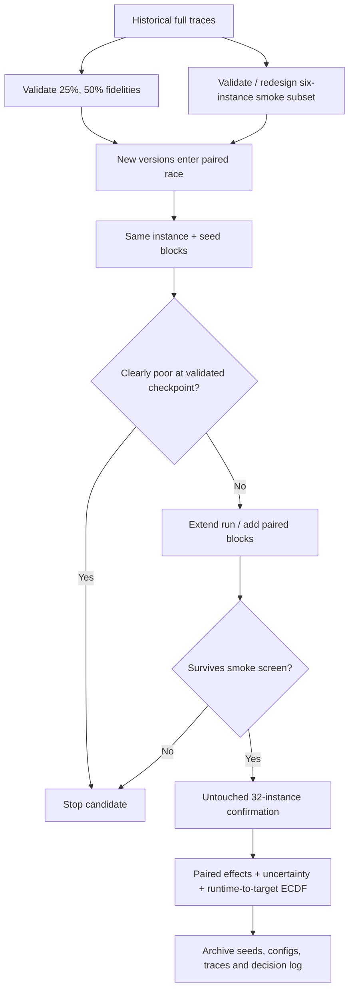

# Judging and Tuning an Expensive Stochastic Optimizer with Very Few Runs

## Executive summary

[SOURCE] This report executes the research task in the attached file: a stochastic construction-plus-local-search optimizer takes 30–60 minutes per single-core run; there are 32 heterogeneous instances, three seeds per normal campaign, five-way parallel capacity, recorded anytime traces, about 30 tunable numerical parameters, and explicit seeds that permit paired version comparisons. The task states that a 32×3 campaign costs about 28 “machine-hours” and a 6×3 smoke campaign about 5 hours. fileciteturn0file0

[DERIVED] **One unit ambiguity matters.** Ninety-six runs at 30–60 minutes each are 48–96 core-hours, whereas the task calls the campaign approximately 28 machine-hours; similarly, ideal five-way wall time would not equal that figure. I therefore use the team's stated empirical conversion—18 smoke runs ≈5 campaign-hours and 96 full runs ≈28 campaign-hours—rather than silently interpreting “machine-hour” as core-hour. That corresponds to roughly 0.28–0.29 stated campaign-hours per completed full-budget run. This definition should be fixed internally before cost accounting is used operationally.

[DERIVED] The central conclusion is that **three seeds should be regarded as a noisy estimator, not as inferential evidence by itself**. With three paired observations, the smallest attainable two-sided exact sign/sign-flip probability is \(2/2^3=0.25\); even five pairs cannot attain 0.05 (\(2/2^5=0.0625\)), while six perfectly concordant pairs can (\(2/2^6=0.03125\)). A generic three-observation percentile bootstrap interval for a median also spans essentially the observed minimum to maximum. The literature reviewed here does not support a universal rule such as “three runs is enough,” nor did the opened primary benchmarking sources prescribe a magic replication count; they instead emphasize experimental design, representative instances, stochastic replication, effect relevance, and reproducibility. citeturn25view0

[DERIVED] Consequently, the most useful statistical unit for the engineering question is usually the **instance**, with seeds supplying within-instance replication. Treating the 18 observations in a 6-instance×3-seed smoke test as 18 exchangeable independent observations would pseudoreplicate the six problem instances. A defensible analysis keeps version comparisons paired by `(instance, seed)`, summarizes or models seed variability within instance, and bases generalization across the benchmark family primarily on the instance dimension.

| Evidence | Practice with highest expected leverage | Why it matters | Cost in the team's units |
|---|---|---|---|
| [DERIVED] | **Pair A and B on exactly the same instance/seed blocks and analyze paired differences, not two independent medians.** | Common random numbers can sharply reduce variance when responses remain positively correlated; their benefit must be measured because CRN can also induce negative correlation. Wright & Ramsay provide an explicit negative example. citeturn23view1turn26view39 | If A is already cached under exactly the same environment: 18 new smoke runs ≈5 h. If both must be rerun: 36 runs ≈10 h. No extra seeds are inherently required. |
| [DERIVED] | **Use the six-instance smoke test as a screening/racing stage, not as proof of improvement.** | A “not worse on every noisy 3-seed median” rule has high opportunity to reject a generally better version because any one noisy instance can veto it. The full 32-instance experiment is the much stronger unit for a benchmark-family claim. Bartz-Beielstein et al. stress that claims are conditional on the actual problem set. citeturn25view0 | No additional machine time relative to the present two-stage process; this changes the decision rule. |
| [DERIVED] | **Exploit the recorded anytime traces for early rejection, but only after validating the fidelity.** | A candidate confidently identified as poor at 25% budget costs roughly 25% of the normal smoke run time. Hyperband and learning-curve extrapolation establish the general resource-allocation idea, but neither proves that *your* 25%-budget ranking predicts the endpoint. citeturn26view28turn26view29 | A candidate rejected at 25% of all 18 smoke runs costs ≈1.25 h instead of 5 h: up to ≈3.75 h saved. At 50%: ≈2.5 h saved. Historical trace validation needs no new optimizer runs if complete traces already exist. |
| [DERIVED] | **Race several competing code versions rather than fully smoke-testing them serially.** | Racing and best-arm methods spend extra evaluations only on alternatives not yet eliminated. Iterated racing is specifically designed for expensive configuration across instances, while fixed-budget best-arm identification gives a formal analogue under stronger stochastic-arm assumptions. citeturn25view6turn26view27 | Illustratively, four versions × six instances × one seed × 25% budget = 24 quarter-runs = six full-run equivalents ≈1.7 h for a first screen, versus ≈20 h for four complete smoke campaigns; survivors then consume more. |
| [DERIVED] | **Validate or redesign the six-instance smoke subset using the existing 32-instance history.** | Instance-space and representative-subset work shows that redundant or biased benchmark collections can reverse conclusions, while diverse selection can stabilize them. SELECTOR specifically reports conflicting conclusions on individual benchmark sets and more robust conclusions from landscape-covering selected sets. citeturn26view31turn25view12turn25view13 | Potentially zero new solver runs. There are only \(\binom{32}{6}=906{,}192\) six-instance subsets, so retrospective subset scoring is computationally trivial relative to optimizer runs. |
| [DERIVED] | **Extract runtime-to-target ECDFs and fixed-budget distributions from the traces instead of reducing every run to its last value.** | COCO's canonical anytime view measures evaluations needed to reach targets; IOHprofiler explicitly supports both fixed-target and fixed-budget views. This extracts many comparisons from the same costly trajectory. citeturn26view24turn26view26 | Essentially zero additional optimizer time; storage and analysis only. |
| [DERIVED] | **Automate tuning only after establishing a trustworthy cheaper fidelity and separating tuning instances from final test instances.** | irace, SMAC, ParamILS, Hyperband and BOHB all economize evaluations differently, but none makes a 30-dimensional configuration problem identifiable from 18 expensive evaluations. Capping and multi-fidelity can make a larger tuning campaign affordable; tuning and testing on the same six instances invites overfitting. citeturn26view33turn26view36turn26view30 | No literature-backed universal minimum was found. A 100-full-evaluation pilot would already equal ≈28–29 stated campaign-hours; 1,000 would be ≈278–292 h. Partial budgets can reduce that only if fidelity is predictive. |

[SOURCE] The reason not to assume that identical seeds automatically solve the variance problem is especially strong. Wright and Ramsay define CRN in the abstract as a design where **“policy alternatives are tested against the same random input streams.”** Their inventory experiment produced *negative* response correlation and increased variance; Glasserman and Yao likewise note that the class for which CRN is provably beneficial is limited. citeturn23view1turn26view39

[DERIVED] For paired scores \(X_A,X_B\),

\[
\operatorname{Var}(X_B-X_A)
 = \operatorname{Var}(X_B)+\operatorname{Var}(X_A)
 -2\operatorname{Cov}(X_A,X_B).
\]

Thus, once two code versions branch into sufficiently different stochastic trajectories, their endpoint covariance may approach zero and CRN's variance advantage disappears; if covariance becomes negative it can become counterproductive. The quantity to measure is therefore the empirical paired correlation/covariance—at multiple trace checkpoints if possible—not simply whether the seed integer was identical.

[DERIVED] A practical decision flow supported by the evidence is:



[DERIVED] The most important change is therefore not “run more seeds everywhere.” It is to **spend replication adaptively**, use the pairing already available, exploit the anytime information already being produced, preserve instance diversity, and reserve expensive full campaigns for candidates that survive a cheap but empirically validated screen.

## Comparing two stochastic versions with few expensive runs

[SOURCE] This section answers Q1: paired designs and common random numbers; small-sample paired inference; bootstrap uncertainty; stochastic-superiority effect sizes; and aggregation across heterogeneous instances.

**Evidence and theoretical foundations**

| Technique | Primary evidence and defining quotation | Conditions and implications for this setting |
|---|---|---|
| [SOURCE] **Common random numbers / paired stochastic design** | Wright & Ramsay, 1979, *Management Science* 25(7), 649–656, DOI 10.1287/mnsc.25.7.649. Abstract: **“policy alternatives are tested against the same random input streams.”** citeturn23view1 | [SOURCE] Their experiment is a simulation inventory model; importantly, CRN induced negative correlation and *increased* variance in that example. Separate random streams for different stochastic inputs usually, but not always, gave the greatest variance reduction. citeturn23view1 |
| [SOURCE] **CRN theoretical qualification** | Glasserman & Yao, 1992, *Management Science*, DOI 10.1287/mnsc.38.6.884. Abstract: **“the class of systems for which it is provably advantageous has remained rather limited.”** citeturn26view39 | [SOURCE] The scope is comparison of stochastic systems by simulation. It directly rules out treating “same seed” as an automatic guarantee of lower variance. citeturn26view39 |
| [SOURCE] **Stochastic-superiority effect size \(A\)** | Vargha & Delaney, 2000, *Journal of Educational and Behavioral Statistics* 25(2), 101–132, DOI 10.3102/10769986025002101. Abstract: **“the A measure of stochastic superiority … may be directly applied for any discrete or continuous variable that is at least ordinally scaled.”** citeturn20search0 | [SOURCE] The paper supplies point/interval inference and extensions for correlated samples; its scale requirement is only ordinal. citeturn20search0 |
| [SOURCE] **Bootstrap** | Efron, 1979, *Annals of Statistics* 7(1), 1–26, DOI 10.1214/aos/1176344552; the opened Springer reprint states that bootstrap estimates a sampling distribution **“on the basis of the observed data.”** citeturn23view5turn21search2 | [SOURCE] Efron's examples explicitly include sample-median variance and ratio estimation. The method presumes the observed empirical distribution is informative about the sampling population; three observations provide extremely little such information. citeturn21search1 |
| [SOURCE] **Performance profiles** | Dolan & Moré, 2002, *Mathematical Programming* 91, 201–213, DOI 10.1007/s101070100263: **“We propose performance profiles—distribution functions for a performance metric—as a tool for benchmarking and comparing optimization software.”** citeturn23view4turn21search0 | [SOURCE] Their case study used COPS, with 17 applications and four instances per application, and principally ratios of solver runtime to the best runtime. They explicitly require a sufficiently large, representative problem set for broad interpretation. citeturn23view4 |
| [SOURCE] **Anytime runtime-to-target aggregation** | Hansen et al., 2016, *COCO: Performance Assessment*, arXiv:1605.03560: **“The performance assessment is based on runtimes … to reach one or several quality indicator target values.”** citeturn26view24 | [SOURCE] The setting is numerical black-box optimization; runtime is counted in objective-function evaluations and performance is anytime. This is directly transferable in concept to timestamped best-so-far traces, while the exact target definitions remain problem-specific. citeturn26view24 |
| [SOURCE] **Fixed-target and fixed-budget analysis** | IOHprofiler official documentation: **“Performance analysis in both a fixed-target and fixed-budget perspective.”** citeturn26view26 | [SOURCE] IOHprofiler is designed for iterative optimization heuristics and supplies statistical/interactive analysis around logged trajectories. citeturn26view2 |

[DERIVED] For a paired comparison, the natural primitive observation is

\[
D_{i,s} = g(Y_{B,i,s},R_i)-g(Y_{A,i,s},R_i),
\]

where \(i\) is instance, \(s\) is the common seed, \(R_i\) is the per-instance reference and \(g\) is a declared normalization. Pairing removes all block effects that are shared by A and B from the difference.

[DERIVED] If all objective values and reference values are positive and \(g(Y,R)=\log(Y/R)\), then

\[
D_{i,s}
=\log(Y_B/R_i)-\log(Y_A/R_i)
=\log(Y_B/Y_A).
\]

Thus the external reference cancels completely in a direct version-to-version comparison. This gives a symmetric interpretation—e.g. \(+10\%\) and \(-10\%\) are handled multiplicatively—without letting heterogeneous instance scales dominate. The task does **not** state that scores/references are strictly positive, so log-ratios are conditional on a fact that must first be checked. fileciteturn0file0

[DERIVED] If zero or negative values are possible, a paired difference in the already-defined normalized score is safer. A ratio should also not be treated as uncertainty-free if the “reference value” is itself estimated from stochastic runs; the task does not state whether references are exact optima, best-known deterministic constants, or noisy estimates. fileciteturn0file0

**What three to ten paired observations can actually establish**

[DERIVED] For an exact two-sided sign or sign-flip test with \(n\) nonzero paired differences, the most extreme possible outcome has probability

\[
p_{\min}=2/2^n.
\]

| Paired observations | Smallest attainable two-sided exact \(p\) |
|---:|---:|
| [DERIVED] 3 | 0.2500 |
| [DERIVED] 4 | 0.1250 |
| [DERIVED] 5 | 0.0625 |
| [DERIVED] 6 | 0.03125 |
| [DERIVED] 7 | 0.015625 |
| [DERIVED] 8 | 0.0078125 |
| [DERIVED] 10 | 0.001953 |

[DERIVED] Hence **\(n=3\) cannot yield a conventional two-sided 5% exact paired rejection even if B beats A in every observation**. Five cannot either. Six can only cross 0.05 at the most extreme sign pattern. This is not a defect of the test; it is the unavoidable information granularity of such a tiny experiment.

[DERIVED] The Wilcoxon signed-rank test adds magnitude ranks and can be more efficient under its symmetry assumptions, but with \(n=3\) its exact null distribution is likewise extremely discrete. Reporting a normal-approximation \(p\)-value at that size would create an appearance of resolution that the exact experiment does not contain.

[DERIVED] The same problem appears in bootstrap inference on three seeds. For three distinct observations \(a<b<c\), a size-three nonparametric bootstrap median equals \(a\) with probability \(7/27\), \(b\) with \(13/27\), and \(c\) with \(7/27\). Therefore its ordinary 2.5th and 97.5th percentile endpoints are simply \(a\) and \(c\): the entire observed range. A bootstrap computation may print many decimal places, but it cannot manufacture unobserved tail information.

[SOURCE] The opened Bartz-Beielstein et al. benchmarking paper explicitly frames “how many runs shall be performed” as an experimental-design issue and says randomized algorithms should ideally be run several times; it does not, in the retrieved text, prescribe three, ten, thirty, or any other universal replication minimum. citeturn25view0

[DERIVED] Accordingly, the answer to “what is the minimum number of runs for a defensible claim?” is **effect- and precision-dependent, not a fixed folklore number**. A defensible sample size is the smallest that provides the required uncertainty width or detection probability for a predeclared practically important effect under the observed variability. With the reported 40% median and 109% maximum seed variation, an unpaired three-run design is particularly weak. fileciteturn0file0

**Effect size rather than winner-only testing**

[SOURCE] Vargha–Delaney \(A\) describes stochastic superiority rather than only a null-hypothesis decision and works for ordinal outcomes. citeturn20search0

[DERIVED] For two independent empirical samples one common estimator is

\[
\hat A_{12}
=
\frac{\#(B>A)+\tfrac12\#(B=A)}
     {n_A n_B},
\]

interpretable as the empirical probability that a randomly selected B outcome exceeds a randomly selected A outcome, with half credit for ties.

[DERIVED] In this project, however, ordinary independent-sample \(A_{12}\) throws away the valuable seed pairing. The paired analogue of most immediate operational meaning is the distribution of \(D_{i,s}\), together with \(P(D>0)\), its median, and an interval. \(A_{12}\) remains useful as a secondary distributional effect or for comparisons where pairing is unavailable.

**Aggregation across heterogeneous instances**

[SOURCE] Dolan and Moré explain two key failures of naïve aggregation: a few difficult problems can dominate raw averages/totals, while ranks suppress the magnitude of performance differences. Their ratio-based performance profile keeps the distribution of relative performance visible and retains failures. citeturn23view4

[DERIVED] For the present benchmark, no single summary should replace the per-instance data. A useful compact bundle is: paired relative effect by instance; median/geometric-mean relative effect when mathematically valid; fraction of instances with positive/negative effects; worst material regression; and an ECDF over runtime-to-target or fixed-budget quality. Ranks are valuable for scale robustness but should not be the sole metric because a 0.1% and a 100% win both become “rank 1.”

[SOURCE] COCO specifically makes the **runtime to targets** the basic anytime quantity rather than only the endpoint objective value; IOHprofiler complements this with fixed-budget analysis. citeturn26view24turn26view26

**What the sources say.** [SOURCE] The primary literature supports pairing and CRN as variance-reduction devices but explicitly shows that CRN can fail or increase variance; stochastic superiority supplies an ordinal-scale effect size; bootstrap is a general empirical-distribution method rather than a cure for tiny samples; performance profiles were introduced to avoid domination by a few difficult problems while retaining relative magnitudes; and COCO/IOH formalize anytime comparisons through fixed targets and fixed budgets. None of the opened primary benchmarking sources endorses \(n=3\) as a generally sufficient replication count. citeturn23view1turn20search0turn21search1turn23view4turn26view24turn26view26

## Sequential and adaptive experimentation

[SOURCE] This section answers Q2: racing, sequential decisions, best-arm identification and the allocation of additional runs only where uncertainty remains.

**Racing and best-arm evidence**

| Method | Primary evidence and defining quotation | Guarantee/condition relevant here |
|---|---|---|
| [SOURCE] **Iterated racing / irace** | López-Ibáñez et al., 2016, *Operations Research Perspectives* 3, 43–58, DOI 10.1016/j.orp.2016.09.002. Official documentation: **“Iterated race is an extension of the Iterated F-race method for the automatic configuration of optimization algorithms.”** citeturn25view6 | [SOURCE] The method tunes configurations against a supplied set of optimization instances and repeatedly races candidates, concentrating budget on survivors. The software documentation exposes explicit instance lists, seeds, experiment budgets and parallel execution. citeturn25view18turn16search12 |
| [SOURCE] **Successive Rejects** | Audibert, Bubeck & Munos, 2010, COLT, *Best Arm Identification in Multi-Armed Bandits*: **“We propose … a new algorithm based on successive rejects.”** citeturn26view27 | [SOURCE] The setting is stochastic multi-armed bandits and selection of the arm with largest mean. The paper proves exponentially decreasing simple regret/error rates, essentially optimal up to a logarithmic factor. citeturn26view27 |
| [SOURCE] **Two-stage screening with CRN** | Chick & Inoue, 2001, *Management Science* 47(8), 1133–1149, DOI 10.1287/mnsc.47.8.1133.10229: **“The procedures allow for screening and attempt to allocate additional replications…”** citeturn26view40 | [SOURCE] These procedures compare simulated systems with CRN, screen alternatives, and allocate second-stage replications for information value; the authors explicitly distinguish them from procedures designed for a specified probability-of-correct-selection guarantee. citeturn26view40 |
| [UNVERIFIED] **Classical SPRT** | Wald, 1945, *Sequential Tests of Statistical Hypotheses*, *Annals of Mathematical Statistics*. The primary article could not be successfully opened during this retrieval, so no verbatim defining quotation is supplied rather than inventing one. | [UNVERIFIED] The classical method concerns sequential testing of specified stochastic hypotheses and is not automatically robust to arbitrary heterogeneous-instance, heavy-tailed optimizer differences. |

[DERIVED] Racing maps naturally onto the engineering workflow, but the experimental unit must be defined carefully. A version is an “arm”; a block is ideally a shared `(instance, seed)` evaluation; all active versions receive the same block before elimination. This preserves pairing and prevents an unlucky easy/hard instance schedule from favoring one candidate.

[DERIVED] The bandit theorem should **not** be transferred literally without checking assumptions. Successive Rejects reasons about repeated stochastic observations from arms with stable means. The project's 32 instances are heterogeneous fixed benchmark cases, and observations from three seeds on the same instance are not exchangeable with observations from a different instance. A direct application is justified only after defining a sampling population—e.g., uniformly sampled benchmark instances followed by a random seed—and accepting that as the estimand.

[DERIVED] A robust engineering race can instead be block-structured: shuffle the instances once; evaluate every active version on the same next instance/seed; maintain per-instance paired effects; eliminate only candidates whose evidence crosses a predeclared inferiority or practical-futility boundary; and leave close versions active.

**Repeated peeking**

[DERIVED] Running an ordinary 5% fixed-sample test after every new run is not a valid 5% sequential test. In the simplified case of \(L\) independent 5% looks under the null, the chance of at least one false rejection is

\[
1-(1-0.05)^L,
\]

which already reaches 14.3% for three independent looks. Dependence changes the exact value but does not make unrestricted optional stopping legitimate.

[DERIVED] Thus an early-stopping rule that claims controlled error requires either a genuine sequential procedure, an anytime-valid confidence/evidence process, or a predeclared multiplicity allocation across looks. A purely engineering “kill” rule can instead be labeled explicitly as screening and followed by an untouched confirmation experiment; that is often simpler in this tiny-\(n\) setting.

**Why early stopping is easiest for obvious losers**

[DERIVED] The strongest cost case is asymmetric. A grossly worse version need not receive three full seeds on all six smoke instances merely to quantify exactly *how much* worse it is. A candidate that remains close to baseline should consume more budget because the decision is intrinsically harder.

[SOURCE] Chick & Inoue's two-stage work is directly consistent with that allocation principle: their procedures perform screening and then deliberately direct additional replications where they have greater informational value. citeturn26view40

[SOURCE] The irace ecosystem also documents adaptive capping as a studied extension; the official project page identifies Pérez Cáceres, López-Ibáñez, Hoos & Stützle's LION 2017 study, DOI 10.1007/978-3-319-69404-7_17. The full primary article was not opened in this retrieval, so its quantitative capping results are not asserted here. citeturn26view35

[DERIVED] With five parallel slots, racing should schedule **information-complete blocks**, not merely keep all cores busy. For example, when comparing four variants, running the same instance/seed concurrently for four versions yields a nearly immediate paired block; filling the fifth slot with an unrelated version-instance combination may improve utilization but complicate sequential comparability.

[DERIVED] There is also a selection-bias issue if “several code changes per day” are repeatedly screened against the same six instances. Even a sound individual comparison becomes an optimizer over the smoke set: the development process learns to exploit whatever those six cases reward. That motivates an untouched or rotating confirmation layer independently of statistical testing.

**What the sources say.** [SOURCE] Racing concentrates evaluations on surviving configurations; Successive Rejects supplies a fixed-budget best-arm analogue with near-optimal exponential error decay under stochastic-bandit assumptions; and CRN ranking-and-selection literature explicitly uses screening plus adaptive replication. Those guarantees are attached to their respective probabilistic models and cannot be assumed merely because the engineering workflow “looks like a bandit.” citeturn25view6turn26view27turn26view40

## Using anytime traces

[SOURCE] This section answers Q3: checkpoint performance, integrated anytime measures, learning-curve prediction and the conditions under which a 25%-budget observation can safely affect a final decision.

**Primary evidence**

| Technique | Defining primary-source evidence | Conditions |
|---|---|---|
| [SOURCE] **Learning-curve extrapolation** | Domhan, Springenberg & Hutter, IJCAI 2015, pp. 3460–3468: **“we mimic this early termination of bad runs based on a probabilistic model that extrapolates performance from the first part”** of a learning curve. citeturn26view28 | [SOURCE] Their setting is neural-network hyperparameter optimization with training/validation learning curves. The reported approach is probabilistic and uncertainty-aware, rather than “stop whenever the current value is bad.” citeturn26view28 |
| [SOURCE] **Hyperband** | Li et al., 2018, *JMLR* 18(185): **“we focus on speeding up random search through adaptive resource allocation and early-stopping.”** citeturn26view29 | [SOURCE] Resource is a fidelity such as iterations, data or related training budget; Successive-Halving-style allocations discard many configurations cheaply and invest increasing resource in survivors. citeturn26view5 |
| [SOURCE] **BOHB** | Falkner, Klein & Hutter, ICML 2018, PMLR 80: **“strong anytime performance and fast convergence to optimal configurations.”** citeturn26view30 | [SOURCE] BOHB combines model-guided configuration search with Hyperband-style bandit resource allocation; it addresses the weakness that unguided bandit search spends candidates randomly. citeturn26view30 |
| [SOURCE] **Runtime-to-target traces** | COCO evaluates **runtimes to target values** rather than only the terminal value. citeturn26view24 | [SOURCE] Appropriate whenever targets can be defined consistently across instances and the best-so-far trajectory is logged. |
| [SOURCE] **Fixed-budget trajectories** | IOHprofiler officially supports both fixed-target and fixed-budget analysis. citeturn26view26 | [SOURCE] This permits direct comparisons at 25%, 50%, 100%, or any other common budget without extrapolating a terminal value. |

[DERIVED] **There is no literature-backed universal statement that “25% of the run predicts the final ranking.”** Hyperband succeeds when lower resource levels contain useful information about higher-resource performance; Domhan et al. model that relationship rather than assuming it. Your optimizer can exhibit late local-search breakthroughs, restart effects or threshold-triggered phase changes that make 25% actively misleading. citeturn26view28turn26view29

[DERIVED] The correct test is empirical and can be performed entirely on historical full traces:

\[
\rho_f
=
\operatorname{rankcorr}
  \bigl(
      \text{ranking at fraction }f,\,
      \text{ranking at }100\%
  \bigr),
\]

evaluated across held-out instances/version comparisons for \(f=0.10,0.25,0.50,\ldots\). Rank correlation alone is insufficient: the operational quantity is the **false-kill rate**, i.e. how often the candidate that would have been terminated at the checkpoint ultimately wins or is practically noninferior at full budget.

[DERIVED] A high overall Spearman/Kendall correlation can coexist with unacceptable top-of-ranking mistakes. For early stopping, therefore, report at least rank correlation, winner/top-\(k\) recall, false-discard probability, and conditional final regret of discarded variants.

[DERIVED] Validation must be **out of sample**. Learning the stop threshold and assessing it on the same historical code versions is optimistic. A simple choice is leave-one-version-out or chronological validation: fit/choose thresholds only on older variants, then measure false kills on newer unseen variants. If instance-specific prediction is used, leave instances out as well.

**Area under the anytime curve**

[DERIVED] A normalized area-under-curve statistic can compactly reward both speed and eventual quality, for example

\[
\operatorname{AUC}
=
\frac{1}{\log(T/t_0)}
\int_{t_0}^{T}
q(t)\,d\log t,
\]

where \(q(t)\) is a declared per-instance normalized best-so-far score.

[DERIVED] This particular formula is a proposed engineering statistic, **not** a canonical metric established by the opened sources. AUC rankings depend on score normalization, the choice of linear versus log time, initial time \(t_0\), and horizon \(T\). That sensitivity is why runtime-to-target ECDFs are attractive: they expose the time/quality trade-off instead of collapsing it into one weighting.

**Checkpoint reliability can be instance-dependent**

[DERIVED] A 25% fidelity may be strongly predictive on instances where improvements arrive smoothly yet useless on instances dominated by rare restart successes. The validation should therefore report correlation/false-kill by instance or instance cluster, not only pooled over all 32 cases.

[DERIVED] If only some clusters show stable early-to-final rankings, multi-fidelity stopping can be enabled on those clusters while full runs remain mandatory for “late-blooming” clusters. This preserves most potential savings without pretending the fidelity is universally ordered.

**Performance and reproducibility implications**

[SOURCE] Bartz-Beielstein et al. note that randomized optimizer performance is a sequence of typically correlated random variables as the algorithm progresses. citeturn25view0

[DERIVED] Accordingly, measurements at 25%, 50% and 100% of the *same run* are repeated measurements, not three independent samples. Any uncertainty calculation that treats checkpoints as independent inflates the apparent sample size.

[DERIVED] The run log should therefore contain the complete monotone best-so-far trace, raw current-state trace if available, wall/CPU time, evaluation count, restart events, seed, exact configuration and termination reason. Memory can be added as peak resident set size. A standardized memory metric was **not found** in the opened COCO/IOH/configuration sources, so memory reporting here is a derived reproducibility recommendation rather than a literature-standard benchmark statistic.

**What the sources say.** [SOURCE] COCO and IOH demonstrate that partial-run information is a first-class benchmarking object; Domhan et al. terminate bad evaluations using a probabilistic extrapolation model; Hyperband formalizes aggressive resource allocation and early stopping; and BOHB adds model-guided search. None of these sources establishes an unconditional “25% rule” for stochastic local-search optimizers. citeturn26view24turn26view26turn26view28turn26view29turn26view30

## Selecting representative instances

[SOURCE] This section answers Q4: instance-space analysis, clustering, algorithm footprints, benchmark reduction and the evidence for small subsets preserving conclusions.

**Instance-space and subset evidence**

| Approach / dataset | Primary evidence | Reported scale/result |
|---|---|---|
| [SOURCE] **Instance Space Analysis** | Smith-Miles and colleagues define ISA as a methodology to support objective algorithm testing and assess benchmark diversity; subsequent work represents algorithm performance as regions or “footprints” in instance space. The opened institutional records are Smith-Miles et al., 2014, *Computers & Operations Research* 45, 12–24, and Muñoz & Smith-Miles, 2017, *Evolutionary Computation* 25(4), 529–554. citeturn25view12turn25view13 | [SOURCE] The principle is to characterize instances by measurable features and map where algorithms succeed/fail, rather than assuming a nominal benchmark set is representative. citeturn25view12turn25view13 |
| [SOURCE] **SELECTOR** | Cenikj et al., GECCO 2022, arXiv:2204.11527. The paper's first strategy **“employs clustering to identify similar groups of problem instances and subsequent sampling from each cluster.”** citeturn24academia18 | [SOURCE] Five portfolios of three algorithms were tested on five common optimization benchmarks. Per-benchmark analyses could give conflicting superiority conclusions; landscape-covering selected instances yielded more robust and consistent statistical outcomes. citeturn26view31 |
| [SOURCE] **MIPLIB 2017 benchmark reduction** | Gleixner et al., *Mathematical Programming Computation*, DOI 10.1007/s12532-020-00194-3: **“Selected from an initial pool of 5721 instances … A subset of 240 instances was specially selected for benchmarking solver performance.”** citeturn26view32 | [SOURCE] Initial pool 5,721 → collection 1,065 → benchmark set 240. This demonstrates aggressive data-driven reduction, but it does **not** establish that 240/5,721—or any fixed percentage—preserves rankings in another domain. citeturn26view32 |

[SOURCE] SELECTOR is particularly relevant because it attacks exactly the failure mode of drawing a statistical conclusion from a benchmark with uneven landscape coverage. Its abstract reports that separate benchmark analyses can produce conflicting outcomes and that selections uniformly covering the landscape produce robust/consistent results. citeturn25view14turn26view31

[UNVERIFIED] The exact cardinalities of all SELECTOR-produced subsets were not recoverable from the opened HTML/abstract material without relying on an unverified secondary summary. Because the task's evidence rule says “not found beats a guess,” no exact SELECTOR subset number is asserted.

[DERIVED] Therefore there is **no sourced universal answer such as “six instances preserve algorithm ranking.”** Ranking preservation is a property of the 32-instance population, the family of candidate code changes, the score definition and the sampling rule.

**A direct validation opportunity with only 32 cases**

[DERIVED] The team's desired smoke size is 6/32 = 18.75% of the benchmark. There are only

\[
{32\choose6}=906{,}192
\]

possible six-instance subsets. Using already-recorded results from historical versions, every candidate subset can be scored without executing the optimizer again.

[DERIVED] Relevant subset objectives are: agreement between the subset's version ranking and the 32-instance ranking; preservation of pairwise win/loss decisions; coverage of static instance features; inclusion of unusually hard/variable instances; and low redundancy in algorithm-performance footprints.

[DERIVED] Optimizing all six instances only for historical ranking agreement would itself overfit. A stronger evaluation is nested: choose the subset using a training set of historical versions, then measure rank agreement on held-out later versions. A chronological split is especially appropriate because the true deployment target is future code changes.

[DERIVED] If static instance descriptors exist—problem size, graph density, constraint density, resource scale, or domain-specific structural properties—they should be combined with historical performance fingerprints. Static features protect against selecting six cases solely because current algorithms happen to behave differently on them; algorithm footprints add discriminative power not visible from structure alone.

[DERIVED] A six-case smoke set also need not be permanently fixed. Five stable representative medoids plus one rotating “sentinel” instance, for example, reduces the chance that daily development optimizes explicitly to the known smoke cases. The specific 5+1 split is a derived engineering design, not a published universal result.

**What the sources say.** [SOURCE] Instance-space methods make benchmark diversity measurable; SELECTOR shows that benchmark choice can change statistical conclusions and that feature-space coverage can stabilize them; MIPLIB demonstrates that large candidate pools can be reduced drastically through systematic benchmark construction. The opened evidence does not provide a universal subset percentage that guarantees rank preservation for future algorithm variants. citeturn25view12turn25view13turn26view31turn26view32

## Automatic configuration under a tiny budget

[SOURCE] This section answers Q5. Here “solver” principally means an **algorithm configurator/tuner for the team's stochastic optimizer**, not a mathematical-programming solver. Commercial mathematical solvers such as CPLEX appear as *targets* in historical configuration experiments, but they do not solve the methodological problem posed in the task by themselves. citeturn25view16turn25view17

**Configurator and software comparison**

| Tool / method | Type, current version status | Core algorithm and theoretical basis | Expensive-evaluation mechanism | Important controls / limitations |
|---|---|---|---|---|
| [SOURCE] **irace** | Open-source, GPL ≥2. A CRAN mirror reports **irace 4.5**, published 2026-09-15; official project docs describe Iterated Racing. citeturn19search4turn25view18 | Iterated racing generalizing Iterated F-Race; samples configurations, races them on problem instances, updates its sampling distribution toward elites. citeturn25view6turn25view18 | Racing eliminates weak configurations; parallel target runs are supported; adaptive capping has a dedicated published extension. citeturn25view18turn26view35 | Scenario exposes training/test instances, seeds, parallelism and an experiment budget. An official example log uses `maxExperiments=1000`; this is an example, **not a recommended minimum**. citeturn16search12 |
| [SOURCE] **SMAC3** | Open-source, BSD 3-Clause. PyPI's current-search metadata reports 2.4.1 released 2026-09-10, while an opened cached release-history rendering still exposes 2.4.0 dated 2026-04-22; this is a source-cache inconsistency, so “2.4.x, verify installation metadata” is the defensible statement. citeturn15search0turn26view37 | Official docs say the core combines **Bayesian optimization and aggressive racing**; the original Hutter–Hoos–Leyton-Brown method is sequential model-based optimization for algorithm configuration. citeturn15search2turn26view10 | Surrogate-guided proposals, intensification/racing, adaptive capping, parallel workers, and current multi-fidelity facilities including Successive Halving/Hyperband components. citeturn26view12turn26view36 | Current v2 docs removed some v1-era interfaces/features and support ask/tell and continuation. The PyPI example's `n_trials=200` is illustrative, not a sample-complexity guarantee. citeturn15search0 |
| [SOURCE] **ParamILS** | Research framework; Hutter et al. 2009, *JAIR* 36, 267–306, DOI 10.1613/jair.2861. No current maintained release number was established from an opened official package source. citeturn25view16 | Iterated local search in configuration space. | Primary abstract: **“present novel techniques for accelerating them by adaptively limiting the time spent for evaluating individual configurations.”** citeturn26view33 | Historically strong where target runtime can be capped. Capping changes what is observed about poor configs and must be reflected in the objective/statistical treatment. |
| [UNVERIFIED] **GGA** | Ansótegui, Sellmann & Tierney, CP 2009, pp. 142–157, DOI 10.1007/978-3-642-04244-7_14. The Springer proceedings entry was opened, but the chapter body was not; no current canonical software version was verified. citeturn25view22 | [SOURCE via later peer-reviewed description] Population-based genetic configuration; later literature describes specialized crossover capturing parameter dependencies and racing. citeturn24search2 | [UNVERIFIED primary quote] A mirror of the original abstract says it proposes a **“robust, inherently parallel genetic algorithm for the problem of configuring solvers automatically.”** Because that quote was not obtained from opened primary chapter text, it remains unverified under this task's strict rule. citeturn16search2 | Strong parallelism fits five concurrent target runs, but evolutionary configuration can still consume many target evaluations. |
| [SOURCE] **Hyperband** | Algorithm, not a single solver release; Li et al. 2018, *JMLR*. citeturn26view5 | Pure-exploration resource allocation built around Successive Halving and multiple budget brackets. | Aggressive early stopping; many configurations receive low resource and few receive the full resource. citeturn26view29 | Requires meaningful resource/fidelity levels. Final ranking can fail if low-budget and full-budget rankings differ. |
| [SOURCE] **BOHB** | Algorithm; Falkner et al. 2018, ICML/PMLR. citeturn26view6 | Combines model-based configuration search with Hyperband-style resource allocation. | Seeks better candidate proposals than random Hyperband while retaining multi-fidelity pruning. citeturn26view30 | Inherits fidelity risks and adds surrogate-model sensitivity under sparse/noisy data. |

[SOURCE] SMAC's current documentation explicitly lists multi-fidelity optimization, parallel execution, intensification and continuation as supported features. citeturn15search2turn26view36

[SOURCE] irace's official interface supports explicit training and testing instance files and records seed and experiment-budget information in its run log, which is particularly important for preventing configuration/test leakage. citeturn16search12

**Why 30 knobs are not the same as 30 observations**

[DERIVED] With roughly 30 numerical parameters, an 18-run smoke budget is much too small for an unconstrained global search over parameter interactions. Even an extremely crude three-level one-factor-at-a-time sweep would require 90 parameter settings before replication, and it would miss interactions.

[DERIVED] At the task's empirical campaign cost, 100 full-budget target evaluations cost roughly 28–29 stated campaign-hours; 200 cost roughly 56–58 h; 1,000 cost roughly 278–292 h. Those figures make capping and validated multi-fidelity evaluation strategically important, but they do not create information if the cheap fidelity is uncorrelated with the final objective. fileciteturn0file0

[DERIVED] The practical parameterization strategy under this budget is therefore hierarchical: freeze structurally unimportant knobs; expose only parameters with a plausible strong effect; encode conditional parameters explicitly; prefer log scales for multiplicative/time-budget parameters where appropriate; and increase dimensionality only when the tuning budget supports it. This is an engineering deduction, not a sample-complexity theorem from irace/SMAC.

**Training-versus-test overfitting**

[SOURCE] irace explicitly distinguishes training and testing instance files in its recorded scenario structure. citeturn16search12

[SOURCE] Bartz-Beielstein et al. emphasize that performance claims are conditional on the benchmark problem set and warn against unjustified generalization beyond it. citeturn25view0

[DERIVED] Therefore tuning all 30 knobs on the same six smoke instances later used to accept code changes creates two levels of adaptation: the tuner adapts the parameters to those six cases, then developers adapt code to those same cases. The final 32-instance campaign partly detects this, but repeated acceptance decisions still turn the smoke suite into a de facto training set.

[DERIVED] A stronger design uses separate roles: configuration/training instances; smoke/screening cases; and untouched confirmation cases. With only 32 instances, cross-fitting or periodically rotated holds-outs may be necessary because permanently removing a large fraction from every stage would itself hurt statistical precision.

**Reported benchmarks and reproducibility characteristics**

| Source | Benchmark/application domain used in the opened literature | Reproducibility/performance details relevant here |
|---|---|---|
| [SOURCE] ParamILS, Hutter et al. 2009 | SAT algorithm configuration is explicitly stated in the primary JAIR abstract; the broader study also evaluates algorithm configuration methodology. citeturn26view33 | Adaptive evaluation-time limits are a central cost-reduction device. |
| [SOURCE] SMAC, Hutter et al. | UBC's original technical-report record describes general algorithm configuration; historical SMAC studies include configuration of complex SAT/tree-search and mathematical-programming targets. citeturn26view10turn25view17 | Surrogate modelling plus intensification is intended to reduce expensive direct target evaluations. |
| [SOURCE] GGA, Ansótegui et al. | Original CP 2009 paper evaluates SAT solver configuration. citeturn16search2turn25view22 | Designed with parallel expensive fitness evaluation in mind. |
| [SOURCE] Hyperband / BOHB | Hyperparameter optimization and machine-learning training budgets. citeturn26view5turn26view6 | Explicit resource levels permit incomplete evaluations; applicability to your optimizer depends on trace-fidelity validation. |
| [SOURCE] COCO / IOH | Black-box numerical optimization; IOH includes iterative heuristic benchmark tooling. citeturn26view24turn26view26 | Fixed-target and fixed-budget traces make multi-fidelity validation observable rather than assumed. |

[DERIVED] Runtime and solution quality dominate these sources. Robustness is captured indirectly through repeated configurations/instances, success rates or distributional analysis. **A standardized peak-memory comparison was not found in the opened primary configurator papers/docs.** For this engineering system, maximum resident set size, OOM/termination events and allocator/library versions should therefore be added locally if memory is operationally important.

[UNVERIFIED] A current commercial configurator with an officially opened vendor release page was not established in this review. Recent peer-reviewed algorithm-configuration literature mentions the .NET-based OPTANO Algorithm Tuner as GGA-based, but its current commercial version/license was not independently verified from a vendor primary source, so no version is guessed. citeturn24search2

**What the sources say.** [SOURCE] ParamILS uses local search and adaptive evaluation limits; irace spends its budget through iterated races over instances; SMAC combines a model-based search with racing/intensification; Hyperband uses explicit multi-fidelity resource allocation; BOHB adds model-guided proposals; and GGA is an evolutionary configuration approach with parallel evaluation. None of the opened primary sources supplies a universal minimum number of evaluations sufficient to tune 30 noisy parameters. citeturn26view33turn25view6turn15search2turn26view29turn26view30turn25view22

## Reporting standards

[SOURCE] This section answers Q6 and checks the named benchmarking-methodology sources against the requirements of the present experiment.

**Bartz-Beielstein et al.**

[SOURCE] Bartz-Beielstein et al., 2020, *Benchmarking in Optimization: Best Practice and Open Issues*, arXiv:2007.03488, organize benchmark quality around **“clearly stated goals, well-specified problems, suitable algorithms, adequate performance measures, thoughtful analysis, effective and efficient designs, comprehensible presentations, and guaranteed reproducibility.”** citeturn25view0

[SOURCE] The paper explicitly distinguishes an abstract algorithm from a concrete **algorithm instance/configuration** and goes further to note that an implementation depends on implementation language, compiler, operating-system optimization and library versions. It also identifies fixed random-number generators/seeds as important to replicability. citeturn25view0

[SOURCE] The same source cautions that algorithm-performance claims must be coupled to the problem class or tested instances, and that extrapolation/generalization should be identified as such. citeturn25view0

[DERIVED] Applied here, a report claiming “B is better than A” therefore needs to identify, at minimum: A and B commit hashes; exact 30-parameter vectors; benchmark-instance IDs and versions; reference-value provenance; RNG algorithm plus seeds; compiler/build flags and relevant libraries; CPU/OS and one-core policy; budget definition; failure/timeout rules; raw endpoint scores and anytime traces; analysis code; and the exact acceptance rule.

**Hooker**

[SOURCE] Hooker, *Testing heuristics: We Have It All Wrong*, *Journal of Heuristics* 1, DOI 10.1007/BF02430364, argues for controlled empirical science rather than mere algorithmic horse races. Its abstract's central criticism is: **“Competitive testing tells us which algorithm is faster but not why.”** citeturn26view0

[DERIVED] That distinction is important for a stream of small code changes. A simple A-vs-B win establishes an empirical effect on a benchmark; it does not establish that the mechanism motivating the code change caused the effect. Mechanism claims require controlled ablations or factorial comparisons where competing changes are isolated.

**Johnson**

[UNVERIFIED] Johnson's 2002 *A Theoretician's Guide to the Experimental Analysis of Algorithms* was identified with stable DOI 10.1090/DIMACS/059/11, and Bartz-Beielstein et al. identify it as a foundational experimental-algorithmics reference, but the primary source failed to open through the available retrieval path. citeturn25view0turn1search7

[UNVERIFIED] Because the task explicitly requires a verbatim primary-source quotation for each technique, I do **not** manufacture a Johnson quotation or silently promote a secondary paraphrase to `[SOURCE]`. The commonly cited Johnson principles concerning meaningful experiments, representative testbeds, reproducibility, implementation quality and justified conclusions should therefore be treated as unverified here until the primary chapter is directly accessible.

**Requirements that are especially important for this particular experiment**

[DERIVED] **Define the estimand before the test.** “B is better” can mean higher expected final score on the fixed 32 instances, higher median normalized score, higher probability of beating A, faster time-to-target, or better anytime performance. Those are different claims and can produce different winners.

[DERIVED] **Declare a practically relevant effect.** A tiny but statistically detectable benefit and a 20% speed/quality improvement should not be treated identically. For daily engineering acceptance, a noninferiority margin for regressions plus a minimum worthwhile improvement is generally more informative than a null of exactly zero.

[DERIVED] **Separate screening from confirmation.** The six smoke cases can be adaptive and frequently reused if they are explicitly a development screen. A scientific or release claim should be based on an experiment whose instances/seeds/analysis rule were not repeatedly modified in response to the candidate's results.

[DERIVED] **Record unsuccessful and censored runs.** A crash, timeout or memory failure is performance information. Removing failures before aggregating biases robustness upward; Dolan and Moré explicitly designed performance profiles to avoid discarding failed problems. citeturn23view4

[DERIVED] **Report effect sizes and uncertainty, not only \(p\)-values.** With tiny \(n\), “not significant” can simply mean low resolution; with enough instances, a trivial effect can eventually become statistically detectable. The endpoint report should show paired effect distributions and practical magnitude.

[DERIVED] **Preserve the paired raw data.** Reporting only three-seed medians destroys the seed-level covariance needed to quantify CRN's actual benefit. Store A/B scores by identical `(instance, seed, checkpoint)` keys.

[DERIVED] **Log the RNG semantics, not just seed integers.** If a code change causes extra random draws, an identical starting seed may cease to represent aligned random inputs after the branch. Separate RNG streams for conceptually distinct stochastic mechanisms—or counter-based/event-keyed random draws—can preserve stronger coupling. Wright & Ramsay's finding that stream construction affects CRN efficiency supports the importance of the design, while the specific software architecture recommendation is derived. citeturn23view1

[DERIVED] **Correct for the development process, not only one comparison.** Trying dozens of patches and promoting the best smoke result creates a winner's-curse/multiple-search problem even if each A-vs-B calculation is internally correct. Untouched confirmation data is the simplest protection.

**What the sources say.** [SOURCE] Modern benchmarking guidance requires explicit goals, concrete problem and algorithm instances, appropriate measures and analysis, sound design, clear presentation and reproducibility; Hooker argues that controlled experimentation should explain algorithm behavior rather than merely crown a winner. Johnson is a foundational named source, but its primary text was not successfully opened here, so its exact claims remain explicitly unverified rather than guessed. citeturn25view0turn26view0

## Synthesis, pseudocode, failure modes, and opened URLs

**Practice table requested by the task**

| Practice | What it saves or improves | What it needs: runs / assumptions | Primary source |
|---|---|---|---|
| [DERIVED] Pair versions using the same seed and instance, retain paired differences | Reduces variance whenever A/B responses have positive covariance; controls instance/seed block variation | Same run count as an unpaired comparison; requires compatible stochastic coupling; verify covariance instead of assuming it | [SOURCE] Wright & Ramsay 1979; Glasserman & Yao 1992. citeturn23view1turn26view39 |
| [DERIVED] Use separate RNG streams/event-keyed randomness | Can keep CRN correlation alive longer after a code change and makes stochastic mechanisms reproducible | Engineering change, no extra optimizer runs; assumes stochastic components can be separated | [SOURCE] Wright & Ramsay show CRN effectiveness depends on stream construction; architecture is derived. citeturn23view1 |
| [DERIVED] Treat 3-seed medians as descriptive rather than inferential | Prevents false confidence | No extra cost; exact-test resolution calculation shows \(n=3\) cannot reach two-sided 0.05 | [SOURCE] Broader statistical benchmarking context: Vargha–Delaney; Bartz-Beielstein et al. citeturn20search0turn25view0 |
| [DERIVED] Use paired relative effects plus stochastic-superiority measures | Adds magnitude and probability-of-superiority interpretation | Paired raw outcomes; positivity only if using log ratios | [SOURCE] Vargha & Delaney 2000. citeturn20search0 |
| [DERIVED] Hierarchical/block bootstrap by instance, then seed, where sample size permits | Preserves two-level variability better than pooling 96/18 runs | Enough instances; resampling scheme must match desired generalization population | [SOURCE] Bootstrap foundation: Efron 1979. citeturn21search1turn21search2 |
| [DERIVED] Runtime-to-target ECDFs | Uses the whole trajectory; compares speed, success and robustness over many targets | Existing anytime logs and meaningful targets; effectively zero new runs | [SOURCE] COCO 2016; IOHprofiler. citeturn26view24turn26view26 |
| [DERIVED] Performance profiles across representative instances | Limits domination by a few huge cases and keeps relative-performance magnitude | Representative set; metric ratio must be meaningful | [SOURCE] Dolan & Moré 2002. citeturn23view4 |
| [DERIVED] Screening/racing before complete replication | Avoids spending full budgets on obvious losers | Common evaluation blocks; valid elimination rule or later independent confirmation | [SOURCE] irace; Chick & Inoue; Successive Rejects. citeturn25view6turn26view40turn26view27 |
| [DERIVED] 25%/50% early stopping after retrospective validation | A 25%-budget rejection can save about 75% of a candidate's remaining smoke cost | Historical complete traces; low false-kill rate on held-out variants/instances | [SOURCE] Domhan et al.; Hyperband. citeturn26view28turn26view29 |
| [DERIVED] Representative six-instance subset selected with nested validation | Cuts daily comparison from 32 to 6 instances without blindly trusting hand selection | Existing 32-instance history and/or instance features; held-out variants needed to detect subset overfit | [SOURCE] SELECTOR; ISA/footprint studies. citeturn26view31turn25view12turn25view13 |
| [DERIVED] irace | More efficient configuration by racing than exhaustive parameter grids | A target-runner interface, training instances, evaluation budget; still potentially hundreds/thousands of target runs | [SOURCE] López-Ibáñez et al. 2016 / official docs. citeturn25view6turn25view18 |
| [DERIVED] SMAC | Model-guided search economizes expensive configuration evaluations; supports racing/multi-fidelity | Numeric/categorical configuration space; enough observations to fit useful models; current 2.4.x software | [SOURCE] UBC SMAC paper and current official docs. citeturn26view10turn15search2 |
| [DERIVED] ParamILS with capping | Avoids completing configurations already known to be bad in runtime-oriented settings | Meaningful cutoff/capping objective | [SOURCE] Hutter et al. 2009. citeturn26view33 |
| [DERIVED] Hyperband / BOHB | Large savings when low-resource evaluations predict high-resource quality | Explicit resource parameter and meaningful fidelity ordering | [SOURCE] Li et al. 2018; Falkner et al. 2018. citeturn26view29turn26view30 |
| [DERIVED] Hold tuning instances separate from final evaluation | Improves external validity and detects overtuning | Consumes some of the 32-instance diversity for validation or requires cross-fitting | [SOURCE] irace exposes separate train/test instance sets; Bartz-Beielstein limits claims to tested problem populations. citeturn16search12turn25view0 |

**Paired sequential comparison of two versions — [DERIVED]**

```text
01  input versions A,B; instances I; common seeds S; checkpoints F
02  input practical margin delta; predeclared sequential stopping rule
03  randomize instance order once, then keep the same order for A and B
04  for each instance i in I:
05      for each seed s in S:
06          start/extend A(i,s) and B(i,s) with the same seed
07          for each checkpoint f in F:
08              record paired best-so-far scores and termination status
09              compute paired effect d(i,s,f) = transform(B)-transform(A)
10              update instance-level summary d_i(f) from its seed pairs
11          end
12      end
13      update a cluster-aware/sequentially-valid interval for overall effect
14      if upper bound < -delta: stop B as materially inferior
15      if lower bound > +delta and confirmation is permitted: mark B survivor
16      otherwise continue with another instance / checkpoint
17  end
18  never convert an ordinary fixed-n p-value into a sequential rule by peeking
19  confirm any promoted version on the predeclared untouched full experiment
20  report paired effects, interval, worst-instance loss and runtime-to-target
```

[DERIVED] Line 13 is deliberately abstract: it must be instantiated by a sequential method whose assumptions and optional-stopping validity are documented. If no such implementation is available, lines 14–15 should be treated as heuristic screening and line 19 becomes mandatory confirmation.

**Racing \(k\) competing versions — [DERIVED]**

```text
01  input active versions V={v1,...,vk}; common blocks B=(instance,seed)
02  input resource ladder R={25%,50%,100%}; practical inferiority margin delta
03  shuffle blocks once and use identical order for every active version
04  for r in R:
05      for next common block b:
06          run or extend every active v on b to resource r
07          store score, trace, runtime, failures and paired block identity
08          summarize each v relative to the current/reference version
09          compute elimination evidence using only a predeclared rule
10          eliminate v only when it is clearly inferior by more than delta
11          keep statistically/operationally undecided versions active
12          if resource allocation for this stage is exhausted: break
13      end
14      if one active version remains: break
15  end
16  allocate unused budget to close surviving comparisons, not eliminated ones
17  rerun the final survivor(s) on the untouched confirmation instance set
18  publish the entire race schedule, blocks, resource levels and eliminations
```

[DERIVED] This sketch has the logic of racing/Successive Rejects without claiming their exact theorem for a heterogeneous blocked benchmark. The formal guarantee is inherited only if the implemented elimination rule and sampling model meet its proof assumptions. citeturn25view6turn26view27

**Checking whether partial-run rankings predict final rankings — [DERIVED]**

```text
01  input historical COMPLETE anytime traces for versions × instances × seeds
02  choose candidate fractions F={10%,25%,50%,...} before inspecting test folds
03  split histories by version/date into training and held-out evaluation folds
04  for each held-out fold:
05      for each fraction f in F:
06          reconstruct each run's best-so-far value at f of full budget
07          compute partial version rankings within each instance
08          compute corresponding rankings at 100% budget
09          measure rank correlation(partial, final)
10          apply the proposed early-kill rule using ONLY partial observations
11          count eventual winners/noninferior versions incorrectly killed
12          compute final regret/quality loss caused by every false kill
13          repeat metrics by instance cluster and difficulty
14      end
15  end
16  bootstrap uncertainty by INSTANCE, preserving all within-instance traces
17  accept a fidelity only if held-out rank stability is high enough AND
18      its upper confidence bound on false-kill rate is below the declared limit
19  freeze the chosen fidelity/threshold before evaluating future versions
20  periodically revalidate when optimizer dynamics change materially
```

[DERIVED] This is a direct operational answer to “when can 25% be trusted?”: when **held-out historical full runs demonstrate that the exact decision rule made at 25% almost never discards final winners, with uncertainty acceptable to the engineering risk tolerance**.

**Known failure modes and negative results**

| Failure mode | Evidence / consequence |
|---|---|
| [SOURCE] **CRN can increase variance.** | Wright & Ramsay exhibit an inventory simulation in which CRN creates negative correlation and augments variance. citeturn23view1 |
| [DERIVED] **Same seed is not necessarily same randomness after branching.** | Different code can consume random draws in a different order. Pairing may then remain strong initially and collapse later; estimate checkpoint correlation rather than assuming permanent coupling. |
| [DERIVED] **Three seeds create false precision.** | Exact two-sided \(p_{\min}=0.25\); bootstrap-median tails are essentially unsupported beyond the three observed values. |
| [DERIVED] **Pooling 6×3 as \(n=18\) pseudoreplicates instances.** | Three seed observations from one instance share the same structural case; a benchmark-family claim must preserve instance blocking. |
| [DERIVED] **Repeated fixed-\(\alpha\) peeking inflates false positives.** | Three independent 5% looks would have \(1-0.95^3=14.3\%\) familywise chance of at least one false rejection; a valid sequential rule is required. |
| [DERIVED] **Checkpoint ranking can reverse.** | Late restarts/local-search breakthroughs can make an early leader lose; Hyperband-style pruning is safe only to the degree low fidelity is informative. citeturn26view29 |
| [DERIVED] **AUC can reverse under a different time/score normalization.** | Integrated anytime metrics encode an implicit preference over early versus late improvement; report the curve/targets as well as an integral. |
| [SOURCE] **Raw means/totals can be dominated by a few hard instances; ranks lose magnitude.** | Dolan & Moré identify both issues when motivating performance profiles. citeturn23view4 |
| [DERIVED] **Ratios misbehave at zero, near-zero or signed references.** | A ratio has no stable relative interpretation in such cases; the task does not specify reference positivity. |
| [DERIVED] **Reference uncertainty can be silently ignored.** | If per-instance “reference values” are estimates rather than fixed truths, their uncertainty belongs in normalized scores. Their status is unspecified in the task. fileciteturn0file0 |
| [DERIVED] **Ordinary \(A_{12}\) can squander pairing.** | Its independent cross-pair computation ignores the controlled same-seed block; paired differences should remain primary. |
| [SOURCE] **Benchmark choice can change the apparent winner.** | SELECTOR reports conflicting statistical outcomes from individual benchmarks and more robust outcomes from representative landscape coverage. citeturn26view31 |
| [DERIVED] **The smoke suite itself can be overtuned.** | Repeated daily choices adapt development to six known instances; retrospective subset optimization can compound this unless validated on held-out versions. |
| [DERIVED] **Tuner overfitting can be mistaken for optimizer improvement.** | Parameter selection and final assessment on the same instances makes the final score optimistically selected; separate training/testing roles mitigate this. citeturn16search12turn25view0 |
| [DERIVED] **Adaptive capping can change the objective.** | A configuration often capped is observed mainly through censoring; runtime penalties and capping semantics must be included in the tuner objective. ParamILS explicitly relies on adaptive evaluation limits. citeturn26view33 |
| [DERIVED] **Surrogates can be unreliable with few high-noise observations.** | SMAC/BOHB become informative only when their learned performance model has enough signal; an expensive 30-D space with dozens rather than hundreds of observations is especially sparse. citeturn15search2turn26view30 |
| [DERIVED] **Parallelism can alter reproducibility.** | If a stochastic implementation uses shared/global RNG state or nondeterministic asynchronous decisions, five-way scheduling can make “seed” insufficient to reproduce a trajectory. |
| [SOURCE] **Failures should not simply disappear from aggregated data.** | Dolan & Moré explicitly identify the bias created when problems on which some solvers fail are discarded. citeturn23view4 |
| [DERIVED] **Memory failures can be missed by objective-only logs.** | Peak RSS/OOM was not a standardized primary metric in the opened configurator sources; it should be logged explicitly when operationally relevant. |
| [DERIVED] **Daily selection creates a winner's curse.** | Choosing the best of many noisy candidate changes produces optimistic observed smoke performance even when each candidate's individual analysis is unbiased. An untouched confirmation stage protects against this search process. |

**Open research gaps**

[DERIVED] A particularly relevant open problem is a practically usable **paired sequential inference framework for stochastic optimizers with two-level variation (instances and seeds), heterogeneous scales, tiny seed counts and anytime censoring**. Classical best-arm and sequential-test guarantees usually impose cleaner i.i.d./arm assumptions than this benchmark possesses.

[DERIVED] A second gap is **quantifying how long CRN remains useful after algorithmic trajectories branch**. Simulation theory establishes when covariance helps and supplies counterexamples, but the useful coupling horizon for randomized constructive/local-search heuristics depends on implementation-level RNG semantics that benchmarking studies rarely expose. citeturn23view1turn26view39

[DERIVED] A third is **prospective smoke-set construction**: methods such as SELECTOR and instance-space analysis select diversity from existing benchmark/performance representations, but the desired property here is stronger—preserving rankings of *future, unseen code variants*. Chronological/nested validation is essential, and universally valid subset-size guarantees were not found. citeturn26view31turn25view12

[DERIVED] A fourth is **calibrated partial-to-final prediction for restart-based optimizers**. Neural-learning-curve extrapolation and Hyperband supply valuable analogues, but restart heuristics can have discontinuous breakthrough processes unlike smooth training curves. citeturn26view28turn26view29

[DERIVED] A fifth is **extreme-budget automatic configuration**: 30 interacting parameters, 30–60 minute targets, five workers and perhaps only tens to low hundreds of evaluations are a much harsher regime than many standard tuner benchmarks. Determining which parameters should be exposed at all may be more important than choosing among irace, SMAC and BOHB.

[DERIVED] A sixth is **uncertainty-aware normalization** when benchmark reference values are themselves best-known or estimated rather than mathematically exact. The attached task does not specify the provenance or uncertainty of the 32 reference values, so this remains an unresolved experimental-design input. fileciteturn0file0

**Opened URLs**

[SOURCE] The following URLs were successfully opened or retrieved as primary/official pages during this research. Failed/restricted primary-page attempts are noted separately so that the evidence boundary is reproducible.

```text
https://arxiv.org/abs/2007.03488
https://ftp.iaorifors.com/paper/29510

https://pubsonline.informs.org/doi/10.1287/mnsc.25.7.649
https://pubsonline.informs.org/doi/10.1287/mnsc.38.6.884
https://pubsonline.informs.org/doi/10.1287/mnsc.47.8.1133.10229

https://journals.sagepub.com/doi/abs/10.3102/10769986025002101

https://arxiv.org/abs/cs/0102001
https://doi.org/10.1007/s101070100263
https://optimization-online.org/2001/03/300/

https://doi.org/10.1007/978-1-4612-4380-9_41
https://doi.org/10.1214/aos/1176344552

https://arxiv.org/abs/1605.03560
https://iohprofiler.github.io/

https://www.microsoft.com/en-us/research/publication/best-arm-identification-multi-armed-bandits/

https://mlopez-ibanez.github.io/irace/
https://mlopez-ibanez.github.io/irace/reference/irace-package.html
https://mlopez-ibanez.github.io/irace/reference/irace.html
https://mlopez-ibanez.github.io/irace/reference/index.html
https://mlopez-ibanez.github.io/irace/reference/multi_irace.html
https://mlopez-ibanez.github.io/irace/reference/read_logfile.html

https://ftp.sun.ac.za/ftp/pub/mirrors/cran.za.r/web/packages/irace/index.html
https://ftp.belnet.be/mirror/CRAN/web/packages/irace/refman/irace.html

https://www.ijcai.org/Abstract/15/487
https://jmlr.org/papers/v18/16-558.html
https://proceedings.mlr.press/v80/falkner18a.html

https://arxiv.org/abs/2204.11527
https://orca.cardiff.ac.uk/id/eprint/53966/
https://research.monash.edu/en/publications/performance-analysis-of-continuous-black-box-optimization-algorit/

https://link.springer.com/article/10.1007/s12532-020-00194-3

https://jair.org/index.php/jair/article/view/10628
https://www.cs.ubc.ca/tr/2010/tr-2010-10

https://automl.github.io/SMAC3/latest/
https://pypi.org/project/smac/

https://link.springer.com/book/10.1007/978-3-642-04244-7
https://link.springer.com/article/10.1007/s10732-025-09561-6
```

[UNVERIFIED] Primary URLs that were identified but could not be successfully opened in the available retrieval path included the primary Johnson chapter page and some publisher renderings of the Vargha–Delaney, Nelson–Hsu and Dolan–Moré articles. Where a primary quotation could not actually be recovered, the corresponding statement above is explicitly marked `[UNVERIFIED]`; no missing text was reconstructed from memory.