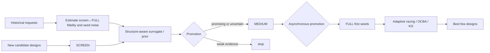

# Multi-Fidelity Screening of Engineering Designs Under Tight Wall-Clock Budgets

## Executive summary

[SOURCE] The attached task specifies a **multi-fidelity design-screening and allocation problem**, with 20–200 candidate designs, SCREEN evaluations of 2–3 minutes, MEDIUM evaluations of 10–15 minutes, FULL evaluations of 30–60 minutes, five parallel workers, substantial top-fidelity stochasticity, correlated designs, and historical observations. It therefore supersedes the otherwise-unspecified generic mathematical-programming-solver scope; CPLEX/Gurobi/SCIP-style MILP benchmarking is not the subject of this report. fileciteturn0file0

[SOURCE] The central finding from the literature is that **successive-halving-family methods are a natural scheduling skeleton, but their value depends critically on whether early fidelity preserves enough information about eventual ordering**. Hyperband hedges how aggressively resources are distributed; ASHA removes synchronization barriers; BOHB and related surrogate-assisted variants use observations to choose better candidates; none makes an uninformative or badly biased screen harmless. citeturn19search1turn19search10turn19search0turn20search1turn14search14

[SOURCE] The second central finding is that the classical stochastic best-arm literature and the multi-fidelity literature solve related but **not identical** statistical problems. Successive Rejects, Sequential Halving, and top-\(k\) identification usually assume repeated stochastic pulls from stationary arm distributions. A 2-minute screen and a 60-minute optimizer output are instead different, systematically biased observations of the same design. Their best-arm guarantees therefore do not automatically transfer to the screen→FULL promotion decision. citeturn15search1turn15search7turn19search1

[SOURCE] No primary source opened for this review establishes a universal minimum Spearman or Kendall rank correlation above which cheap screening is “safe.” Primary work instead treats fidelity usefulness as problem-dependent; MFES-HB explicitly notes that low-fidelity observations can be both **biased and informative**, while work on early training identifies configurations that look poor early but become strong later. citeturn14search14turn2academia38

[SOURCE] Small paired samples provide only coarse evidence about fidelity quality. Bonett and Wright frame sample-size planning in terms of a desired confidence-interval width, and Caruso and Cliff found that simple Fisher-transform intervals for Spearman correlation cease to behave reliably when the sample is small. Thus \(n=10\) paired designs is enough to detect catastrophic decorrelation, but it is generally too small to distinguish, for example, a moderately useful fidelity from a strongly useful one with precision. citeturn21search0turn21search1

[SOURCE] Structure sharing is particularly relevant to this design space. SMAC was built for configuration spaces containing many categorical parameters; TPE was designed for conditional/hierarchical hyperparameter assignments; CoCaBO explicitly shares information among categorical variables through a Gaussian-process kernel; warm-start Bayesian optimization jointly models sequences of related optimization tasks. citeturn20search21turn20search3turn5search11turn23academia48

[SOURCE] At the noisy FULL fidelity, the relevant literature is ranking-and-selection rather than ordinary early stopping. OCBA allocates additional simulations nonuniformly to improve selection efficiency, while the knowledge-gradient policy chooses the next noisy measurement according to expected information value under a probabilistic model. Both are conceptually closer to “which finalist gets the next seed?” than fixed three-seeds-per-design allocation. citeturn23search2turn22search0

**The techniques most likely to matter in this setting**

[DERIVED] The cost examples below use the task's own ranges and, where a single point estimate is useful, the midpoints SCREEN \(=2.5\) min, MEDIUM \(=12.5\) min, FULL \(=45\) min. “Ideal wall time” means total worker-minutes divided by five; real wall time is higher because of stragglers, discrete jobs, startup, and scheduler overhead.

| Technique | Why it matters here | Cost in this problem's units |
|---|---|---|
| [SOURCE] **ASHA / asynchronous successive halving** citeturn20search1turn17search0 | [DERIVED] It replaces a hard “screen all, retain exactly two” boundary with several promotion opportunities while keeping all five workers busy. | [DERIVED] Example \(N=60,\eta=4\): 60 SCREEN + 15 MEDIUM + 4 first-seed FULL; adding two more FULL seeds to each of two eventual finalists gives 60 SCREEN + 15 MEDIUM + 8 FULL = **510–885 worker-min**, ideal **102–177 min**, midpoint **139.5 min**. |
| [SOURCE] **Hyperband** citeturn19search10 | [DERIVED] It hedges the unknown right level of screening aggressiveness by running brackets with different numbers of configurations/resources. | [DERIVED] It is normally run under a fixed global budget rather than adding a fixed number of runs; in this problem that budget should be expressed directly in worker-minutes and capped at 450–900 worker-min for 1.5–3 h × five workers. |
| [SOURCE] **BOHB / surrogate-assisted Hyperband** citeturn19search0 | [DERIVED] It can spend future SCREEN slots on candidates predicted to be promising instead of repeatedly sampling blindly, especially once history exists. | [DERIVED] Same objective-evaluation budget as Hyperband; extra cost is model fitting. No credible wall-clock scheduler-overhead number was found in the opened primary source. |
| [SOURCE] **Screen↔FULL rank-correlation audit** citeturn21search0turn21search1 | [DERIVED] It directly tests the assumption on which screening depends and exposes archetype-specific late bloomers. | [DERIVED] **0 new runs** if history contains paired observations. Otherwise 10 paired SCREEN+one-FULL observations cost 10 SCREEN + 10 FULL = **320–630 worker-min**, ideal **64–126 min**; prospective calibration is therefore expensive and history should carry most of this burden. |
| [SOURCE] **Categorical surrogate / structural sharing: SMAC, TPE, CoCaBO** citeturn20search21turn20search3turn5search11 | [DERIVED] Archetype/mode/component similarity can make one design informative about another, unlike independent-arm screening. | [DERIVED] No additional objective evaluations are intrinsically required; it changes which design receives the next run. Modeling overhead is implementation-dependent and was not quantified by the opened primary papers. |
| [SOURCE] **Warm-start / multi-task transfer from prior requests** citeturn23academia48turn21search15 | [DERIVED] Past requests can supply priors on archetypes, fidelity relationships, and seed variance before any new FULL run. | [DERIVED] Historical ingestion costs **0 SCREEN/MEDIUM/FULL runs**; current-request evaluation cost is unchanged. |
| [SOURCE] **OCBA- or knowledge-gradient-style adaptive seed allocation** citeturn23search2turn22search0 | [DERIVED] It spends repeats where noise leaves the identity of the winner unresolved instead of forcing every finalist to exactly three seeds. | [DERIVED] Four candidates × one initial FULL + two adaptively assigned FULLs = **6 FULL runs**, exactly the current baseline's number of FULL runs, but exposes four candidates before concentrating. FULL-stage cost = **180–360 worker-min**, ideal **36–72 min**. |
| [SOURCE] **Asynchronous five-worker scheduling** citeturn20search1turn17search0 | [DERIVED] The 2–3/10–15/30–60-minute runtime mismatch makes synchronization itself costly; an idle worker should not wait for a 60-minute straggler. | [DERIVED] Adds **zero objective evaluations**; benefit is reduced idle time. End-to-end scheduler overhead is software- and workload-dependent. |

[DERIVED] A useful budget identity is

\[
B_{\text{worker-min}}=5B_{\text{wall-min}},
\]

so the stated 1.5–3 h budget is **450–900 worker-minutes**. The current baseline, with \(N\) screens and six FULL runs, costs

\[
C_{\text{baseline}}=N\,t_S+6t_F .
\]

[DERIVED] At midpoint durations this is \(2.5N+270\) worker-minutes. It therefore has an ideal wall-clock lower bound of 64 min at \(N=20\), 84 min at \(N=60\), 104 min at \(N=100\), and 154 min at \(N=200\). At \(N=200\) and the upper runtime bounds, the lower bound rises to **192 minutes**, already exceeding a three-hour target before stragglers and overhead. The baseline is therefore computationally economical at small \(N\), but increasingly fragile both statistically and operationally at the largest request sizes.

[DERIVED] The report's high-level evidence map is:



[DERIVED] The literature therefore separates this problem into three questions that should not be conflated: **which designs deserve more fidelity, which design deserves another stochastic seed, and how jobs should be dispatched onto five workers**. Multi-fidelity schedulers address the first, ranking-and-selection addresses the second, and ASHA-style asynchronous execution addresses the third.

## Multi-fidelity and bandit formulations

[SOURCE] **Successive Halving.** Jamieson and Talwalkar, *AISTATS 2016*, introduced non-stochastic best-arm identification as an HPO abstraction and analyzed the allocation rule now widely called Successive Halving. Their defining characterization states that the method “**makes no assumptions on the convergence behavior of the arms’ losses**” in the sense that the algorithm does not need a convergence-rate parameter supplied by the user. The paper reports comparable test accuracies about an order of magnitude faster than uniform allocation in its HPO experiments. citeturn19search1

[SOURCE] **Conditions.** The object being allocated is an iterative resource such as training iterations, and the sequence of increasingly expensive observations is supposed eventually to reveal arm quality. The non-stochastic formulation is more appropriate than an i.i.d. stochastic-bandit model when repeated resource levels are deterministic learning-curve observations. Its theorem does not mean arbitrary low-fidelity rankings can be adversarial forever without consequence; an early elimination is irreversible. citeturn19search1

[DERIVED] In the engineering setting, one SH bracket can be represented as \(N\) SCREEN runs, roughly \(N/\eta\) MEDIUM promotions, then \(N/\eta^2\) FULL promotions. With three discrete fidelities there are only two elimination points, so \(\eta\) has much more direct significance than in a long epoch-based learning curve. A large \(\eta\) saves FULL runs but creates a large false-negative cost when “late bloomers” exist.

[SOURCE] **Hyperband.** Li, Jamieson, DeSalvo, Rostamizadeh, and Talwalkar, *JMLR 2018*, define the problem as “**a pure-exploration non-stochastic infinite-armed bandit problem**” in which resources such as iterations, samples, or features are distributed among configurations. Hyperband repeatedly invokes successive halving with different initial configuration counts and resource allocations, thereby hedging the exploration-versus-fidelity trade-off. The authors report greater-than-order-of-magnitude speedups over their comparator set on several deep-learning and kernel-learning problems. citeturn19search10

[SOURCE] **Conditions.** Hyperband is strongest when a resource can be increased incrementally and when cheaper partial evaluations are sufficiently predictive to eliminate bad configurations. Its different brackets do **not** learn a calibration function from low to high fidelity; they hedge the amount of early stopping. Thus bracket diversity mitigates uncertainty about the correct aggressiveness, not arbitrary fidelity bias. citeturn19search10turn16search0

[SOURCE] **BOHB.** Falkner, Klein, and Hutter, *ICML 2018*, describe BOHB as combining “**the benefits of both Bayesian optimization and bandit-based methods**.” It retains Hyperband-style resource allocation but replaces pure random configuration generation with model-based selection. The paper reports consistently stronger performance than both Bayesian optimization and Hyperband across high-dimensional toy problems, SVMs, feed-forward and Bayesian neural networks, deep reinforcement learning, and CNNs. citeturn19search0

[SOURCE] **Conditions.** The original BOHB design deliberately bases its density-model guidance on sufficiently high-fidelity observations; MFES-HB later identifies scarcity of such high-fidelity data as a BOHB limitation. That distinction matters here: indiscriminately fitting the search model to cheap SCREEN values could propagate screen bias into candidate generation. citeturn14search14

[SOURCE] **ASHA.** Li et al., *MLSys 2020*, define ASHA as a method that “**exploits parallelism and aggressive early-stopping**.” In their experiments ASHA scaled approximately linearly with the number of workers and, in one 500-worker experiment, reached a high-quality configuration in half the time taken by Google's Vizier service. citeturn20search1

[SOURCE] **Conditions.** ASHA modifies the execution semantics of successive halving so that a worker need not wait for every peer in a rung. This targets stragglers and massive parallelism; it does not introduce a new statistical mechanism for rescuing candidates whose low-fidelity values systematically understate high-fidelity strength. Ray's current implementation explicitly describes ASHA as avoiding the straggler issues of synchronous Hyperband. citeturn17search0turn17search3

[SOURCE] **Successive Rejects.** Audibert, Bubeck, and Munos, *COLT 2010*, propose “**a new algorithm based on successive rejects**” for fixed-budget stochastic best-arm identification. They establish exponentially decreasing error, within logarithmic factors of the attainable rate, and emphasize that Successive Rejects is parameter-free. Their sample-complexity characterization depends on the gaps \(\Delta_i\) between stationary arm means. citeturn15search1

[SOURCE] **Conditions.** This is a stochastic-arm model: each pull produces another sample from the same arm's reward distribution, and the objective is identifying the arm with the largest mean. The cited complexity discussion assumes a unique best arm. A SCREEN and a FULL optimization are therefore not two ordinary pulls of the same arm unless one can justify that statistical reduction. citeturn15search1

[SOURCE] **Sequential Halving.** Karnin, Koren, and Somekh, *ICML 2013*, present “**two novel, parameter-free algorithms**” for fixed-confidence and fixed-budget best-arm identification and show upper bounds within a doubly logarithmic factor of their lower bound. Sequential Halving is the fixed-budget elimination procedure from this work. citeturn1search0

[SOURCE] **Conditions.** Again, the theory concerns repeated stochastic samples from arms with fixed distributions, not biased fidelity transformations. Later lower-bound work by Carpentier and Locatelli shows that a \(\log K\)-type price can be unavoidable in fixed-budget best-arm identification, supporting the near-optimality of successive-rejection strategies under their stochastic assumptions. citeturn0search11

[SOURCE] **Top-\(k\) identification.** Bubeck, Wang, and Viswanathan, *ICML 2013*, directly study “**identifying the top m arms in a multi-armed bandit game**” using successive rejection of apparently bad arms and successive acceptance of apparently good arms. This is the cleanest classical analogue when the engineering deliverable is several good designs instead of one winner. citeturn15search7

[SOURCE] **Conditions.** The same stationary stochastic-arm caveat applies. The method identifies arms by repeated noisy observations of their means; it does not supply a theorem for a biased two-minute proxy whose ranking can change after 60 minutes. citeturn15search7

[SOURCE] **An important unresolved theoretical point.** Qin's 2022 COLT open-problem note states that, unlike fixed-confidence best-arm identification, the exact instance-dependent asymptotic complexity of the general fixed-budget setting remained incompletely characterized. Consequently, claims that one practical fixed-budget ranking rule is universally statistically optimal should be treated cautiously even before adding multi-fidelity bias. citeturn15search12

| Method | Guarantee or evidence | Fidelity assumption relevant here |
|---|---|---|
| [SOURCE] Successive Halving citeturn19search1 | [SOURCE] Beats uniform allocation in favorable non-stochastic convergence settings; within logarithmic factors otherwise in the paper's model. | [DERIVED] Early resource must expose enough eventual quality that eliminating an arm is not systematically destructive. |
| [SOURCE] Hyperband citeturn19search10 | [SOURCE] Theoretical non-stochastic bandit analysis plus strong HPO experiments. | [DERIVED] Does not require a known correlation coefficient, but still benefits only when some low-resource observations discriminate configurations. |
| [SOURCE] BOHB citeturn19search0turn14search14 | [SOURCE] Strong empirical anytime/convergence results across diverse HPO tasks. | [DERIVED] Surrogate guidance must not be dominated by misleading low-fidelity data. |
| [SOURCE] ASHA citeturn20search1 | [SOURCE] Empirical linear worker scaling and 500-worker demonstration. | [DERIVED] Same ranking premise as successive halving; asynchrony solves utilization, not bias. |
| [SOURCE] Successive Rejects citeturn15search1 | [SOURCE] Exponential fixed-budget error rate up to logarithmic factors. | [SOURCE] Stationary stochastic arm means; not a multi-fidelity theorem. |
| [SOURCE] Sequential Halving citeturn1search0 | [SOURCE] Near lower-bound fixed-budget identification rate. | [SOURCE] Stationary stochastic arm observations. |
| [SOURCE] Top-\(m\) accept/reject citeturn15search7 | [SOURCE] Extends elimination to multiple desired winners. | [SOURCE] Stochastic repeated arm samples. |

**What the sources say.** [SOURCE] Multi-fidelity successive-halving methods and classical fixed-budget best-arm methods share an elimination architecture but have different observation models. Hyperband and ASHA are best interpreted as resource-allocation and scheduling frameworks; BOHB adds search guidance; Successive Rejects/Sequential Halving/top-\(m\) methods provide stronger statistical identification results only when repeated evaluations conform to their stationary stochastic-arm assumptions. citeturn19search10turn20search1turn15search1turn15search7

## Biased cheap fidelities and correlation calibration

[SOURCE] **Bias is a first-class issue, not an edge case.** Li et al.'s MFES-HB paper, *AAAI 2021*, states that “**low-fidelity measurements can be biased yet informative**.” MFES-HB therefore builds an ensemble surrogate that combines multiple fidelities rather than assuming that low-fidelity values are interchangeable with high-fidelity values. On the authors' real AutoML tasks it reported 3.3–8.9× speedups over BOHB. citeturn14search14

[SOURCE] **Late bloomers have direct precedent.** Work on multi-fidelity HPO with recurring learning rates notes that high-performing configurations can converge slowly in their early phase, which is exactly the failure mode in which aggressive early screening eliminates eventual winners. citeturn2academia38

[DERIVED] In this design problem, a late bloomer is not merely a noisy SCREEN result. It is a design for which

\[
\operatorname{rank}(y_{\text{SCREEN}})\gg
\operatorname{rank}(\mathbb{E}[y_{\text{FULL}}]),
\]

so repeating the SCREEN does not necessarily repair the problem. More screen repeats reduce random error around the wrong low-fidelity target; adding MEDIUM observations, preserving more candidates, or explicitly modeling fidelity bias addresses the systematic component.

[SOURCE] **There is no sourced universal rank-correlation cutoff.** None of the opened primary Hyperband, ASHA, BOHB, MFES-HB, HPOBench, or YAHPO sources says that, for example, Spearman \(\rho>0.5\) or \(\rho>0.7\) is a sufficient condition for early stopping to be safe. Benchmark work instead emphasizes that fidelity behavior varies by problem. YAHPO Gym even finds that common tabular benchmark abstractions can produce unfaithful rankings of HPO algorithms, illustrating how sensitive conclusions are to the fidelity model itself. citeturn19search10turn20search1turn19search0turn14search14turn14academia46turn14academia47

[SOURCE] **Promotion fraction.** In ASHA/Hyperband notation, the reduction factor \(\eta\) sets promotion aggressiveness. Ray's official documentation gives the concrete interpretation that `reduction_factor=4` keeps approximately one quarter of trials at an elimination point. Optuna similarly documents `reduction_factor` as the promotable-trial reduction factor. citeturn17search2turn16search0

[DERIVED] If there are \(N\) designs and only one promotion stage, retaining \(1/\eta\) of them roughly divides downstream evaluation cost by \(\eta\) but also forces the high-fidelity winner to lie in that retained fraction. Thus \(\eta\) is simultaneously a cost parameter and an implicit tolerance for screen-ranking error. With 60 candidates, \(\eta=4\) sends about 15 to MEDIUM; \(\eta=3\) sends about 20. With 200 candidates those become 50 and 67, respectively, which can overwhelm a 1.5–3 h budget if every promoted design receives a 10–15-minute MEDIUM run.

[SOURCE] **Correlation should be estimated with uncertainty.** Bonett and Wright, *Psychometrika 2000*, state that “**the sample size required to yield a confidence interval having the desired width is examined**,” and propose improved inference and sample-size planning for Spearman correlation. Their formulation makes the key point: “useful \(n\)” is defined relative to the precision needed, not by a universal paired-sample count. citeturn21search0

[SOURCE] Caruso and Cliff, *Educational and Psychological Measurement 1997*, evaluated several 95% Spearman intervals using 2,000 Monte Carlo samples at \(n=10,50,200\). Their result was that Fisher-\(z\)-based inference worked adequately only when “**N was not small**” and the correlation was not too large; some conventional alternatives had liberal or conservative coverage. citeturn21search1

[DERIVED] The following table is **not** presented as a Bonett-Wright interval. It is a deliberately simple Fisher-\(z\) diagnostic,

\[
z_r=\operatorname{atanh}(r),\quad
SE(z_r)=1/\sqrt{n-3},
\]

transformed back after \(z_r\pm1.96SE\). It illustrates why \(n=10\)–40 is intrinsically imprecise. Because Caruso and Cliff specifically warn about small-\(n\) Spearman coverage, these numbers should be treated as rough width intuition, not production confidence limits. citeturn21search1

| Paired designs \(n\) | [DERIVED] If observed rank correlation is 0.50 | [DERIVED] If observed rank correlation is 0.70 |
|---:|---:|---:|
| [DERIVED] 10 | [DERIVED] approximately **[-0.19, 0.86]** | [DERIVED] approximately **[0.13, 0.92]** |
| [DERIVED] 20 | [DERIVED] approximately **[0.07, 0.77]** | [DERIVED] approximately **[0.37, 0.87]** |
| [DERIVED] 30 | [DERIVED] approximately **[0.17, 0.73]** | [DERIVED] approximately **[0.45, 0.85]** |
| [DERIVED] 40 | [DERIVED] approximately **[0.22, 0.70]** | [DERIVED] approximately **[0.50, 0.83]** |

[SOURCE] The maintained `statpsych` implementation of Bonett-Wright interval planning exposes sample size as a function of \(\alpha\), planned Spearman correlation, and desired interval width rather than a generic rule such as “20 observations is enough.” citeturn21search12

[DERIVED] For this application, \(n=10\) historical pairs is useful for answering coarse questions such as “is SCREEN ranking essentially unrelated to FULL?” but weak for discriminating a moderate from a high correlation. Around \(n=30\)–40, an observed strong relationship becomes more convincing, but subgroup analysis by approximately 20 archetypes immediately destroys that effective sample size unless history is much larger.

[SOURCE] Kendall inference has the same broad precision problem: Bonett and Wright explicitly study both Kendall and Spearman sample-size requirements, so switching coefficients does not remove finite-sample uncertainty. citeturn21search0

[DERIVED] A robust empirical audit should therefore compute both Spearman \(\rho\) and Kendall \(\tau\), bootstrap paired designs at the **request/design** level, and record top-\(k\) recall in addition to a global correlation. Global rank correlation can be high even when the few eventual winners are exactly the designs misranked by SCREEN, whereas top-\(k\) recall directly measures the screening failure relevant to the decision.

[DERIVED] The most decision-relevant calibration statistic for a keep-\(m\) policy is

\[
\text{winner recall}(m)=
P\{\text{FULL-best design is among SCREEN top }m\},
\]

estimated by replaying historical requests. A second statistic is top-\(k\) recall:

\[
\frac{\lvert \text{SCREEN-top-}m\cap\text{FULL-top-}k\rvert}{k}.
\]

Neither requires pretending there is a universal rank-correlation threshold.

[SOURCE] HPOBench supplies more than 100 reproducible multi-fidelity benchmark problems and evaluates 13 optimizers from six tools, while YAHPO Gym supplies more than 700 multi-fidelity problems and explicitly evaluates benchmark faithfulness. They are therefore useful external stress tests for implementation correctness, but neither benchmark can substitute for measuring the engineering system's own SCREEN↔FULL relationship. citeturn14academia46turn14academia47

**What the sources say.** [SOURCE] Low fidelity may be both biased and useful; early learning curves can misorder eventual winners; no opened primary source supplies a universal safe Spearman/Kendall threshold; and correlation estimates based on only 10–40 pairs can be broad enough that uncertainty must be shown rather than hidden. citeturn14search14turn2academia38turn21search0turn21search1

## Sharing information across related designs

[SOURCE] **SMAC-style random forests.** Hutter, Hoos, and Leyton-Brown's SMAC work, published at LION 2011 with an extended UBC technical report, extends model-based algorithm configuration to spaces “**allowing many categorical parameters and optimization for sets of instances**.” Their experiments covered SAT local/tree-search algorithms and commercial CPLEX configuration, demonstrating that random-forest-style algorithm-configuration modeling is not restricted to smooth continuous spaces. citeturn20search21

[SOURCE] Current SMAC3 continues this design and provides a multi-fidelity facade; its documentation states that real-valued fidelity budgets are passed directly to the target function, while Hyperband is the default multi-fidelity intensifier. Current documentation also explains that when too few highest-budget points exist to fit the surrogate, lower-budget observations can be used. citeturn16search1turn16search11

[DERIVED] That matches this candidate structure well: archetype, mode, and optional components can remain categorical rather than being arbitrarily mapped onto a Euclidean number line. A forest can learn interactions such as “component X helps archetype A but not B,” sharing data without forcing every pair of designs to be equally similar.

[SOURCE] **TPE.** Bergstra, Bardenet, Bengio, and Kégl, *NeurIPS 2011*, introduce sequential expected-improvement methods and specifically contribute response-surface machinery for cases where “**many elements of hyper-parameter assignment ... are known to be irrelevant**” conditionally on other choices. This hierarchical/conditional structure is the reason TPE is frequently used in mixed categorical configuration spaces. citeturn20search3

[SOURCE] **A small-budget caveat for TPE+Hyperband is unusually concrete.** Optuna's current Hyperband documentation says its TPE sampler uses 10 startup trials by default and that each Hyperband bracket needs enough observations for TPE to adapt; with four brackets, roughly 40 trials can be consumed in startup. citeturn16search0

[DERIVED] That is material when a request contains only 20–60 candidates. A nominally sophisticated TPE+many-bracket Hyperband combination can spend much of a small request effectively behaving like unguided startup sampling. Historical warm-starting or fewer brackets changes that arithmetic.

[SOURCE] **Gaussian processes with categorical structure.** Ru et al.'s CoCaBO, *ICML 2020*, “**combines the strengths of multi-armed bandits and Bayesian optimisation**” over categorical and continuous inputs. Its GP kernel explicitly permits sharing information across several categorical variables, and the paper includes a batch extension. citeturn5search11turn20search10

[SOURCE] **Conditions.** CoCaBO was developed for mixed continuous/categorical black-box functions and demonstrated on synthetic and real optimization tasks. GP-based methods are attractive when evaluations are scarce, but their kernel is a stronger structural assumption than the nonparametric partitioning implicit in a random forest. citeturn5search11

[SOURCE] **Contextual bandits.** Contextual Thompson-sampling work by Agrawal and Goyal treats the stochastic contextual-bandit problem with reward structure tied to observed context and derives regret guarantees under a linear-payoff model. Its defining setup is “**the stochastic contextual bandit problem**” with model-based sharing across arms/contexts. citeturn1search6

[DERIVED] An archetype/mode/component vector can be treated as context, but the benefit comes only if the reward model links context to FULL performance reasonably well. If archetype effects and component interactions are strongly nonlinear, a linear contextual-bandit guarantee is not evidence that the engineering problem itself satisfies the required model.

[SOURCE] **Warm-start Bayesian optimization.** Poloczek, Wang, and Frazier's 2016 work develops a framework that “**reduces the solution time**” when solving one problem in a sequence of related problems. It jointly models the related objective functions and uses a value-of-information calculation to select evaluations. citeturn23academia48

[SOURCE] **Scalable transfer.** Perrone, Jenatton, Seeger, and Archambeau, *NeurIPS 2018*, address the cubic scaling that prevents ordinary GP models from ingesting very large histories. Their multi-task adaptive Bayesian linear regression shares a learned neural representation and has “**complexity ... linear in the function evaluations**.” citeturn21search15

[DERIVED] History can support at least three kinds of transfer here: an archetype-level prior on expected FULL performance; a fidelity map \(p(y_F\mid y_S,y_M,x)\); and a prior on top-fidelity seed variance. These are statistically different. A design can have a high prior FULL mean but unreliable SCREEN correlation, or a low prior variance but mediocre mean.

[SOURCE] HPO-B provides a large transfer-learning benchmark with 176 search spaces, 196 datasets, and about 6.4 million evaluations, with explicit non-transfer and transfer protocols. It illustrates that transfer-HPO should be tested against held-out tasks rather than evaluating on the same tasks used to learn the prior. citeturn14academia48

[DERIVED] With only **tens of observations on the current request**, simple structure-sharing mechanisms have a statistical advantage over highly parameterized meta-models unless a much larger cross-request history already exists. A categorical random forest can begin exploiting a handful of observations; a learned deep meta-representation derives its strength from accumulated historical tasks, not 20 observations from a brand-new request.

[SOURCE] Optuna's documented TPE startup behavior provides an operational example of this small-data limitation, while SMAC's `min_trials` mechanism explicitly falls back to lower budgets when too few high-budget runs exist. citeturn16search0turn16search1

| Sharing mechanism | Structure shared | Main assumption | Regime suggested by the sources |
|---|---|---|---|
| [SOURCE] SMAC random forest citeturn20search21turn16search1 | [SOURCE] categorical/configuration interactions, instance information, budgets | [DERIVED] similar configurations have learnable feature interactions | [DERIVED] attractive with tens of current evaluations because the model is designed for algorithm-configuration data |
| [SOURCE] TPE citeturn20search3 | [SOURCE] conditional/hierarchical choices | [DERIVED] enough good/bad observations exist to estimate densities | [SOURCE] many Hyperband brackets can consume substantial startup trials in Optuna citeturn16search0 |
| [SOURCE] CoCaBO citeturn5search11 | [SOURCE] multiple categorical variables through a GP kernel | [DERIVED] kernel captures useful categorical relatedness | [DERIVED] small-data-friendly in principle, but model assumptions matter |
| [SOURCE] contextual linear TS citeturn1search6 | [SOURCE] arm/context features | [SOURCE] linear payoff structure for the cited guarantees | [DERIVED] suitable only if that approximation is empirically credible |
| [SOURCE] warm-start BO citeturn23academia48 | [SOURCE] related objective functions across tasks | [SOURCE] tasks are statistically related | [DERIVED] strongest when historical requests are genuinely comparable |
| [SOURCE] scalable transfer BO citeturn21search15 | [SOURCE] learned representation across tasks | [DERIVED] enough historical tasks exist to learn the representation | [DERIVED] intended to exploit larger histories rather than only tens of fresh points |

**What the sources say.** [SOURCE] Categorical random forests, hierarchical density models, categorical GP kernels, contextual models, and multi-task warm starts all provide mechanisms for information sharing that independent-arm screening discards. Their assumptions differ sharply: forests learn interactions flexibly, GP methods encode kernel similarity, contextual-bandit guarantees depend on their payoff model, and transfer methods require genuinely related historical tasks. citeturn20search21turn20search3turn5search11turn23academia48

## Noise at the top fidelity

[SOURCE] The task states that three FULL seeds for the same design can differ substantially, so the final stage is a **ranking-and-selection under simulation noise** problem rather than a deterministic optimization comparison. fileciteturn0file0

[DERIVED] A single FULL outcome can therefore play two very different roles: it is evidence about a design's expected FULL quality, and it is also one realization of seed noise. Treating the raw best observed seed as the design's latent quality creates selection bias toward designs that happened to receive favorable noise.

[SOURCE] **OCBA.** Chen, Lin, Yücesan, and Chick, *Discrete Event Dynamic Systems 2000*, DOI 10.1023/A:1008349927281, propose a simulation-allocation procedure whose abstract says it determines “**a highly efficient number of simulation replications or samples**.” Their 210-design numerical example reported a speedup exceeding 20 over the ordinal-optimization baseline used in that experiment. citeturn23search2turn23search5

[SOURCE] **Conditions.** Classical OCBA is a simulation-ranking framework in which candidate means and variances are estimated from repeated stochastic simulations and the remaining budget is preferentially allocated to alternatives where additional replication most improves correct selection. Its asymptotic motivation is strongest after enough initial replications exist to estimate the relevant quantities. citeturn23search2

[SOURCE] Recent finite-budget work has explicitly challenged blindly using asymptotic OCBA allocation when budgets are small, motivating budget-adaptive variants. That negative result is particularly relevant when only a handful of 30–60-minute repeats are affordable. citeturn9search12

[SOURCE] **Knowledge Gradient.** Frazier, Powell, and Dayanik, *INFORMS Journal on Computing 2009*, DOI 10.1287/ijoc.1080.0314, propose “**a fully sequential sampling policy called the knowledge-gradient policy**.” Their setup has noisy normal rewards with a correlated multivariate-normal belief over alternative means; the policy is optimal in special cases and has bounded suboptimality in the others they analyze. citeturn22search0

[SOURCE] The correlation assumption in KG is potentially useful here because related archetypes can make one FULL observation informative about another candidate, whereas independent OCBA-style calculations do not automatically capture such cross-design correlation. citeturn22search0

[DERIVED] With only six FULL evaluations—the current fixed-seed budget—an adaptive scheme can expose more candidates without increasing the count. One illustrative allocation is four finalists × one seed = four FULL runs, followed by two further FULL runs allocated to the candidates with greatest posterior probability of changing the selected top set. That is still six FULL runs, but it trades some within-design replication for broader finalist coverage.

[DERIVED] There is an important statistical catch: one seed per design cannot estimate a design-specific variance. An implementation must therefore begin with a **historical/pool-level seed-noise prior**, or ensure two preliminary seeds before variance-based OCBA allocation. The reported “median 40%” variation is not itself enough to reconstruct a variance without the underlying distribution.

[DERIVED] A robust final ranking should predefine its target. Possibilities include expected FULL value, median FULL value, a lower confidence bound, or probability of being best. “Take the maximum of three seeds” is a different estimand from “estimate expected design quality,” and it systematically favors high-variance designs.

[SOURCE] SMAC's intensification machinery also supports racing and repeated seeds; its multi-fidelity examples explicitly warn when a non-deterministic target is configured with only one seed. citeturn16search12

[DERIVED] A simple racing rule can use posterior intervals: retain every finalist whose plausible upper performance remains competitive with the current leader, and spend the next seed on the candidate whose extra observation has the highest estimated chance of changing the selected top set. This is a practical approximation to value-of-information logic rather than a claim of exact KG optimality.

**What the sources say.** [SOURCE] The simulation-optimization literature supports nonuniform replication when evaluations are noisy. OCBA allocates replications according to selection difficulty; KG explicitly values the next noisy measurement under a probabilistic belief model; recent work warns that asymptotic OCBA logic can be poor in very small budgets. citeturn23search2turn22search0turn9search12

## Parallel asynchronous scheduling

[SOURCE] Five workers, evaluation times differing by roughly an order of magnitude, and stochastic FULL runs make synchronized barriers costly. The ASHA paper was explicitly motivated by distributed HPO and reports approximately linear scaling with worker count in its experiments, including a 500-worker demonstration. citeturn20search1

[SOURCE] Ray's current ASHA documentation states that its implementation provides “**better parallelism and avoids straggler issues**” relative to synchronous Hyperband and recommends ASHA over its standard Hyperband scheduler. citeturn17search0

[DERIVED] With a synchronous rung, four workers can finish 30-minute FULL evaluations and sit idle while one 60-minute run completes before the next promotion decision. The lost capacity in that one event is \(4\times30=120\) worker-minutes—equivalent to two to four extra FULL runs depending on their durations.

[SOURCE] Parallel Bayesian-optimization work by Kandasamy et al. also analyzes synchronous and asynchronous worker regimes and shows, under its model of random evaluation times, that asynchronous parallel Thompson sampling can avoid waiting penalties that synchronous batches incur. citeturn0search16

[DERIVED] For this setting, the scheduler should separate **statistical promotion** from **worker dispatch**. A completed result updates the rung immediately; if it qualifies, its next fidelity becomes eligible immediately; whenever a worker becomes free, a currently eligible job is dispatched without waiting for an entire cohort.

[DERIVED] The principal implementation caveat is that SCREEN, MEDIUM, and FULL may be **different programs** rather than resumable checkpoints of one iterative training process. Hyperband/ASHA papers often count “resource” cumulatively; if a promoted design must restart from scratch, the SCREEN and MEDIUM costs are sunk rather than reusable. The scheduling logic remains applicable, but theoretical resource accounting should use actual incremental job costs, not pretend that a 15-minute MEDIUM run includes a reusable 3-minute SCREEN.

[SOURCE] Ray distinguishes this issue operationally: its ASHA scheduler requires monotonically increasing reported progress but does not itself require checkpointing, whereas its synchronous Hyperband configuration may require checkpoint support. citeturn17search10

**Asynchronous three-fidelity schedule for five workers**

[DERIVED] The sketch below is intentionally budget-driven rather than epoch-driven; `eligible()` incorporates a keep fraction and a minimum peer count so the first completion cannot promote itself unopposed.

```text
[DERIVED]
1  input designs D, workers W=5, keep factor η, worker-minute budget B
2  define fidelities F = [SCREEN, MEDIUM, FULL]
3  create rung[SCREEN], rung[MEDIUM], rung[FULL] as completed-result sets
4  enqueue every design d as (d, SCREEN)
5  while queue or running jobs:
6      while a worker is free and queue nonempty and budget permits:
7          job = pop_highest_priority_eligible_job(queue)
8          launch(job); mark worker busy; reserve its expected cost
9      job, value, elapsed = wait_for_next_completion()
10     add (job.design, value) to rung[job.fidelity]
11     debit actual worker-minutes; free its worker
12     if job.fidelity == FULL:
13         update finalist posterior and continue
14     next = next_fidelity(job.fidelity)
15     peers = completed comparable designs in rung[job.fidelity]
16     if len(peers) >= minimum_rung_size:
17         cutoff = rank threshold retaining about 1/η of peers
18         if job is above cutoff OR promotion_uncertainty_is_high(job):
19             enqueue (job.design, next)
20     use remaining free slots for unscreened designs
21  return FULL observations and posterior ranking
```

[DERIVED] This is **not** identical to textbook ASHA because line 18 includes an uncertainty escape hatch intended to protect a biased SCREEN. Removing that clause yields a closer ASHA analogue. The escape hatch should be evaluated empirically rather than assumed beneficial.

[DERIVED] A five-worker event-driven simulator for offline benchmarking needs only an event heap keyed by completion time, each algorithm's promotion rule, and empirical or recorded duration distributions for SCREEN/MEDIUM/FULL. This permits apples-to-apples measurement of wall time, utilization, and straggler loss without actually spending optimization compute.

**What the sources say.** [SOURCE] Asynchronous allocation is primarily a systems improvement: it removes cohort barriers and mitigates stragglers. Its statistical decisions still depend on the quality of the rung metric. ASHA's empirical scaling results support asynchronous execution, while neither ASHA nor Ray documentation claims that asynchrony fixes biased low-fidelity rankings. citeturn20search1turn17search0

## Open-source implementations on Python and Windows

[SOURCE] The versions below are current as of **September 19, 2026**, based on the official project/PyPI pages opened for this review: Optuna 5.0.0 was released September 7, 2026; Ray 2.58.0 on August 23, 2026; SMAC 2.4.1 on September 10, 2026; and Syne Tune 0.16.0 on August 3, 2026. citeturn22search2turn23search0turn22search7turn22search1

| Framework | Version / license / cost | Windows status | Custom multi-fidelity hook | Scheduling / overhead evidence |
|---|---|---|---|---|
| [SOURCE] **Optuna** citeturn22search2 | [SOURCE] 5.0.0; MIT; open-source, no license fee; Python ≥3.9. | [SOURCE] Docs describe the framework as platform-agnostic. citeturn16search5 | [SOURCE] `trial.report(value, step)` then `trial.should_prune()`; `SuccessiveHalvingPruner` implements ASHA-style pruning and `HyperbandPruner` implements Hyperband. citeturn16search0turn16search8 | [UNVERIFIED] No end-to-end scheduler-overhead benchmark for this workload was found in the opened official documentation. |
| [SOURCE] **Ray Tune** citeturn23search0 | [SOURCE] 2.58.0; Apache-2.0; no license fee; Python ≥3.10. | [SOURCE] Official Windows x86-64 wheels exist, but Ray documentation still labels Windows support **beta**. citeturn23search0turn23search8 | [SOURCE] Training functions call `tune.report`; `ASHAScheduler` consumes the reported metric and `time_attr`. citeturn16search10turn17search0 | [SOURCE] Ray automatically throttles global experiment-state checkpointing so roughly 5% of driver time is spent snapshotting when set to `auto`; this is one documented overhead control, not total Tune overhead. citeturn17search7 |
| [SOURCE] **SMAC3** citeturn22search7 | [SOURCE] 2.4.1; BSD-3-Clause; no license fee; PyPI reports Python ≥3.8. | [SOURCE] Current PyPI publishes the 2.4.1 source distribution; repository work around 2.4.x removed an older SWIG dependency path and reported successful Windows 11/Python 3.10 testing. citeturn10search13turn22search7 | [SOURCE] `MultiFidelityFacade`; target function accepts a real-valued `budget`; Hyperband is the default multi-fidelity intensifier. citeturn16search1turn16search11 | [UNVERIFIED] No authoritative milliseconds-per-decision scheduler benchmark was found in the opened docs. Surrogate fitting is additional CPU work. |
| [SOURCE] **Syne Tune** citeturn22search1 | [SOURCE] 0.16.0; Apache-2.0; no license fee; Python ≥3.8; universal Python wheel. | [UNVERIFIED] The opened official material does not explicitly guarantee Windows support; it documents local subprocess and cluster operation, so Windows should be validated in CI before relying on it. | [SOURCE] Training script creates `Reporter`; `Tuner` + `LocalBackend` + `ASHA`, with `n_workers` controlling concurrency. citeturn18search0 | [SOURCE] The reporter automatically records worker timestamps and worker elapsed time, which makes application-level overhead measurable. citeturn18search1 |

[SOURCE] Optuna 5.0.0's Hyperband documentation defines a `HyperbandPruner` using `min_resource`, `max_resource`, and `reduction_factor`; the user-facing pruning interface is explicitly `Trial.report()` plus `Trial.should_prune()`. citeturn16search0turn16search8

[DERIVED] A Windows-isolated installation makes version reproduction clearer than putting all HPO frameworks into one environment:

```powershell
# [DERIVED] Optuna 5.0.0
py -3.11 -m venv .venv-optuna
.\.venv-optuna\Scripts\python -m pip install --upgrade pip
.\.venv-optuna\Scripts\python -m pip install "optuna==5.0.0"

# [DERIVED] Ray Tune 2.58.0
py -3.11 -m venv .venv-ray
.\.venv-ray\Scripts\python -m pip install --upgrade pip
.\.venv-ray\Scripts\python -m pip install "ray[tune]==2.58.0"

# [DERIVED] SMAC 2.4.1
py -3.11 -m venv .venv-smac
.\.venv-smac\Scripts\python -m pip install --upgrade pip
.\.venv-smac\Scripts\python -m pip install "smac==2.4.1"

# [DERIVED] Syne Tune 0.16.0
py -3.11 -m venv .venv-syne
.\.venv-syne\Scripts\python -m pip install --upgrade pip
.\.venv-syne\Scripts\python -m pip install "syne-tune==0.16.0"
```

[SOURCE] Ray 2.58.0 supplies CPython 3.10–3.14 Windows x86-64 wheels, so Python 3.11 in the example above is directly covered by the published wheel matrix. citeturn23search0

**Optuna custom three-fidelity objective**

[DERIVED] With only three discrete stages, the “step” is a stage identifier rather than an epoch. An objective adapter can look like:

```python
# [DERIVED] Illustrative Optuna 5.0.0 adapter
import optuna

def objective(trial: optuna.Trial) -> float:
    design = {
        "archetype": trial.suggest_categorical("archetype", ARCHETYPES),
        "mode": trial.suggest_categorical("mode", MODES),
        "component": trial.suggest_categorical("component", COMPONENTS),
    }

    values = []
    for step, fidelity in enumerate(("screen", "medium", "full"), start=1):
        value = evaluate_design(design, fidelity=fidelity)
        values.append(value)
        trial.report(value, step)

        if step < 3 and trial.should_prune():
            raise optuna.TrialPruned()

    return values[-1]

pruner = optuna.pruners.SuccessiveHalvingPruner(
    min_resource=1,
    reduction_factor=4,
)
study = optuna.create_study(direction="maximize", pruner=pruner)
study.optimize(objective, n_trials=60, n_jobs=5)
```

[SOURCE] The `report`/`should_prune` interaction follows the official Optuna API; the specific three-stage mapping and \(\eta=4\) are [DERIVED] choices for this engineering setting. citeturn16search8

**Ray Tune ASHA**

```python
# [DERIVED] Illustrative Ray Tune 2.58.0 adapter
from ray import tune
from ray.tune.schedulers import ASHAScheduler

def trainable(config):
    design = decode_design(config)
    for stage, fidelity in enumerate(("screen", "medium", "full"), start=1):
        value = evaluate_design(design, fidelity=fidelity)
        tune.report({"score": value, "stage": stage})

scheduler = ASHAScheduler(
    time_attr="stage",
    metric="score",
    mode="max",
    max_t=3,
    grace_period=1,
    reduction_factor=4,
    brackets=1,
)

tuner = tune.Tuner(
    trainable,
    tune_config=tune.TuneConfig(
        scheduler=scheduler,
        num_samples=60,
        max_concurrent_trials=5,
    ),
    param_space=SEARCH_SPACE,
)
results = tuner.fit()
```

[SOURCE] Ray's current docs show the same `ASHAScheduler` parameters and recommend one bracket by default; the custom discrete design decoder is application-specific. citeturn17search0turn17search11

**SMAC multi-fidelity target**

```python
# [DERIVED] Illustrative SMAC 2.4.1 structure
from smac import MultiFidelityFacade, Scenario

def target(config, seed: int, budget: float) -> float:
    if budget <= 1:
        fidelity = "screen"
    elif budget <= 2:
        fidelity = "medium"
    else:
        fidelity = "full"

    # SMAC minimizes by convention in many examples.
    return -evaluate_design(
        dict(config),
        fidelity=fidelity,
        seed=seed,
    )

scenario = Scenario(
    configspace=CONFIGSPACE,
    min_budget=1,
    max_budget=3,
    n_workers=5,
    deterministic=False,
)

smac = MultiFidelityFacade(
    scenario,
    target,
    overwrite=True,
)
incumbent = smac.optimize()
```

[SOURCE] The essential documented contract is that the multi-fidelity target accepts a `budget` argument and that `MultiFidelityFacade` defaults to Hyperband-style intensification. citeturn16search1turn16search11

**Syne Tune ASHA**

```python
# [DERIVED] training_design.py
from syne_tune import Reporter

report = Reporter()
design = read_design_from_cli()

for stage, fidelity in enumerate(("screen", "medium", "full"), start=1):
    value = evaluate_design(design, fidelity=fidelity)
    report(stage=stage, score=value)
```

```python
# [DERIVED] launch.py
from syne_tune import Tuner, StoppingCriterion
from syne_tune.backend import LocalBackend
from syne_tune.optimizer.baselines import ASHA

tuner = Tuner(
    trial_backend=LocalBackend(entry_point="training_design.py"),
    scheduler=ASHA(
        CONFIG_SPACE,
        metric="score",
        mode="max",
        time_attr="stage",
    ),
    stop_criterion=StoppingCriterion(max_wallclock_time=3 * 60 * 60),
    n_workers=5,
)
tuner.run()
```

[SOURCE] Syne Tune's official project example uses the same architectural pattern: `Reporter` inside the training script, `LocalBackend`, an ASHA scheduler, a wall-clock stopping criterion, and an explicit worker count. citeturn18search0

[SOURCE] **Benchmark evidence and hardware reporting.** The major primary papers report algorithm-level runtime/scalability improvements but their opened HTML abstracts generally do not identify detailed CPU/GPU models or memory consumption. It would therefore be misleading to manufacture a hardware-normalized performance table from incompatible experiments.

| Primary benchmark source | Problem set / scale | Hardware information available in opened source | Metric / reported result |
|---|---|---|---|
| [SOURCE] Jamieson & Talwalkar 2016 citeturn19search1 | [SOURCE] iterative ML HPO | [SOURCE] exact processor/GPU model not stated in opened abstract | [SOURCE] comparable test accuracy about an order of magnitude faster than uniform allocation |
| [SOURCE] Hyperband 2018 citeturn19search10 | [SOURCE] deep-learning and kernel-learning HPO | [SOURCE] exact hardware not stated in opened abstract | [SOURCE] greater-than-order-of-magnitude speedups over comparator set on several problems |
| [SOURCE] BOHB 2018 citeturn19search0 | [SOURCE] toy functions, SVM, FNN, BNN, deep RL, CNN | [SOURCE] exact hardware not stated in opened abstract | [SOURCE] consistently outperformed BO and Hyperband in reported study |
| [SOURCE] ASHA 2020 citeturn20search1 | [SOURCE] distributed HPO; one 500-worker experiment | [SOURCE] worker count given; detailed device model not in opened abstract | [SOURCE] approximately linear worker scaling; high-quality configuration in half Vizier's time in cited experiment |
| [SOURCE] MFES-HB 2021 citeturn14search14 | [SOURCE] real-world AutoML tasks | [SOURCE] exact device model not stated in opened abstract | [SOURCE] 3.3–8.9× speedup over BOHB |
| [SOURCE] HPOBench 2021 citeturn14academia46 | [SOURCE] 12 benchmark families, >100 MF problems, 13 optimizers from six tools | [SOURCE] containerized reproducibility emphasized rather than one hardware platform | [SOURCE] comparative benchmark framework |
| [SOURCE] YAHPO Gym 2022 citeturn14academia47 | [SOURCE] 14 scenarios, >700 MF HPO problems | [SOURCE] surrogate benchmark minimizes dependence on physical evaluation hardware | [SOURCE] optimizer rankings and benchmark-faithfulness analysis |

[SOURCE] “Optimality gap” in the MIP-solver sense is not the principal metric in these HPO sources; they report objective quality/test error/simple performance versus runtime or budget. Likewise, memory consumption is not reported in the opened abstracts. `[UNVERIFIED]` No defensible cross-framework peak-memory ranking was found in the official material examined.

**What the sources say.** [SOURCE] Optuna, Ray Tune, SMAC3, and Syne Tune all expose usable multi-fidelity interfaces from Python. Optuna is the lightest direct pruning API; Ray provides the clearest distributed ASHA machinery but labels Windows beta; SMAC adds a strong categorical surrogate and explicit budgets; Syne Tune directly supports asynchronous local workers and experiment benchmarking. None of the opened official sources provides a universal scheduler-overhead number transferable to 2–60-minute engineering evaluations. citeturn16search0turn17search0turn16search1turn18search0

## Comparative synthesis, reproducible experiments, failure modes, and opened URLs

**Technique comparison required by the task**

| Technique | What it adds over “screen once, optimize top 2” | What it assumes | Evaluations it needs | Primary source |
|---|---|---|---|---|
| [SOURCE] Successive Halving | [DERIVED] adds intermediate elimination rather than one hard SCREEN cutoff | [DERIVED] partial-resource performance contains useful eventual-quality information | [DERIVED] approximately \(N,N/\eta,N/\eta^2\) at three rungs | [SOURCE] Jamieson & Talwalkar 2016 citeturn19search1 |
| [SOURCE] Hyperband | [DERIVED] hedges promotion aggressiveness via several SH brackets | [DERIVED] at least some resource levels are informative | [SOURCE] budget controlled rather than fixed trial count | [SOURCE] Li et al. 2018 citeturn19search10 |
| [SOURCE] BOHB | [DERIVED] learns where new promising designs lie instead of only random generation | [DERIVED] surrogate observations generalize across configurations | [DERIVED] same broad MF budget plus model fitting | [SOURCE] Falkner et al. 2018 citeturn19search0 |
| [SOURCE] ASHA | [DERIVED] removes synchronous barriers and keeps five workers occupied | [DERIVED] rung metrics meaningfully discriminate designs | [DERIVED] same evaluation count as equivalent SH schedule | [SOURCE] Li et al. 2020 citeturn20search1 |
| [SOURCE] Successive Rejects | [DERIVED] allocates repeated stochastic samples adaptively for a fixed budget | [SOURCE] stationary stochastic arm rewards and mean gaps | [SOURCE] depends on arm gaps and total budget | [SOURCE] Audibert et al. 2010 citeturn15search1 |
| [SOURCE] Sequential Halving | [DERIVED] fixed-budget best-arm elimination with near-optimal theory | [SOURCE] stochastic repeated-arm model | [SOURCE] fixed total number of pulls | [SOURCE] Karnin et al. 2013 citeturn1search0 |
| [SOURCE] Top-\(m\) accept/reject | [DERIVED] directly targets several winners | [SOURCE] stochastic arm model | [SOURCE] adaptive pulls until fixed budget/confidence criterion | [SOURCE] Bubeck et al. 2013 citeturn15search7 |
| [SOURCE] MFES-HB | [DERIVED] explicitly combines biased lower-fidelity observations in a surrogate | [SOURCE] fidelities are biased but retain exploitable information | [DERIVED] Hyperband-style MF evaluations | [SOURCE] Li et al. 2021 citeturn14search14 |
| [SOURCE] SMAC RF | [DERIVED] shares information across related categorical designs | [DERIVED] configuration features predict performance | [DERIVED] no extra evaluations intrinsically | [SOURCE] Hutter et al. 2011 citeturn20search21 |
| [SOURCE] TPE | [DERIVED] models conditional/hierarchical design choices | [SOURCE] enough observations to estimate useful good/bad densities | [DERIVED] no extra objective runs; startup observations needed | [SOURCE] Bergstra et al. 2011 citeturn20search3 |
| [SOURCE] CoCaBO | [DERIVED] GP-based sharing among categorical variables | [SOURCE] kernel similarity represents the objective adequately | [DERIVED] ordinary BO evaluation budget | [SOURCE] Ru et al. 2020 citeturn5search11 |
| [SOURCE] Warm-start BO | [DERIVED] transfers information from old requests into the new one | [SOURCE] old and new objective functions are related | [DERIVED] zero new evaluations to ingest history | [SOURCE] Poloczek et al. 2016 citeturn23academia48 |
| [SOURCE] OCBA | [DERIVED] adapts seed counts to ranking uncertainty | [SOURCE] repeated stochastic simulation outputs permit mean/variance estimation | [DERIVED] initial replication plus adaptively allocated remaining FULL budget | [SOURCE] Chen et al. 2000 citeturn23search2turn23search5 |
| [SOURCE] Knowledge Gradient | [DERIVED] explicitly prices the value of the next noisy observation | [SOURCE] cited theory uses normal observations and correlated normal beliefs | [DERIVED] one sequential FULL sample per decision | [SOURCE] Frazier et al. 2009 citeturn22search0 |

**Adaptive seed allocation among finalists**

```text
[DERIVED]
1  input finalists C, remaining FULL-run budget R, historical noise prior
2  for each c in C:
3      if c has no FULL result:
4          launch one seed and update posterior(c)
5  while R > 0:
6      for each c in C:
7          estimate posterior mean μ[c] and uncertainty s[c]
8          estimate probability c is in desired top-k
9          estimate value of one more seed for changing top-k decision
10     c_star = candidate with largest estimated decision value
11     launch FULL(c_star, new_seed)
12     observe y; update posterior(c_star)
13     R = R - 1
14     if all nonselected candidates have negligible top-k probability:
15         break
16 return posterior top-k and all seed-level observations
```

[DERIVED] Line 9 can be implemented as a simple Monte Carlo probability-of-selection-change score, a KG acquisition approximation, or—after enough repeats—an OCBA allocation score. With one seed per design, a historical/pool variance prior is required because a candidate-specific empirical variance is undefined.

**Check SCREEN→FULL rank correlation from history**

```text
[DERIVED]
1  load historical rows: request_id, design_id, archetype, screen, full_seed_value
2  choose the production target statistic before analysis
3  aggregate FULL seeds per design to that statistic, e.g. mean
4  retain designs with both SCREEN and aggregated FULL
5  compute Spearman rho and Kendall tau over paired designs
6  bootstrap whole designs, not individual seed rows, B=10_000 times
7  obtain 2.5% and 97.5% bootstrap quantiles for rho and tau
8  for each historical request:
9      rank designs by SCREEN and by aggregated FULL
10     for m in candidate promotion counts:
11         record whether FULL-best is inside SCREEN top-m
12         record recall of FULL top-k inside SCREEN top-m
13 compute late-bloomer rate overall and by archetype
14 repeat using MEDIUM→FULL pairs where available
15 compare coefficients and top-k recall across request types
16 flag archetypes with materially different fidelity behavior
17 output correlations, intervals, winner-recall curves, and pair counts
```

[DERIVED] The bootstrap unit is the design because multiple FULL seeds belonging to the same design are not independent design-level pairs. If requests themselves induce strong shared variation, a hierarchical bootstrap that resamples requests and then designs within requests is preferable.

**Reproducible comparative experiment**

[DERIVED] A credible experiment should be a **request-level paired replay/prospective study**, not a comparison of whichever historical evaluations happen to exist. The following protocol fixes the statistical and systems variables before looking at results.

1. [DERIVED] **Freeze the target metric.** Define a design's final score—for example expected FULL value estimated over seeds—and define success as top-1 regret, top-\(k\) recall, and probability of returning a member of the true top-\(k\).

2. [DERIVED] **Freeze the candidate sets.** Use the same 20–200 designs for every policy on each request. Encode archetype, mode, components, and request context identically.

3. [DERIVED] **Collect or construct a complete benchmark.** For a small number of calibration requests, evaluate enough designs at SCREEN, MEDIUM, and multiple FULL seeds that counterfactual promotion decisions can be replayed. A sparse historical log cannot fairly replay an algorithm that asks for an outcome never recorded.

4. [DERIVED] **Compare at equal worker-minute budgets.** Use 450, 600, 750, and 900 worker-minute caps, corresponding to 90, 120, 150, and 180 ideal wall minutes on five workers. Charge observed job durations rather than nominal fidelity labels.

5. [DERIVED] **Policies.** Include the current baseline; ASHA with \(\eta\in\{3,4\}\); Hyperband; a surrogate-assisted multi-fidelity method such as SMAC/BOHB; the same scheduler with archetype/history features; and adaptive finalist seed allocation.

6. [DERIVED] **Parallel simulator.** Replay each policy with exactly five worker slots using recorded duration distributions. Record actual wall time, worker utilization, queue delay, straggler idle time, number of runs by fidelity, and scheduler/model overhead separately.

7. [DERIVED] **Statistical replication.** Re-run each randomized policy with fixed published seed lists. Pair methods on the same requests and report median plus interval across requests, not only a pooled average.

8. [DERIVED] **Failure-focused metrics.** Report SCREEN→FULL Spearman/Kendall correlation, winner recall after each promotion, proportion of eventual top-\(k\) designs killed at SCREEN, and regret conditional on archetype. This directly measures late-bloomer damage.

9. [DERIVED] **Seed-noise metrics.** Report within-design variance, rank-switch probability as more seeds arrive, number of FULL evaluations spent on ultimately dominated candidates, and probability that a one-seed ranking disagrees with the multi-seed target ranking.

10. [DERIVED] **Hold out requests for transfer evaluation.** Train any history-based surrogate only on earlier requests and evaluate it on chronologically or semantically held-out requests, paralleling the non-transfer/transfer separation emphasized by transfer-HPO benchmarks. citeturn14academia48

[DERIVED] A compact results schema should contain:

| Metric | Unit | Why it matters |
|---|---:|---|
| [DERIVED] best final regret | objective units / normalized % | measures final decision quality |
| [DERIVED] top-\(k\) recall | proportion | directly matches “best few” goal |
| [DERIVED] winner killed at SCREEN | proportion | quantifies late-bloomer harm |
| [DERIVED] wall time | minutes | user-visible latency |
| [DERIVED] total worker time | worker-minutes | actual compute consumption |
| [DERIVED] utilization | % of five-worker capacity | isolates scheduling quality |
| [DERIVED] SCREEN / MEDIUM / FULL counts | evaluations | makes cost interpretable |
| [DERIVED] scheduler/model overhead | seconds and % driver time | distinguishes HPO overhead from objective runtime |
| [DERIVED] peak controller memory | MiB | requested implementation resource metric |
| [DERIVED] seed-allocation efficiency | FULL runs per correct selection | measures racing benefit |

**Known failure modes and negative results**

[SOURCE] **Late bloomers.** An early trajectory can rank an eventual winner badly; the recurring-learning-rate multi-fidelity literature explicitly identifies slowly converging high-performing configurations. citeturn2academia38

[SOURCE] **Biased low fidelity.** MFES-HB's motivation is precisely that cheap values can be biased. A high number of cheap observations is therefore not automatically equivalent to more trustworthy evidence. citeturn14search14

[DERIVED] **Winner recall can be poor despite respectable global correlation.** Spearman/Kendall summarize all pairs; a handful of critical inversions near the promotion boundary can determine the decision. A policy should therefore report boundary/top-\(k\) diagnostics, not only one global coefficient.

[SOURCE] **Small calibration samples.** Spearman confidence intervals can have poor finite-sample behavior, and \(n=10\) was explicitly among the sample sizes used by Caruso and Cliff to demonstrate small-\(n\) issues. citeturn21search1

[SOURCE] **Aggressive reduction.** Ray's semantics make the trade-off explicit: a reduction factor of four retains only about 25% at a reduction point. When screen bias exists, that means three quarters may disappear before any more faithful evidence is observed. citeturn17search2

[SOURCE] **TPE starvation in many Hyperband brackets.** Optuna documents approximately 10 startup trials per bracket for default TPE behavior; with four brackets, around 40 observations can pass before all bracket models have enough startup data. citeturn16search0

[DERIVED] **Non-nested fidelities.** If SCREEN, MEDIUM, and FULL are separate optimizers and state cannot be reused, textbook resource accounting overstates the benefit of promotions because each promotion restarts work.

[DERIVED] **Seed noise can reverse final rankings.** A design selected on a favorable first FULL seed may simply be a high-variance design. Selecting the maximum observed seed is especially vulnerable because additional repetitions create additional opportunities for positive noise.

[SOURCE] **Asymptotic OCBA in a tiny budget.** Recent research specifically finds reasons to adapt OCBA allocation to the finite budget rather than applying only asymptotic allocation prescriptions. citeturn9search12

[SOURCE] **Fixed-budget best-arm theory is not completely closed.** The exact instance-dependent asymptotics of general fixed-budget best-arm identification remained an open problem in the 2022 COLT discussion. citeturn15search12

[DERIVED] **Negative transfer.** A warm-start prior learned on a different request family can confidently steer evaluation toward historically good but currently irrelevant archetypes. The correctness question is therefore not “do we have history?” but “does held-out history predict this request family?”

[SOURCE] **Benchmark artifacts.** YAHPO Gym reports that tabular benchmark construction can produce unfaithful optimizer rankings, so conclusions should not rest on one synthetic/tabular HPO suite. citeturn14academia47

[SOURCE] **Windows maturity differs.** Ray 2.58.0 publishes Windows wheels but still labels Windows support beta; SMAC 2.4.1's PyPI release is source-distribution based; Syne Tune's opened docs do not explicitly promise Windows. These are deployment risks separate from algorithm quality. citeturn23search0turn23search8turn22search7

[UNVERIFIED] No opened primary benchmark gave a defensible cross-framework comparison of **peak RAM**, end-to-end **scheduler decision latency**, or a common hardware-normalized throughput metric for Optuna vs Ray Tune vs SMAC3 vs Syne Tune. Those quantities should be measured on the intended Windows host rather than inferred from unrelated HPO papers.

[DERIVED] The strongest practical falsification test for the entire screening concept is simple: on historical paired data, compare the current “SCREEN top 2” against increasingly wider promotion sets and measure how often the FULL-best design would have been rescued. If widening from top 2 to top 5 dramatically improves winner recall for modest additional MEDIUM cost, screen bias—not optimizer sophistication—is the dominant problem.

**All URLs opened and used as evidence**

[SOURCE] Successive Halving / non-stochastic best-arm identification:  
https://proceedings.mlr.press/v51/jamieson16.html

[SOURCE] Hyperband:  
https://www.jmlr.org/papers/v18/16-558.html

[SOURCE] BOHB:  
https://proceedings.mlr.press/v80/falkner18a.html

[SOURCE] ASHA / massively parallel HPO:  
https://proceedings.mlsys.org/paper_files/paper/2020/hash/a06f20b349c6cf09a6b171c71b88bbfc-Abstract.html

[SOURCE] Google Research mirror for ASHA paper:  
https://research.google/pubs/a-system-for-massively-parallel-hyperparameter-tuning/

[SOURCE] Successive Rejects / fixed-budget best arm:  
https://www.microsoft.com/en-us/research/publication/best-arm-identification-multi-armed-bandits/

[SOURCE] COLT 2010 proceedings index:  
https://www.learningtheory.org/colt2010/conference-website/papers.html

[SOURCE] Top-\(m\) identification:  
https://proceedings.mlr.press/v28/bubeck13.html

[SOURCE] Fixed-budget open problem:  
https://proceedings.mlr.press/v178/open-problem-qin22a.html

[SOURCE] Batched top-arm identification:  
https://proceedings.mlr.press/v51/jun16.html

[SOURCE] MFES-HB:  
https://ojs.aaai.org/index.php/AAAI/article/view/17031

[SOURCE] Multi-fidelity hierarchical black-box optimization:  
https://proceedings.mlr.press/v80/sen18a.html

[SOURCE] HPOBench arXiv record:  
https://arxiv.org/abs/2109.06716

[SOURCE] HPOBench repository:  
https://github.com/automl/HPOBench

[SOURCE] YAHPO Gym arXiv record:  
https://arxiv.org/abs/2109.03670

[SOURCE] HPO-B arXiv record:  
https://arxiv.org/abs/2106.06257

[SOURCE] Bonett & Wright, rank-correlation sample size:  
https://link.springer.com/article/10.1007/BF02294183

[SOURCE] Bonett-Wright Spearman sample-size implementation:  
https://dgbonett.github.io/statpsych/reference/size.ci.spear.html

[SOURCE] Caruso & Cliff, Spearman confidence intervals:  
https://journals.sagepub.com/doi/10.1177/0013164497057004009

[SOURCE] TPE primary paper:  
https://papers.nips.cc/paper/4443-algorithms-for-hyper-parameter-optimization

[SOURCE] Original SMAC extended report:  
https://www.cs.ubc.ca/tr/2010/tr-2010-10

[SOURCE] SMAC3 repository:  
https://github.com/automl/SMAC3

[SOURCE] Current SMAC multi-fidelity documentation:  
https://automl.github.io/SMAC3/main/advanced_usage/2_multi_fidelity/

[SOURCE] SMAC multi-fidelity example:  
https://automl.github.io/SMAC3/development/examples/2_multi_fidelity/1_mlp_epochs.html

[SOURCE] SMAC PyPI:  
https://pypi.org/project/smac/

[SOURCE] CoCaBO / mixed categorical-continuous BO:  
https://proceedings.mlr.press/v119/ru20a.html

[SOURCE] Warm-start Bayesian optimization:  
https://arxiv.org/abs/1608.03585

[SOURCE] Scalable hyperparameter transfer learning:  
https://papers.nips.cc/paper/2018/hash/14bfa6bb14875e45bba028a21ed38046-Abstract.html

[SOURCE] OCBA bibliographic/primary-publisher metadata:  
https://cir.nii.ac.jp/crid/1361137044309139072

[SOURCE] OCBA primary publisher full-text location exposed by the bibliographic record:  
https://link.springer.com/article/10.1023/A:1008349927281/fulltext.html

[SOURCE] Knowledge Gradient:  
https://pubsonline.informs.org/doi/abs/10.1287/ijoc.1080.0314

[SOURCE] Optuna 5.0.0 documentation:  
https://optuna.readthedocs.io/en/stable/

[SOURCE] Optuna HyperbandPruner documentation:  
https://optuna.readthedocs.io/en/stable/reference/generated/optuna.pruners.HyperbandPruner.html

[SOURCE] Optuna Trial API:  
https://optuna.readthedocs.io/en/latest/reference/generated/optuna.trial.Trial.html

[SOURCE] Optuna PyPI:  
https://pypi.org/project/optuna/

[SOURCE] Ray Tune schedulers / ASHA:  
https://docs.ray.io/en/latest/tune/api/schedulers.html

[SOURCE] Ray Tune getting started:  
https://docs.ray.io/en/latest/tune/getting-started.html

[SOURCE] Ray Tune FAQ:  
https://docs.ray.io/en/latest/tune/faq.html

[SOURCE] Ray Tune concepts and scheduler compatibility:  
https://docs.ray.io/en/latest/tune/key-concepts.html

[SOURCE] Ray Tune environment/overhead controls:  
https://docs.ray.io/en/latest/tune/api/env.html

[SOURCE] Ray installation / Windows status:  
https://docs.ray.io/en/latest/ray-overview/installation.html

[SOURCE] Ray 2.58.0 PyPI:  
https://pypi.org/project/ray/

[SOURCE] Syne Tune repository and examples:  
https://github.com/syne-tune/syne-tune

[SOURCE] Syne Tune documentation FAQ:  
https://syne-tune.readthedocs.io/en/latest/faq.html

[SOURCE] Syne Tune concepts / local backend:  
https://syne-tune.readthedocs.io/en/latest/tutorials/basics/concepts.html

[SOURCE] Syne Tune 0.16.0 PyPI:  
https://pypi.org/project/syne-tune/0.16.0/

[SOURCE] **Overall evidence conclusion.** The literature supports replacing a single irreversible SCREEN→top-2 cutoff with a budget-aware combination of multi-stage promotion, asynchronous dispatch, structure/history-aware prediction, and adaptive top-fidelity replication **only to the extent that each component's assumptions are empirically validated on this design family**. The most consequential unknown is not which HPO package is fastest; it is the empirical joint distribution of SCREEN, MEDIUM, and multi-seed FULL values—especially the probability that a true top design lies below the SCREEN promotion boundary. citeturn14search14turn20search1turn21search0turn22search0